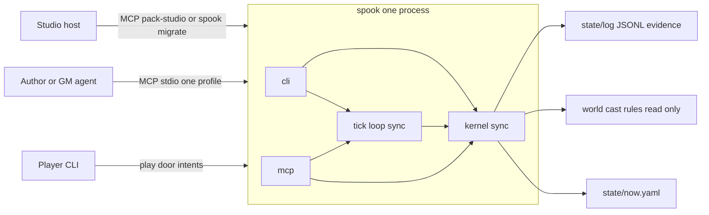

# Spookery v0 architecture

**Status:** Record of truth before any implementation commit. No production behavior is implied by the existence of this file.
**License:** CC BY 4.0 (spec). Runtime code that lands under `/src` is AGPL-3.0-or-later.
**Audience:** Founders, a reviewing programmer, and coding agents implementing crate by crate.
**Precedence:** `SHARD_TICK_SPEC_v0.3.md` → `NOW_AND_EFFECTS.md` → `PACK_ENCODING_v0.3.md` → `STACK_v0.3.md` → `PRODUCT_SPEC_v0.5.md`. This file does not outrank them. A sentence with no license in those five is out of v0.

The spec sketch says `/docs`. This repository keeps the specs in `Docs/`. This file lives beside them. Do not rename the spec directory in the implementation commits.

---

## Executive summary

1. One OS process, binary `spook` (alias `spookery`, package `spookery`), loads one pack folder and is the only process that may persist `state/`.
2. Humans and models submit intents. The only durable writers are `tick_commit` and `commit_turn`. `apply_effect` mutates an in-memory transaction.
3. The kernel is synchronous. It owns legality, inventory and resources, the knowledge firewall, checks, and the closed effect enum. It does not link MCP, Tokio, or an LLM.
4. Idle mode is `kernel_only`. `llm_npc_intents_per_tick` stays 0. This repository has no model SDK and no embedder.
5. Canon (`world/`, `cast/`, `rules/`) is read-only at runtime. `pack_rev` is BLAKE2s-256 over sorted canon bytes. A mismatch refuses ticks until the host migrates.
6. `Now` is a typed struct. `state/now.yaml` is its pinned YAML projection. JSONL is an evidence tape. Kernel-only replay re-executes recorded moves and must byte-match `now.yaml`.
7. `perceive` always takes `as=player:<id>` or `as=npc:<id>`. Host `spook status` is an omniscient idle digest. Player resume is a filter over that tape. Off-screen stock is not a login banner.
8. v0 is the pack schema and lint, the one binary, three MCP stdio profiles, the tick loop, JSONL, the named CLI, `packs/oneshot-docks`, and conformance tests 1–10.
9. The first 45 days are CLI plus MCP stdio. This architecture does not schedule `--serve`, billing, Discord, a database, or a second writer.
10. Smallest commit: the three JSON Schemas, the workspace skeleton, the license split, and ignored conformance test 1 with its closed-secret fixture. No tick behavior in that commit.

A reviewer who needs a database, an idle LLM, or a second writer should reject this document rather than extend it.

### Residual conflicts

Do not smooth these over in code review. The implemented rule is the one in the "Rule" column.

| # | Conflict | Rule |
|---|---|---|
| C1 | Tick §8.1: tick `perceive` requires `as=npc:<id>` and forbids `as=gm`. Product §10.2 adds "or system actor". Product principle 3 and the planning invariants allow only `player:<id>` and `npc:<id>`. | Tick profile accepts only `as=npc:<id>`. Table and CLI play accept `as=player:<id>` or `as=npc:<id>`. `as=gm` and a bare call are `UNSCOPED_PERCEIVE`. There is no system viewer on `perceive`. |
| C2 | Product criterion 2 says `perceive(as=npc:mira)` never contains Mira's hidden strings. Tick test 1 forbids that string in Aldric's memories, rumors, and `perceive(as=npc:aldric)`. The `Now` example gives Mira `known_facts: [fact_ledger_short]`, and tick §8.3 returns `known_facts` as ids plus short text. | Test 1 is the suite. A viewer receives a fact's text only when that fact id is in their `known_facts`, or the fact is public and at their place. Mira can perceive a hidden fact she knows. Criterion 2's literal reading is not implemented. |
| C3 | Tick §8.1 says `recall` is "keyword/semantic". Stack says keyword plus fact-id index, and lists an embedder as out of v0. | `recall` is keyword match plus fact-id lookup inside the viewer's allowed facts. No vector index. |
| C4 | Tick §12 sample JSON uses `"seed": "shard:abc\|tick:1842"`. Stack and the planning invariant use `blake2s("shard_id\|tick_index")`. | Preimage is `{shard_id}\|{tick_index}`. The §12 sample string is non-normative. One function, `seed_preimage`, is the only formatter. See §16. |
| C5 | Tick §5.2 prints `ceil(D * 60 / tick_every_real_seconds)` while `D` is real hours and `tick_every_real_seconds` is seconds. | Implement the printed formula. Do not silently substitute `D * 3600`. Also apply the §3.1 world-hour cap. The burst stops at the tighter bound. Flagged in §7. |
| C6 | `state_rev` is specified as +1 per successful `tick_commit`. `commit_turn` is also a `state/` writer. | Both successful commits increment `state_rev`. `tick_index` increments only when the tick loop runs. See §16. |
| C7 | Product §9 shows `spook ./pack`. Stack names the subcommand `run`. | The only load invocation is `spook run <pack>`. See §11 and §16. |
| C8 | Product §15 allows an optional ugly `--serve` after a week-idle fixture, inside days 71–90. The planning brief says not to schedule `--serve`. | Days 71–90 do not include `--serve`. A later edge would be the same binary and the same kernel. This document specifies no HTTP route. |
| C9 | The `Now` example rumor `r_184` carries hidden `fact_ledger_short` and lists Aldric in `known_by`. Tick test 1 says Aldric does not know Mira's hidden fact. | The example is a shape, not fixture start state. The fixture rumor cites a public fact. Aldric's `known_facts` omit `fact_ledger_short`. |
| C10 | Product §10's opening sentence says "two servers or two tool profiles". The same section and the stack name three profiles. | One process, three profiles, one profile bound for the life of the process. |

---

## 1. Purpose and refusal

### Boxed loop

```text
author a pack → spook run <pack> → friends submit intents → tick_commit / commit_turn persist state/
```

The pack is the world. The kernel is the proof that the pack can be refereed. The spec is the refusal of a second writer. v0 ships all three as one repository. It does not ship a campaign, a table product, or a model.

### One writer

| Stage | Who | What they hold | Disk |
|---|---|---|---|
| Propose | Player CLI, GM agent, kernel derivation | `Intent` | Nothing |
| Stage | `apply_effect` inside a `Txn` | In-memory `Now` | Nothing |
| Persist | `tick_commit` or `commit_turn` | The `Txn` | `state/` via temp file, `fsync`, atomic rename |
| Canon edit | Studio `patch_entity`, host only | A canon diff | `world/` or `cast/` only. Never `state/` |

`apply_effect` is not a writer. A crash after `apply_effect` and before `tick_commit` leaves the previous `state_rev` on disk because the transaction has not touched it.

Models never patch `state/`, `world/`, or `cast/`. `llm_say` is discarded on intake. Persisted intents store `llm_say: null`.

Markdown bodies are flavor. Every number the tick uses is a YAML field or a Rust constant. A pack with every Markdown body deleted must still tick.

There is no GM perceive on the tick process. Host omniscience is the read-only CLI `spook status`, which filters the evidence tape with `viewer = host`. It is not a tick tool.

---

## 2. System context

### Actors

| Actor | Door | Profile or entry | May persist `state/` |
|---|---|---|---|
| Player on the laptop | Play door, CLI | `spook run <pack>` with `--as player:<id>` | Only by reaching `commit_turn` |
| GM / author agent | Agent door, MCP stdio | `pack-table` | Only by reaching `commit_turn` |
| Tick scheduler | In-process, later days 46–70 | Calls `tick::run_tick` | Only by reaching `tick_commit` |
| Studio / host | Agent door or CLI | `pack-studio`, plus `lint` / `status` / `migrate` | Studio `patch_entity` writes canon. `migrate` is a host commit. Models are not given this profile by the tick |

One process. One shard directory. Zero humans is a valid shard. A session is a presence window inside that process, not a second process.

v0 laptop play is one invocation. Two humans on one machine share that invocation by submitting intents under their own `player:<id>`. There is no local multiplayer socket in v0.



The tick loop calls kernel functions that implement the `pack-tick` allowlist. It does not open a JSON-RPC connection to itself.

---

## 3. Crate and module map

### Workspace

Cargo workspace, package name `spookery`, `publish = false` on every member. Binary names `spook` and `spookery` share `src/cli/main.rs`. Do not publish a crate named `spook`.

```text
Cargo.toml                 # workspace; bin package spookery at the repo root
src/cli/main.rs            # thin binary
src/kernel/Cargo.toml      # package spookery-kernel
src/kernel/lib.rs
src/tick/Cargo.toml        # package spookery-tick
src/tick/lib.rs
src/mcp/Cargo.toml         # package spookery-mcp
src/mcp/lib.rs
schema/                    # JSON Schema, CC BY 4.0
rulesets/                  # template of the tiny original rules; not loaded at runtime
packs/oneshot-docks/       # official fixture, CC BY 4.0
tests/conformance/         # integration tests of the root bin package
```

`edition = "2021"`. `rust-version = "1.89"` because the pinned YAML crate requires it (§16).

Dependency arrows, and the only legal ones:

| Crate | May depend on | Must not depend on |
|---|---|---|
| `spookery-kernel` | `serde`, `serde-saphyr` (the one YAML crate), `blake2`, `jsonschema`, Rust std | `tokio`, `rmcp`, `spookery-tick`, `spookery-mcp`, any model SDK, any DB crate |
| `spookery-tick` | `spookery-kernel` | `tokio`, `rmcp`, `spookery-mcp` |
| `spookery-mcp` | `spookery-kernel`, `spookery-tick`, `rmcp`, `rmcp-macros`, `tokio` | A second kernel, a model SDK |
| root bin `spookery` | `spookery-kernel`, `spookery-tick`, `spookery-mcp` | Business logic. Parsing argv and printing are the whole crate |

Tokio exists only inside `spookery-mcp` (stdio runtime) and, from days 46–70, inside `src/cli` for the scheduler sleep. The tick function and the kernel stay on the calling thread. No `tokio::spawn` of a tick. No cargo feature named `llm`.

`rulesets/` is the authoring template copied into a pack. The loader reads `pack/rules/` only. v0 loads one ruleset, the one in the pack directory.

### Kernel modules

All paths under `src/kernel/`.

| Module | Owns | Public surface used by tick and MCP |
|---|---|---|
| `model` | `Now`, `Intent`, `Effect`, `PcSheet`, ids, closed enums | Types |
| `error` | `Code` | `Result` |
| `codec` | The only `serde-saphyr` calls for `Now`, sheets, proposals, rules YAML | `emit_now`, `load_now` |
| `canon` | Frontmatter split, `pack_rev` | `load_canon`, `pack_rev` |
| `store` | Shard lock, `Txn`, commit, crash recovery | `tick_commit`, `commit_turn`, `open_shard` |
| `moves` | `rules/moves.yaml` allowlist | `load_moves` |
| `check` | `resolve_check` | `resolve_check` |
| `inventory` | Needs, resources, stock, PC inventory list | Used by `apply` |
| `firewall` | Fact visibility | `allows(viewer, fact_id)` |
| `lint` | Schema, frontmatter, hidden-string, strip-bodies helper | `lint_pack` |
| `perceive` | Scoped view | `perceive` |
| `recall` | Keyword and fact-id index over a view | `recall` |
| `eligibility` | §4.3 predicate | `is_eligible` |
| `derive` | `kernel_intents_for_eligible_npcs` | That function |
| `expand` | Move → effect table | `expand` |
| `apply` | Effect validators, staging into `Txn` | `apply_effect` |
| `pause` | §6.3 policy applied to staging clocks | `apply_pause_policy` |
| `digest` | Host vs player filter over JSONL | `idle_digest` |
| `limits` | Default budget constants | `Budget` |

`store` is the only module that calls `File::create` under `state/` or `saves/`. Other modules take `&mut Txn`.

### Tick modules

| Module | Function |
|---|---|
| `loop_` | `run_tick` — §9 of the tick spec |
| `advance` | `pick_advance` |
| `budget` | `prioritize`, caps, catch-up count |
| `seed` | `seed_preimage`, `shuffle_key`, `die_face` |
| `replay` | `replay_recorded` |
| `log` | One JSON object, the §12 shape |

### MCP modules

| Module | Function |
|---|---|
| `profile` | Bind `pack-table`, `pack-tick`, or `pack-studio` for the process lifetime. Stable `tools/list` order |
| `table` | Table handlers |
| `tick_tools` | Tick handlers. Same kernel functions the tick loop calls |
| `studio` | Studio handlers |

### Import test

`tests/conformance/import_boundaries.rs` fails the build if:

- `src/kernel` or `src/tick` contains `rmcp`, `tokio`, `sqlx`, `postgres`, or `redis`
- any file under `src/` contains `langchain`, `openai`, `anthropic`, `ollama`, or `reqwest`

The test is a string scan of source, present from commit 1.

---

## 4. Pack load and identity

### Load order

`kernel::open_shard(path)`:

1. Read `pack.yaml` (id, title, system, start). Refuse unknown top-level keys.
2. Read canon: `world/**/*.md`, `cast/*.md`, `rules/checks.yaml`, `rules/moves.yaml`, `rules/tick.yaml`. Split frontmatter on a leading `---` pair. Body is kept for `perceive` flavor and for the hidden-string lint. Body is not parsed for facts, exits, stock, or flags.
3. Compute `pack_rev`. Compare to `state/now.yaml`'s `pack_rev`. Unequal → `PACK_REV_MISMATCH`. The tick does not run.
4. `load_now`. Unknown top-level keys → `SCHEMA`.
5. Re-emit with the pinned emitter. Bytes differ and the command is not `migrate` → `HAND_EDIT`.
6. Load each PC sheet pointed at by `actors.<id>.sheet`.
7. Run crash recovery (§10) before any tool is served.
8. Validate the loaded `Now`, a sample intent, and a sample effect against `/schema/*.json` in tests. Runtime load uses the Rust types plus the same unknown-key refusal. Schema files are the review contract; the types are what the tick executes.

Missing `state/now.yaml` → refuse. v0 does not synthesize a `Now` from canon.

`pack.yaml` minimum:

```yaml
schema: pack/v0
id: docks-001
title: Oneshot Docks
system: oneshot-docks
start:
  place: docks_shop
  pc: pc_rowan
```

`shard_id` lives on `Now`. The fixture sets `shard_id` equal to `pack.yaml` `id`. v0 runs the directory it was pointed at. It does not fork a second shard from one pack.

### Typed struct vs disk

| Disk | Rust | Direction |
|---|---|---|
| `state/now.yaml` | `Now` | Emitter projection. Disk is never hand-patched into the tick |
| `state/actors/<pc-id>.yaml` | `PcSheet` | Same emitter, same rule |
| `world/`, `cast/` frontmatter | `Canon` | Load only |
| Markdown body | `String` on the canon entity | Flavor attachment only |
| JSONL | `TickRecord`, `MemoryRecord` | Evidence written at commit. Never loaded as `Now` |

Maps inside `Now` are `BTreeMap` so key order is sorted. Id lists that are sets (`known_facts`, `flags`, `fact_ids`, `known_by`, `owners`) are sorted before emit. `rumors`, `messages`, and `proposals` are sorted by id before emit. The canonicalizer runs inside `emit_now`. No other function serializes `Now`.

Emitter policy, pinned in `codec::NOW_EMIT_OPTIONS`:

- Serde serialize straight to text. No DOM rewrite, no second snapshot file.
- No anchors, no tags, no comments, no document-start marker.
- Block mappings. Plain scalars when YAML-safe; double quotes otherwise.
- UTF-8, LF, exactly one trailing newline.
- `last_tick_at` is an already formatted `String` (`YYYY-MM-DDTHH:MM:SSZ`), never a `DateTime` type that picks its own format.
- Integers only on `Now`. No floats, so float formatting cannot drift.

If `serde-saphyr` 1.3.0 cannot hold this policy, stop. Do not add `now.canonical.json` unless that failure is written down. The stack forbids a parallel snapshot until the emitter is shown to be unpinnable.

### `pack_rev`

```text
files = every file under world/, cast/, rules/, relative path, '/' separators
sort files by raw UTF-8 path bytes
preimage = concat over files of: utf8(rel_path) || 0x00 || u64be(byte_len) || file_bytes
pack_rev = "blake2s:" || lowercase hex(BLAKE2s-256(preimage))
```

Bodies count, because they are canon bytes. `pack.yaml`, `state/`, and `saves/` do not count. A studio edit of `cast/` or `world/` changes `pack_rev`. The next tick refuses until `spook migrate` rewrites `now.pack_rev` through a real commit and bumps `state_rev`.

Hash algorithm everywhere in this document is BLAKE2s-256. The `blake2` crate type is `Blake2s256`.

### Hand edit

A mid-shard edit of `now.yaml` is a migration. `spook tick` and `spook run` refuse it with `HAND_EDIT`. `spook migrate` parses, schema-validates, re-emits, bumps `state_rev`, writes through `commit_turn`'s commit path, and records a studio evidence line. Migrate is a host command. It is not an MCP tool on `pack-tick` or `pack-table`.

---

## 5. Data model ownership

### Who writes what

| Type | Owner module | Disk | Who may write |
|---|---|---|---|
| `Now` | `kernel::model` | `state/now.yaml` | `tick_commit`, `commit_turn` |
| Actor live fields (NPC) | `kernel::model` | Inside `now.yaml` only | Those commits |
| `PcSheet` | `kernel::model` | `state/actors/<pc-id>.yaml` | Those commits. v0 idle ticks do not mutate sheets |
| PC live pointer | `kernel::model` | `now.actors.<pc>` | Those commits. Fields: `kind`, `place`, `sheet`, `flags`, `busy`, `known_facts` |
| Clock | `kernel::model` | `now.clocks` | Those commits, via effect `clock` or pause policy inside the same txn |
| Rumor | `kernel::model` | `now.rumors` is authoritative. `state/rumors.yaml` is rewritten at commit as a derived copy | Those commits. Readers do not tick from `rumors.yaml` |
| Message | `kernel::model` | `now.messages`. Place `notes` are ids into that list | Those commits |
| Proposal id | `kernel::model` | `now.proposals` plus `state/proposals/<id>.yaml` | Effect `proposal` inside a commit. Never `world/` or `cast/` |
| Memory record | `kernel::apply` | `state/memories/<actor_id>.jsonl` | Commit, one file per actor, full-file temp rewrite |
| Tick record | `tick::log` | `state/log/tick-NNNN.jsonl` | `tick_commit` only. `NNNN` is `tick_index` zero-padded to 4 |
| Studio evidence | `kernel::store` | `state/log/studio.jsonl` | `patch_entity` and `migrate`, append of one object, fsynced. Evidence, not `Now` |
| Explicit snapshot | `kernel::store` | `saves/<name>.yaml` | Table tool `session_save` only. A copy of emitted `Now`. Does not change `state_rev` |
| Canon entity | `kernel::canon` | `world/**/*.md`, `cast/*.md` | `patch_entity` |
| Rules | `kernel::moves`, `limits`, `check` | `rules/*.yaml` | Authors between runs. Immutable during a tick |
| Player intent queue | Process memory on `ShardProcess` | None | `intent`. Dies on crash |

`rumors.yaml` existing and differing from `now.rumors` is overwritten from `Now` at the next successful commit. It is not a merge source.

### `Now` fields

`schema: now/v0`. Unknown top-level keys fail load.

| Field | Rust | Notes |
|---|---|---|
| `shard_id` | `String` | Durable |
| `pack_rev` | `String` | `blake2s:` hex |
| `state_rev` | `u64` | +1 per successful `tick_commit` or `commit_turn` |
| `tick_index` | `u64` | +1 per tick loop that runs, including a loop whose intents all reject |
| `world_time` | `u64` | Minutes since pack epoch |
| `last_tick_at` | `String` | UTC `YYYY-MM-DDTHH:MM:SSZ`. Scheduler argument. Replay copies the recorded string |
| `presence` | `Presence` | `humans: u32`, `session_ids: Vec<String>`, `actors_present: Vec<ActorId>` |
| `pause` | `PauseView` | Derived at tick start into the txn: each value `paused` or `running` |
| `places` | `BTreeMap<PlaceId, PlaceLive>` | `stock`, `hours`, `notes`, `actors` |
| `actors` | `BTreeMap<ActorId, ActorLive>` | |
| `clocks` | `BTreeMap<ClockId, Clock>` | |
| `rumors` | `Vec<Rumor>` | |
| `messages` | `Vec<Message>` | |
| `proposals` | `Vec<ProposalId>` | |

`places.<id>.actors` is a derived index rebuilt from `actors.<id>.place` at canonicalization. `actors.<id>.place` is authoritative. On load, if the index disagrees, fail `SCHEMA`. Do not tick with two occupancy maps.

`places.<id>.hours` stays at its stored value. No v0 effect writes it. Do not derive shop hours from the schedule inside the kernel.

### Actor live fields

| Field | NPC | PC |
|---|---|---|
| `kind` | `npc` | `pc` |
| `place` | yes | yes |
| `flags` | profile-listed flag keys only | Tick-visible flags. Empty in the docks start |
| `busy` | stored encounter flag | stored encounter flag |
| `needs` | `BTreeMap<NeedKey, i64>` | absent |
| `resources` | `BTreeMap<ResourceKey, i64>` | absent on `Now`; the sheet holds PC resources |
| `relationships` | `BTreeMap<ActorId, Relation>` | absent unless a later pack authors them on the sheet. Idle drift reads NPC relations on `Now` |
| `reputation` | `BTreeMap<FactionId, Reputation>` | absent in the fixture |
| `known_facts` | `Vec<FactId>` sorted | `Vec<FactId>` sorted |
| `tick` | `TickCounters` | absent |
| `sheet` | absent | relative path `state/actors/<pc-id>.yaml` |

`Relation`: `stance: i64`, `target: i64`, `last_interaction_world_time: u64`.

`Reputation`: `value: i64`, `last_world_time: u64`. The effect exists; the `Now` example omitted the field. Empty map when unused. This is pin P3 in §16.

`TickCounters`: `last_act_tick: u64`, `idle_acts_today: u32`, `live_acts_this_hour: u32`.

`Clock`: `value: i64`, `max: i64`, `requires_presence: bool`, `owners: Vec<ActorId>`, `paused: bool`.

Stored `busy` is the encounter flag (tick spec §5.3). Co-location with a present player is an extra eligibility term (tick spec §10). Co-location is computed per tick and is not written back as `busy: true`, so a player leaving does not leave a sticky flag.

`PcSheet` (`state/actors/<pc-id>.yaml`): `id`, `template`, `stats` (`BTreeMap<String, i64>`), `resources`, `inventory` (`Vec<ItemId>`), `flags`. Sheet `flags` are sheet data. The idle predicate does not read them. It reads `Now.actors.<id>.busy` and `Now.actors.<id>.flags`. The two `flags` lists are not synced. Pin P4.

Players do not write `cast/` during play. A sheet field that should become canon is a proposal.

### Closed effect enum

`Effect` is a Rust enum. The YAML/JSON boundary parses `class` plus `payload` into that enum. Unknown `class` or an extra payload key returns `ILLEGAL_CLASS` and never becomes an `Effect`.

Envelope, every variant: `as_viewer: ViewerId`, `intent_id: IntentId`.

| `class` | Payload | Failures |
|---|---|---|
| `clock` | `clock_id`, `delta: i64` | `PAUSED_CLOCK` if `paused` or (`requires_presence` and `presence.humans == 0`). `UNKNOWN_KEY` if the clock is absent. `OUT_OF_RANGE` if `value + delta` is outside `[0, max]`. Needs clamp; clocks do not |
| `need` | `actor_id`, `key`, `delta` | `UNKNOWN_KEY` if `key` is not in the profile needs list. Clamp to the profile range when a range is present. No range in canon → leave the value, still require the key to be listed |
| `stock` | `place`, `sku`, `delta` | `NOT_OWNER` if the actor's `range` and schedule places omit `place`. `OUT_OF_RANGE` if `abs(delta)` exceeds that actor's `stock_rate[sku]` or the result would be `< 0` |
| `location` | `actor_id`, `from`, `to` | `from` must equal live place. `to` must be in profile `range` and on the schedule graph. Otherwise `OUT_OF_RANGE`. Idle `location` whose `actor_id` is a PC → `NOT_OWNER` |
| `relationship` | `a`, `b`, `delta` in `-1, 0, +1` | At most one apply per pair per world-day. If either stored-busy or `last_interaction_world_time` is within 1 world-day → `SKIPPED` (no-op, remainder of this intent continues) |
| `reputation` | `actor_id`, `faction`, `delta` in `-1, 0, +1` | At most one per faction per world-day, tracked by `reputation.<faction>.last_world_time`. Second apply → `SKIPPED` |
| `memory` | `actor_id`, `fact_ids`, `tags`, `text?` | `text` ≤ 240 chars. `actor_id` must be the causing actor (`NOT_OWNER` otherwise). Fact ids and `text` may only mention facts in `known_facts` after earlier effects in this txn. Else `ILLEGAL_KNOWLEDGE` |
| `rumor` | `rumor_id`, `fact_ids`, `from`, `to`, `heat` 1–3 | Recipient must already be allowed each fact. Else `ILLEGAL_KNOWLEDGE`. Counts against `max_rumor_hops` |
| `resource` | `actor_id`, `key`, `delta` | `UNKNOWN_KEY` if `key` is not on the profile (NPC) or the live sheet (PC). Result `< 0` → `OUT_OF_RANGE` |
| `flag` | `actor_id`, `key`, `value: bool` | Key must be listed on the profile. `key: busy` writes `ActorLive.busy`. Any other allowed key writes `flags` |
| `proposal` | `proposal_id`, `kind`, `target`, `summary` | `kind` is `delete_place`, `patch_entity`, or `other`. Writes a proposal file inside the txn. Does not edit the target |
| `message` | `message_id`, `to`, `place?`, `fact_ids`, `text` | Queued onto `now.messages`. Duplicate id → `UNKNOWN_KEY`. Not narration |

There is no `inventory` class, no `xp` class, and no `season_advance` class. Catch-up overflow files one `proposal` with `kind: other` and summary `season_advance` (§7).

### Intent

| Field | Values |
|---|---|
| `id` | UUID string, caller-supplied. Kernel checks uniqueness inside the txn |
| `tick_index` | The tick that will consider it |
| `actor_id` | |
| `actor_kind` | `npc`, `player`, `system` |
| `source` | `kernel`, `llm`, `player`, `system`. v0 derivation emits only `kernel`. `llm` exists so a recorded line can be replayed. v0 never creates an `llm` intent |
| `move` | Loaded allowlist. Unknown → `UNKNOWN_MOVE` |
| `target` | At most one of `place`, `actor`, `clock`, `rumor`. Two set → `SCHEMA` |
| `args` | Move-specific. Extra keys → `UNKNOWN_KEY` |
| `rationale_code` | String, audit only, not mechanical |
| `llm_say` | Persisted as null. Inbound text dropped |

Idle moves: `wait`, `travel`, `work`, `restock`, `rest`, `pay_upkeep`, `drift_relationship`, `spread_rumor`, `leave_note`, `file_proposal`, `advance_clock`.

Live-only names, rejected with `LIVE_ONLY` when `presence.humans == 0`: `talk`, `attempt`, `attack`, `give`, `take`.

Their expansion when humans are present is not in `NOW_AND_EFFECTS` §4. `expand` returns `NOT_IN_SPEC` for those five even during a session. They may be declared in `moves.yaml` so the fixture matches the product list. They do not mutate inventory. Do not add an effect class to make `give` work.

### Move → effect

| Move | Effects | Args the kernel reads |
|---|---|---|
| `wait` | none. Does not count against `max_npcs_acting` | none |
| `travel` | one `location` | `target.place` is `to`. `from` is the live place |
| `work` | `need` and/or `resource` only as a canon `work` block declares. Missing block → zero effects. The intent still applied | the block |
| `restock` | one `stock` | `sku`, `delta` |
| `rest` | one `need` on key `rest` | `delta` |
| `pay_upkeep` | `resource` and/or `need` | `key`, `delta` |
| `drift_relationship` | one `relationship` | `target.actor` is `b`. `delta` from the §6.4 formula |
| `spread_rumor` | one `rumor` | `target.rumor` or args `rumor_id`, `to` |
| `leave_note` | one `message` | message fields |
| `file_proposal` | one `proposal` | proposal fields |
| `advance_clock` | one `clock` | `target.clock`, `delta` default 1 |

Truncate to `max_effects_per_intent` (default 4). Do not invent a further effect from `rationale_code`, `llm_say`, or a Markdown body.

---

## 6. Kernel internals

Illegal combinations are enums plus private fields, not booleans the caller can mix.

- `Effect` is an enum. A string class does not cross the parse boundary.
- `ViewerId` is `Player(ActorId)` or `Npc(ActorId)`. It has no `Gm` variant.
- `Txn` is not `Clone`, not `Send`, and has no public "write files" method.
- `Canon` is owned by `Shard` behind `&`. Tick code cannot get `&mut Canon`.
- `MoveName` is a newtype validated against `moves.yaml`. The idle expansion is a `match` on the eleven idle names. A new mechanical move is a new match arm plus a conformance test. There is no move expression language. Eligibility is the §4.3 predicate, not a string DSL.
- Adding a name to `moves.yaml` without a match arm fails at expand: `UNKNOWN_MOVE` if the name is absent from the allowlist, `NOT_IN_SPEC` if it is listed and has no arm. The fixture lists exactly the sixteen names in §5 (eleven idle plus five live-only).

### Budgets (constants in `kernel::limits`, overlaid by `rules/tick.yaml`)

Defaults from tick §5 and §3. Absent keys use these. Unknown `tick.yaml` keys → `SCHEMA`. Negative values → `SCHEMA`. `llm_npc_intents_per_tick: 0` is valid and required in v0.

| Key | Default |
|---|---|
| `max_intents_applied` | 12 |
| `max_npcs_acting` | 8 |
| `llm_npc_intents_per_tick` | 0 |
| `max_effects_per_intent` | 4 |
| `max_state_keys_mutated` | 24 |
| `max_memory_writes` | 8 |
| `max_rumor_hops` | 2 |
| `idle_acts_per_world_day` | 3 |
| `live_acts_per_world_hour` | 6 |
| `tick_every_real_seconds` | 300 |
| `live_tick_every_real_seconds` | 60 |
| `idle_minutes_per_tick` | 60 |
| `live_minutes_per_tick` | 5 |
| `idle_catchup_max_ticks` | 12 |
| `idle_max_world_hours_per_real_hour` | 8 |

v0 accepts only these pause values: `named_plot_clocks: pause_when_empty`, `subsistence_clocks: always_run`, `relationship_drift: always_run`, `travel: run_if_schedule`. Any other value → `SCHEMA`.

World-minute modulus, pin P5: one world-hour is 60 minutes, one world-day is 1440. `world_hour = (world_time / 60) % 24`. Schedule ranges may wrap (`[18, 6]`).

### `resolve_check`

Idle moves in the fixture do not roll. The function still exists and is deterministic.

```text
in:  as, intent_id, check_id, target
out: roll faces, stat, total, target, success
```

`rules/checks.yaml` for the fixture declares one check:

```yaml
checks:
  - id: grit
    dice: { count: 2, sides: 6 }
    stat: grit
```

Unknown `check_id` → `UNKNOWN_KEY`. Stat is read from the PC sheet. Missing stat → `UNKNOWN_KEY`. No XP, no spell list, no ability-score block.

Dice, pin P6: for each die, `face = (u32le(BLAKE2s-256("{shard_id}|{tick_index}|{roll_i}")[0..4]) % sides) + 1`. `roll_i` starts at 0 for the tick and increments per die. `total = sum(faces) + stat`. `success = total >= target`. Replay calls the same function. It does not read a stored face. No RNG crate.

### Inventory and resources

- NPC purse and needs live on `ActorLive`.
- PC purse and `inventory: [item ids]` live on `PcSheet`.
- Stock lives on `PlaceLive.stock`. Result is never negative.
- `give` / `take` do not move inventory in v0 (`NOT_IN_SPEC`).
- The kernel cannot mint a resource key, a sku, an item id, or a flag key that canon did not list.

### Knowledge firewall

`allows(viewer, fact_id)` is true when `fact_id` is in `now.actors[viewer].known_facts`, or the fact is not hidden and is attached to the viewer's current place or to a visible actor's public fact list.

Hidden means `fact.hidden: true` or the fact id is listed in the entity's `hidden:` array. There is no `gm_secret` field in v0. The blocklist sentence that mentions `gm_secret` is satisfied by the hidden flag.

A viewer who fails `allows` does not receive the fact id, the text, or the body. `unknown_mentioned` carries public names whose bodies were stripped. It does not carry hidden fact ids.

Rumor hop and memory text call `allows`. Failure is `ILLEGAL_KNOWLEDGE`.

`perceive` builds `known_facts` by resolving text only through `allows`. Flavor bodies are attached only to fact ids that survived that filter. Bodies never add a fact.

### Hidden-string lint

Collect every hidden fact `text`. Scan every Markdown body in the pack. Substring, case-sensitive. A hit fails `spook lint`, including a hit in the owner's body. Test 1 is allowed to stay string-level: the same strings are grepped in Aldric's `perceive` output, `state/memories/aldric.jsonl`, and rumor texts.

The fixture secret, taken from the encoding law's own example, is the text `The lamp-oil ledger is short.` on fact `fact_ledger_short`. Mira's body must not contain that sentence. The encoding-law sample body ("Mira keeps the shop neat and the tin out of sight.") does not contain it. Use that body.

### Eligibility (tick spec §4.3)

`is_eligible(npc, now, presence, budget)` is true when all of these hold:

1. Canon `tick.eligible == true`. Missing `tick` block → not eligible.
2. `kind == npc`.
3. `not actor.busy` and not co-located with an `actors_present` player.
4. `tick.tier` is `named` or `major`, or `tick.plot_relevant == true`, or `tick.schedule` is non-empty.
5. `actor.tick.last_act_tick != now.tick_index` (at most once per tick).
6. If `presence.humans == 0`: `idle_acts_today < idle_acts_per_world_day`.
7. If `presence.humans > 0`: `live_acts_this_hour < live_acts_per_world_hour`.

At tick start, if `world_time / 1440` changed during `pick_advance`, set every actor's `idle_acts_today` to 0. If `world_time / 60` changed, set `live_acts_this_hour` to 0.

### `kernel_intents_for_eligible_npcs`

Pure function of canon frontmatter plus staging `Now`. At most one intent per NPC. No model. No randomness. First match wins:

| Step | Move | Match |
|---|---|---|
| 1 | `pay_upkeep` | A listed needs key is at or below its floor and the move is legal. **No floor field is specified.** No key matches. The step falls through. Do not invent floor 0 |
| 2 | `restock` | Actor's place is one they have `stock_rate` for, the sku is due, result would stay `≥ 0`. "Due" in v0 means the actor has not already restocked this tick. Several skus → lowest sku key (pin P7). `delta` is the declared `stock_rate[sku]` |
| 3 | `travel` | Only if pause travel is `running` (`run_if_schedule` and a schedule applies, or `always_run`). Current `world_hour` schedule place ≠ live place, destination in `range` |
| 4 | schedule `work` or `rest` | Already in the scheduled place. `work` uses the canon work block if any |
| 5 | `drift_relationship` | Only if relationship drift is `running`. A declared pair has `stance != target`, last interaction ≥ 1 world-day ago, neither stored-busy. Several pairs → lexicographically smallest `(a, b)` (pin P7) |
| 6 | `spread_rumor` | A rumor with `heat >= 1` is known by this actor (`known_by` contains them), an adjacent recipient is firewall-allowed, hop budget remains. Adjacent means same place or a declared relationship key. Several rumors → lowest rumor id. Several recipients → lowest actor id (pin P7) |
| 7 | `leave_note` | A canon note trigger is due (pin P8) |
| 8 | `advance_clock` | A clock this actor owns is not paused, `value < max`. Several → lowest clock id. `delta` 1 |
| 9 | none | Do not emit `wait` |

`file_proposal` is a legal move and is not in this table. The kernel does not add a tenth step. The catch-up path files the season proposal itself (§7).

### `apply_effect` validators

Order for every effect: class already parsed → viewer matches the intent actor → budget counters (`BUDGET` stops the remainder of this intent and, on global caps, stops the loop) → class validator from the table in §5 → stage into `Txn`.

`SKIPPED` (relationship or reputation day-cap) does not consume `max_effects_per_intent`, does not reject the remainder, and is recorded on the tick line's `rejected` list with reason `skipped`.

A failed effect rejects the remainder of that intent (tick spec §9 "or reject remainder") for every code except `SKIPPED`.

Pause policy runs at the start of the tick, inside the txn, before derivation:

- `presence.humans == 0` and policy `pause_when_empty` → set `paused = true` on clocks with `requires_presence`.
- `presence.humans > 0` → set `paused = false` on those clocks. v0 has no second pause source.
- Subsistence clocks (`requires_presence: false`) stay unpaused by this policy.

### Failure codes

Named by the tick spec on `apply_effect`:

| Code | Meaning |
|---|---|
| `ILLEGAL_CLASS` | Unknown class or extra payload key |
| `ILLEGAL_KNOWLEDGE` | Firewall refusal |
| `OUT_OF_RANGE` | Travel, stock rate, stock below 0, resource below 0, clock outside `[0, max]`, location |
| `BUDGET` | A §5 cap |
| `PAUSED_CLOCK` | Paused or presence-gated clock |
| `UNKNOWN_KEY` | Clock, need, flag, resource, sku, check, or args key that canon did not list |
| `NOT_OWNER` | Stock place outside range, memory of another actor, idle move of a PC |

The JSONL `rejected` reason for a budget drop is the lowercase word `budget`, matching tick §5 prose. The tool `code` field is `BUDGET`.

Pinned tokens. The spec requires the failure and does not name the token. Use these spellings and no others:

| Code | When |
|---|---|
| `PACK_REV_MISMATCH` | Canon hash ≠ `now.pack_rev`. Refuse the tick |
| `UNKNOWN_MOVE` | Not in `rules/moves.yaml` |
| `LIVE_ONLY` | Live-only move while `presence.humans == 0` |
| `UNSCOPED_PERCEIVE` | Missing `as`, `as=gm`, empty id, or any prefix other than `player` or `npc` |
| `DENIED_TOOL` | Tool not on this process's profile, or tick calling a denylisted tool |
| `COMMIT_CONFLICT` | Lock held, or `state_rev` changed under this process |
| `HAND_EDIT` | `now.yaml` bytes are not the pinned emitter's bytes |
| `LLM_DISABLED` | `npc_act` while `llm_npc_intents_per_tick == 0` |
| `SCHEMA` | Unknown key, two targets, bad pause value, negative budget |
| `NOT_IN_SPEC` | Live-only expansion, missing `now.yaml`, any request this document refuses |
| `SKIPPED` | Legal no-op under the day cap |

---

## 7. Tick loop architecture

### Functions and lock scope

`tick::run_tick(shard, reason, now_wall, catchup: Catchup)` takes the shard lock and holds it until commit or a clean abort. `reason` is `scheduler`, `catchup`, `flush` (`include_tick`), or `manual`. `manual` is host `spook tick` and tests.

No concurrent ticks. A second call while the lock is held returns `COMMIT_CONFLICT`. The lock is an exclusive `flock(2)` on `state/.tick.lock` (pin P9). The lock file is under `state/` and is outside `pack_rev`.

```text
lock shard                                          store::lock_shard
status = session_status()                           kernel::session_status
world_minutes = pick_advance(status, catchup)       tick::pick_advance
apply_pause_policy                                   kernel::apply_pause_policy
candidates = collect_player_queued_intents()        in-memory queue
           + kernel_intents_for_eligible_npcs()     kernel::derive
           + maybe_one_llm_intent()                 returns []  (budget is 0)
candidates = filter_blocklist(candidates, presence) kernel::filter_blocklist
candidates = prioritize(candidates)[:max_intents]   tick::prioritize
applied = []
for intent in candidates:
    view = perceive(as = intent.actor)              kernel::perceive
    if not legal(intent, view): reject; continue    kernel::legal
    if needs_roll(intent): resolve_check(seeded)    kernel::resolve_check
    for effect in expand(intent)[:max_effects]:
        apply_effect(effect) or reject remainder    kernel::apply_effect
    applied.append(intent)
tick_commit(...)                                     kernel::store::tick_commit
unlock
```

`maybe_one_llm_intent` returns an empty list. It does not call `npc_act`. It exists so the loop shape matches tick spec §9.

`filter_blocklist` when `presence.humans == 0` rejects `LIVE_ONLY` moves and any intent whose expanded class would kill or move a PC, start combat, or edit canon in place. `proposal` / `delete_place` is allowed through to `apply_effect`, which writes `state/proposals/` and leaves the markdown file in place (test 10).

`legal(intent, view)` checks the move allowlist, that target ids exist, that every fact id in args is allowed for `intent.actor`, and that a `kernel` intent's actor is eligible. It does not require off-screen stock to appear in the view.

`needs_roll` is true only when that move's `moves.yaml` entry names a `check`. Fixture idle moves do not.

On `perceive` yielding a view with no usable facts, the actor's intent is rejected and the loop continues. The spec's "actor cannot act; `wait`" is this rejection. The kernel still does not emit a `wait` intent.

Budget exceeded mid-loop: stop applying, `tick_commit` what passed (tick spec §13).

`tick_commit` conflict or I/O error: drop the txn, keep the previous `state_rev`, unlock, return `COMMIT_CONFLICT`.

LLM timeout does not exist in v0 because the model is not called. The §13 row is satisfied by `maybe_one_llm_intent` returning empty.

### `pick_advance`

Inputs are the status, the rules, and a scheduler-supplied downtime. The kernel does not read the wall clock. `last_tick_at` is the string the scheduler passes in.

| Situation | World minutes | Tick count |
|---|---|---|
| Humans present, normal tick | `live_minutes_per_tick` (default 5) | 1 |
| Humans present, catch-up pending | one tick of `live_minutes_per_tick`, then yield. Remainder stays pending | at most 1 |
| Shard empty, scheduler tick | `idle_minutes_per_tick` (default 60) | 1 |
| Shard empty, wake after `D` real hours | each tick advances `idle_minutes_per_tick` | see below |

Catch-up count, formula as printed in tick §5.2 (conflict C5):

```text
ticks_to_run = min(
  ceil(D * 60 / tick_every_real_seconds),
  idle_catchup_max_ticks          # default 12
)
```

Also cap world minutes in that burst by `idle_max_world_hours_per_real_hour * D * 60`. If the printed tick count would exceed that minute cap, run fewer ticks.

Ticks that the cap does not run collapse into one `proposal`, `kind: other`, summary `season_advance`. Intent `actor_kind: system`, `source: system`. Effect `as` is `player:<first PC id>` when a PC exists (pin P10), so `ViewerId` stays closed. If no PC exists, do not file the proposal (`NOT_IN_SPEC`) rather than invent a system viewer. This path does not call `perceive`. Plot clocks stay on `Now`, paused. They are not deleted.

A tick with zero applied intents still commits: `tick_index` and `state_rev` increment, `world_time` advances.

### Priority (tick spec §5.4)

Sort ascending by this tuple. Keep a prefix until `max_intents_applied`. While adding, distinct NPC actors may not exceed `max_npcs_acting`. Further NPC intents die with reason `budget`. They are not queued. Player intents do not consume the NPC slot. `wait` does not consume it.

| Key | Order |
|---|---|
| 0 | `actor_kind == player` before `npc` before `system` (tick spec §10: player intents outrank NPC idle intents) |
| 1 | Intent targets a clock whose `owners` contain a PC |
| 2 | `target.actor` is in `actors_present`, or `target.place` is that player's place, or a `message.to` contains them |
| 3 | Canon `tier` in `{named, major}` or `plot_relevant` |
| 4 | Move is `file_proposal` |
| 5 | `shuffle_key = BLAKE2s-256("{shard_id}\|{tick_index}\|{npc_id}")` bytewise |

"Claimed assets" in §5.4 are, in v0, the player's current place, messages addressed to them, and clocks they own. There is no asset registry.

### Presence and busy skip

At eligibility time, an NPC whose `place` equals the place of any id in `presence.actors_present` produces no idle intent (test 5). Other places still run subsistence: a shop across town may `restock`.

Opening a session does not stop `world_time`. It pauses `requires_presence` clocks only while the shard is empty, via the policy above.

### Seed

```text
seed_preimage(shard_id, tick_index) = shard_id || "|" || decimal(tick_index)
rng material = BLAKE2s-256(seed_preimage)
```

The JSONL field `seed` stores the preimage, not the digest, and not the sample string `shard:abc|tick:1842`.

`resolve_check` mixes `roll_i` as in §6. Shuffle uses `shuffle_key` above. Neither reads `/dev/urandom`. Neither reads the wall clock.

### Replay

`spook replay <pack>`:

1. Load the start `Now` (fixture start, or the snapshot path the caller names).
2. Read `state/log/tick-*.jsonl` in `tick_index` order onto a temp copy of the pack. Replay does not clobber the source shard.
3. For each line, run `run_tick` with the recorded intents, `presence_humans` from that line, and `last_tick_at` from that line.
4. `source: llm` uses the stored `move`. It does not call a model. `replay_mode = recorded`.
5. Recompute `seed_preimage`. If it differs from the line's `seed`, refuse.
6. Compare `state_rev` to the line's `state_rev_after`.
7. After the last line, byte-compare `now.yaml` to the golden.

Replay applies moves through `expand` and `apply_effect`. It does not paste logged effect diffs into `Now`. JSONL is not a second `Now`.

`SystemTime::now` is forbidden inside `run_tick`, `expand`, `apply_effect`, `emit_now`, and `replay_recorded`.

### Tick JSONL

One file per tick, one JSON object, path `state/log/tick-{tick_index:04}.jsonl`.

Fields from tick §12, plus one pinned field required for byte-equal replay:

| Field | Source |
|---|---|
| `tick_index` | loop |
| `state_rev_before`, `state_rev_after` | commit |
| `world_time_before`, `world_time_after` | commit |
| `presence_humans` | status |
| `seed` | preimage string |
| `last_tick_at` | scheduler argument, copied on replay (pin P11) |
| `intents` | applied, with `llm_say: null` |
| `rejected` | `{ id or actor, reason }` |
| `effects` | accepted effects |
| `tool_trace` | kernel call names actually made, e.g. `session_status`, `perceive:mira`, `apply_effect`, `tick_commit` |

`public_say` is absent in v0 because `npc_act` is never called.

---

## 8. MCP surface

One process. The profile is chosen by the CLI flag at start and does not change. A client cannot escalate from `pack-tick` to `pack-studio`. There are no accounts and no tokens. Authz is the profile plus argument checks.

Start: `spook run <pack> --mcp <profile>` with profile one of `pack-table`, `pack-tick`, `pack-studio`.

Stable `tools/list` order:

| Profile | Order |
|---|---|
| `pack-table` | `session_open`, `session_status`, `perceive`, `intent`, `resolve_check`, `apply_effect`, `npc_act`, `commit_turn`, `recall`, `session_save` |
| `pack-tick` | `session_status`, `perceive`, `recall`, `npc_act`, `resolve_check`, `apply_effect`, `tick_commit` |
| `pack-studio` | `pack_info`, `read_entity`, `patch_entity`, `lint_pack`, `simulate_knowledge`, `run_conformance`, `compile_preview` |

Do not add tools. Do not reorder them.

### Tick profile contracts

`perceive`

| | |
|---|---|
| in | `{ as: "npc:<id>", focus?: "place" or "actor", budget_tokens?: 800 }` |
| out | `{ viewer, place, visible_actors[], known_facts[{id, text}], unknown_mentioned[], clocks[], stocks[], schedule_hint }` |
| authz | `as` must be `npc:<id>`. Missing, `gm`, `player:`, or `system` → `UNSCOPED_PERCEIVE` |
| writes | none |
| denylist | Unscoped call. Reading another NPC's hidden fact into this view. Returning Markdown that failed `allows` |

`budget_tokens` caps the size of attached flavor strings. It does not change which fact ids are visible. Default 800. Truncate flavor first. Do not drop a `known_facts` id to satisfy the cap.

Stocks in a tick `perceive` are the viewer's current place only.

`recall`

| | |
|---|---|
| in | `{ as: "npc:<id>", query?: string, fact_id?: string }` |
| out | `{ facts: [{ id, text }] }` already passed through `allows` |
| authz | Same `as` rule as `perceive` |
| writes | none |
| denylist | Vector search. Facts the viewer may not know. Tick profile `as=player` |

Match is exact `fact_id` if supplied, otherwise case-sensitive substring on the allowed fact text. Empty query returns the allowed id list with text.

`npc_act`

| | |
|---|---|
| in | `{ actor_id, perceive_ref, allowed_moves[] }` |
| out | v0 always `{ code: "LLM_DISABLED" }` |
| authz | Tick profile, and `llm_npc_intents_per_tick > 0`, and this actor has not acted this tick |
| writes | none |
| denylist | Any model call. A second call for an actor who already acted (`DENIED_TOOL`). Writing `public_say` into `Now` |

The tool stays on `tools/list` because the profile names it. The handler does not link a model.

`resolve_check`

| | |
|---|---|
| in | `{ as: "npc:<id>", intent_id, check_id, target }` |
| out | `{ faces, stat, total, target, success }` |
| authz | Tick or table profile. Seed from the open txn's `tick_index` |
| writes | none, other than consuming `roll_i` inside the txn |
| denylist | Unseeded randomness |

`apply_effect`

| | |
|---|---|
| in | `{ intent_id, class, payload, as: "npc:<id>" }` |
| out | `{ accepted: bool, code?, diff? }` |
| authz | Class must be one of §5. `as` required. Viewer must be the intent's actor |
| writes | The open `Txn` only |
| denylist | Unknown class. Canon paths. `patch_entity`. Persisting before `tick_commit` |

`diff` is the list of `Now` field paths the staging copy changed. It is not a file write.

`session_status`

| | |
|---|---|
| in | `{}` |
| out | `{ presence, pause, world_time, tick_index, state_rev, pack_rev, last_tick_at }` |
| writes | none |

`tick_commit`

| | |
|---|---|
| in | `{ tick_index, world_minutes_advanced, applied_intent_ids[], effects[], memory_writes[], proposals[] }` |
| out | `{ state_rev, diff_summary, log_path }` |
| authz | Tick profile, or the in-process loop. The effects must already be accepted on this txn. A payload that disagrees with the txn → `COMMIT_CONFLICT` and no write |
| writes | The §10 commit set |
| denylist | A second commit for the same `tick_index`. Partial write left in place on failure |

Tick denylist, whole profile: `intent`, `patch_entity`, `read_entity`, `session_open`, `session_save`, `run_conformance`, every studio tool, `apply_effect` with a class outside §5, `perceive` without `as`, `npc_act` for an actor who already acted.

### Table profile

Players are not given this profile. The CLI play door calls kernel functions with a player `ViewerId`. It never calls `apply_effect`.

| Tool | in | out | writes | denylist |
|---|---|---|---|---|
| `session_open` | `{ session_id, as: "player:<id>" }` | presence after the queued change | Stages presence on the txn and persists via `commit_turn` (presence only, no world-minute advance unless `include_tick`) | Opening as GM. Tick profile |
| `session_status` | `{}` | same as tick | none | |
| `perceive` | `{ as: "player:<id>" or "npc:<id>", focus? }` | same view shape | none | Missing `as`, `as=gm` |
| `intent` | one Intent with `source: player` | `{ queued: id }` | Process memory queue only | `apply_effect` smuggled in args. Keeping `llm_say` |
| `resolve_check` | as table viewer | check result | `roll_i` only | |
| `apply_effect` | effect envelope | accepted, code, diff | `Txn` only | Unknown class. Called by the player CLI |
| `npc_act` | same as tick | `LLM_DISABLED` in v0 | none | Model SDK |
| `commit_turn` | `{ include_tick: bool, session_id }` | `{ state_rev, diff_summary, log_path }` | One commit. If `include_tick`, run exactly one `run_tick` under the same lock, which consumes the queue, then commit once. If false, apply queued player intents only, no NPC derivation, no `world_time` advance | A second writer. Catch-up burst |
| `recall` | `{ as, query?, fact_id? }` | allowed facts | none | Facts outside `allows` |
| `session_save` | `{ name }` | `{ path }` | `saves/<name>.yaml` emitted copy. `state_rev` unchanged | Tick profile. Restore-as-live-patch. Restoring a save is `spook migrate` on a host-chosen file, a new commit, not a tick tool |

CLI play sends `include_tick: true` (pin P12) so subsistence clocks do not stall during a sitting. That is one tick, then yield. It is not a catch-up burst.

`commit_turn` with no open txn and an empty queue is a no-op that does not bump `state_rev`.

### Studio profile

| Tool | in | out | writes | denylist |
|---|---|---|---|---|
| `pack_info` | `{}` | `{ id, title, pack_rev, state_rev, tick_index }` | none | |
| `read_entity` | `{ path }` under `world/`, `cast/`, `rules/` | raw file text, frontmatter included | none | Paths outside canon. Tick profile |
| `patch_entity` | `{ path, new_text }` canon only | `{ pack_rev_after, audit: "state/log/studio.jsonl" }` | The canon file, temp + fsync + rename. Then ticks refuse until `migrate` because `pack_rev` changed | Any path under `state/`. Applying the edit inside a tick. A model on `pack-tick` |
| `lint_pack` | `{}` | lint report | none | |
| `simulate_knowledge` | `{ as, fact_id }` | `{ allowed: bool, code? }` | none | A write of `known_facts` |
| `run_conformance` | `{}` | suite result | A temp copy of the pack only. The host shard's `state/` is not the working directory | Ticking the live shard in place |
| `compile_preview` | `{ as }` | `{ perceive, lint }` both read-only | none | A digest sentence that is not a filtered row |

`compile_preview` is named and unspecified. The contract above is the whole tool (pin P13).

`patch_entity` records one JSONL object: `{ op, path, pack_rev_before, pack_rev_after, blake2s of new bytes }`. It does not edit `now.proposals`. Removing an accepted proposal id from `Now` happens on a later `commit_turn` or `migrate`, which is the state writer.

---

## 9. Perception and idle UX

Three pure functions. None of them calls a model. None of them writes a digest file.

| Surface | Function | Viewer | Rows |
|---|---|---|---|
| `spook status` | `idle_digest(Host)` | host | Every effect class on the tape, plus clock rows from `Now` (`paused` included) |
| Session resume | `idle_digest(Player(id))` | that player | `message` whose `to` contains the player; `rumor` that adds the player to `known_by`; `clock` whose `owners` contain the player |
| In place | `perceive(as)` | `player:<id>` or `npc:<id>` | Current place only: stock, messages whose `place` is here, present actors, public facts, known facts |

Resume reads tick JSONL. It does not read `places.*.stock` and does not print other places' inventories. A rumor the player does not know is absent.

The product sentence that also shows a message "left at their last place" on resume loses to tick §11 and the encoding table. A message with an empty `to` is a place fact and appears only in `perceive`. A message with `to: [pc_rowan]` appears on that player's resume and in `perceive` at `place`.

The door note `note_mira_door` is addressed to `pc_rowan`, so resume may show its text. Resume still must not show `lamp_oil` stock deltas. Criterion 9 is that test: Rowan in `mira_rooms` does not see `docks_shop` stock; Rowan who travels to `docks_shop` and perceives does.

`spook status` after a week idle on the fixture shows at least one effect of each class `stock`, `message`, `rumor`, and a `clock` row that stayed paused (`assassination_debt`). That output is structured rows. It is not a paragraph.

If the only way for a host to see that the world moved is to diff `now.yaml`, criterion 9 fails. If a player learns off-screen stock from resume, the firewall failed.

---

## 10. Persistence, crash, replay

### What one commit fsyncs

Held under the shard lock, inside `tick_commit` or `commit_turn`:

1. Write the next bytes to temp files beside their targets: `now.yaml`, each touched `state/actors/<pc>.yaml`, `state/rumors.yaml` (derived), `state/log/tick-NNNN.jsonl`, each touched `state/memories/<actor>.jsonl` (complete file, not a short append), each new `state/proposals/<id>.yaml`.
2. `fsync` each temp file and `fsync` the directory.
3. Rename non-`now` files into place. Keep the previous bytes under `state/.txn/prev/` until step 5.
4. Rename `now.yaml` into place last. Its `state_rev` is the commit marker. `fsync` the directory.
5. Delete `state/.txn/`.

`session_save` uses the same temp + fsync + rename for `saves/<name>.yaml` and does not touch `state_rev`.

Scratch under `state/.txn/` is not a snapshot format. Lint and open both delete or roll it back before serving tools. No code reads `.txn` as `Now`.

### Recovery

On `open_shard`, before tools:

| Disk condition | Action |
|---|---|
| No `.txn/prev`, `now.yaml` parses, emitter bytes match | Normal load. `state_rev` on that file wins |
| `.txn/prev` exists and `now.state_rev` equals the txn's intended new rev | Commit finished; cleanup did not. Delete `.txn` |
| `.txn/prev` exists and `now.state_rev` is still the previous rev | Commit did not finish. Move `prev` files back, delete `.txn` |
| A tick JSONL object whose `state_rev_after` is greater than `now.state_rev`, or whose line does not parse | Delete that file |
| A memory line whose `tick_index` has no surviving tick record | Drop the line and rewrite the memory file through the same rename path once, as recovery, before serving |
| A proposal file whose id is not in `now.proposals` | Delete the file |
| `rumors.yaml` differs from `now.rumors` | Regenerate from `Now` |

Test 6 kills the process after `apply_effect` and before `tick_commit`. `apply_effect` has not created `.txn`. Restart loads the previous `state_rev`. The test asserts that, and asserts no new proposal, memory, or stock value.

A kill during `tick_commit` is the `.txn/prev` table above. Both paths leave one `Now`.

### Replay proof

Section 7. The ship gate is byte-equal `now.yaml` from the pinned emitter after a kernel-only 20-tick replay (test 7), on a temp copy, with wall-clock APIs absent from the pure path.

Typed `Now` equality is available for debugging. It is not the gate.

---

## 11. CLI and process model

Argv is parsed with `std::env::args` (pin P14). Closed subcommands:

| Command | Calls | Writes |
|---|---|---|
| `spook run <pack>` | `open_shard`, player queue, `commit_turn` with `include_tick: true` | `state/` only through `commit_turn` |
| `spook run <pack> --mcp <profile>` | MCP stdio on that profile | Whatever that profile's commit tools write |
| `spook run <pack> --as player:<id>` | Sets the CLI viewer. Default viewer is `start.pc` from `pack.yaml` | |
| `spook lint <pack>` | `kernel::lint` | Nothing |
| `spook tick <pack>` | `run_tick` once, `reason=manual` | One `tick_commit` |
| `spook replay <pack>` | `replay_recorded` on a temp copy | The temp copy only. v0 replay refuses to write the source pack |
| `spook conformance [pack]` | The suite. Default pack `packs/oneshot-docks` | Temp copies |
| `spook status <pack>` | `idle_digest(Host)` | Nothing |
| `spook migrate <pack>` | Host re-emit, bump `state_rev`, rewrite `pack_rev` | One commit |

`spookery` is the same binary and the same argv.

There is no bare `spook <pack>` in v0. Agents and docs use `spook run <pack>` only.

First 45 days: these commands and MCP stdio. The `--serve` flag is not implemented. A later `--serve` would be the same binary, calling the same `commit_turn` / `tick_commit`, and would not be a second authority. This document does not define that flag's routes.

The scheduler (days 46–70) lives in `src/cli/schedule.rs`. It may use Tokio's timer. Each wake computes downtime from the last recorded `last_tick_at` and calls `run_tick` on the calling thread, one at a time. Live play does not depend on the scheduler. If the scheduler crash-loops, `spook run` still accepts intents and `commit_turn`.

Terminal play reads a line, queues it as `intent` for `--as`, and calls `commit_turn`. Players do not see YAML. v0 may print the filtered resume rows and the `perceive` rows. That is the whole UI.

---

## 12. Fixture and schemas on commit 1

### Schemas

Land on commit 1, `additionalProperties: false`, JSON Schema draft 2020-12 (pin P15). Field tables in §5 are the normative shape. Required highlights:

**`schema/now.schema.json`** — `schema` const `now/v0`, required `shard_id`, `pack_rev`, `state_rev`, `tick_index`, `world_time`, `last_tick_at`, `presence`, `pause`, `places`, `actors`, `clocks`, `rumors`, `messages`, `proposals`. Actor `reputation` is an object of `{ value, last_world_time }`, default `{}`.

**`schema/intent.schema.json`** — fields in §5. `move` is a string (the allowlist is pack data, not a schema enum of one game), `actor_kind` and `source` are the closed string sets. `llm_say` is null.

**`schema/effect.schema.json`** — `oneOf` the twelve classes. Each payload lists its keys as required and forbids extras. This is what makes an unknown class fail before it is an `Effect`.

### `rulesets/`

A copy of the fixture's `rules/*.yaml` for authors to copy. Runtime does not load this directory.

`rules/moves.yaml` names exactly:

```text
wait travel work restock rest pay_upkeep
drift_relationship spread_rumor leave_note file_proposal advance_clock
talk attempt attack give take
```

`rules/checks.yaml` is the single `grit` / 2d6 profile in §6.

`rules/tick.yaml` is the tick-spec default block, including `llm_npc_intents_per_tick: 0` and the docks pause policy.

### `packs/oneshot-docks` contract

Ids licensed by the specs, and the ones this architecture pins so the fixture can tick:

| Id | Role | When it must exist |
|---|---|---|
| `mira` | NPC, knows `fact_ledger_short`, shop schedule | Commit 1 |
| `aldric` | NPC, does not know `fact_ledger_short` | Commit 1 |
| `pc_rowan` | PC, sheet `state/actors/pc_rowan.yaml`, template `cast/pc-harbormouse.md` | Day 45 fixture |
| `docks_shop`, `docks_street`, `mira_rooms` | Places | `docks_shop` on commit 1; all three by day 45 |
| `lamp_oil` | Sku, `stock_rate` 4 | Day 45 |
| `assassination_debt` | `requires_presence: true`, owner `pc_rowan`, stays paused while empty | Day 45. Test 2 may use a smaller pack under `tests/conformance/fixtures/` |
| `shop_day` | Subsistence clock, owner `mira` | Day 45 |
| `note_mira_door` | Message to `[pc_rowan]` at `docks_shop` | Day 45, and it must fire as a `message` effect during idle, not only exist at start |
| `r_184` | Rumor. Fixture fact is public `fact_oil_on_shelf`, text `Oil is on the shelf.` The rumor does not cite `fact_ledger_short` | Day 45 |
| third NPC | `cast/<id>.md`, `tick.eligible: true`, a non-empty schedule | Day 45 authorship. This document does not name them or write their voice |

Commit 1 fixture files, enough for ignored test 1:

```text
packs/oneshot-docks/pack.yaml
packs/oneshot-docks/cast/mira.md
packs/oneshot-docks/cast/aldric.md
packs/oneshot-docks/world/places/docks_shop.md
packs/oneshot-docks/rules/moves.yaml
packs/oneshot-docks/rules/checks.yaml
packs/oneshot-docks/rules/tick.yaml
packs/oneshot-docks/state/now.yaml
```

`mira.md` frontmatter includes the hidden fact and a `tick` block with `eligible: true`, `range: [docks_shop, docks_street, mira_rooms]`, and a schedule. The body is the encoding-law sentence that does not contain the secret. `now.yaml` has `presence.humans: 0`, Mira's `known_facts: [fact_ledger_short]`, Aldric's `known_facts: []`, `state_rev: 0`, `tick_index: 0`. It is schema-valid. It is not yet under the byte-equality gate; the emitter pin rewrites it in the same change that golden-files the emitter.

By day 45 the pack also has the shop stock, the note trigger (pin P8), the public rumor, the paused plot clock, the PC sheet, and the third NPC. Host status shows `stock`, `message`, `rumor`, and the paused clock. Strip-bodies still passes tests 1–8.

Pin P8, the note trigger, because "profile or clock says a note is due" has no shape. Canon on the NPC:

```yaml
tick:
  notes:
    - id: note_mira_door
      due_clock: shop_day
      due_value: 1
      to: [pc_rowan]
      place: docks_shop
      fact_ids: []
      text: "Back at dusk. Oil on the shelf."
```

`leave_note` matches when that clock's `value >= due_value` and `note_mira_door` is not already in `now.messages`. The text is the spec's own sample sentence. It must not include the hidden ledger sentence.

---

## 13. Conformance architecture

Agents add or update a conformance test in the same change as the feature. Tests call library functions or the `spook` binary (`CARGO_BIN_EXE_spook`). They do not reimplement the firewall in the test.

Synthetic packs (50 NPCs, kill-mid-commit) live under `tests/conformance/fixtures/`. They are not extra official worlds. The official world is `packs/oneshot-docks`.

### Tick spec §15

| Test | File | Module that makes it pass | Assert |
|---|---|---|---|
| 1 Closed secret | `tests/conformance/tick_01_closed_secret.rs` | `kernel::firewall`, `kernel::perceive` | 100 idle ticks. The ledger sentence is absent from Aldric's perceive, memories, and rumors |
| 2 No self-win | `tick_02_no_self_win.rs` | `kernel::pause`, `kernel::apply` | `assassination_debt` unchanged across 12 empty ticks |
| 3 Shop lives | `tick_03_shop_lives.rs` | `kernel::inventory`, `apply` stock | `lamp_oil` changes by at most `stock_rate` per tick and stays `≥ 0` |
| 4 Catch-up cap | `tick_04_catchup_cap.rs` | `tick::advance` | 72h downtime → `≤ idle_catchup_max_ticks` commits, plus at most one `season_advance` proposal |
| 5 Busy skip | `tick_05_busy_skip.rs` | `kernel::eligibility` | A present player in `docks_shop` → Mira has no idle move. Another place may still act |
| 6 Atomic commit | `tick_06_atomic_commit.rs` | `kernel::store` | Kill after `apply_effect` and before `tick_commit`. Restart `state_rev` unchanged |
| 7 Replay | `tick_07_replay.rs` | `tick::replay`, `kernel::codec` | 20 kernel-only ticks, replay, byte-equal `now.yaml` |
| 8 Budget | `tick_08_budget.rs` | `tick::budget` | 50 eligible NPCs, one tick, `≤ 8` act, `≤ 12` intents applied |
| 9 Tool scope | `tick_09_tool_scope.rs` | `mcp::tick_tools` | `perceive` with no `as` on the tick profile → `UNSCOPED_PERCEIVE` |
| 10 Proposal only | `tick_10_proposal_only.rs` | `kernel::apply` proposal | Idle delete-place → `state/proposals/<id>.yaml` exists and the place markdown still exists |

### Product §13.1

| # | Criterion | Where it passes |
|---|---|---|
| 1 | Load a folder, MCP stdio | `product_01_load_mcp.rs` spawns `spook run <pack> --mcp pack-table` and checks `tools/list` order |
| 2 | Mira perceive vs hidden strings | Wording conflict C2. The automated assert is test 1, plus Mira's perceive contains `fact_ledger_short` text because she knows it |
| 3 | 100 ticks, Aldric still ignorant | Test 1 |
| 4 | Presence clock | Test 2 |
| 5 | Stock rate | Test 3 |
| 6 | Kill between apply and commit | Test 6 |
| 7 | Byte-equal replay | Test 7 |
| 8 | 50 NPCs | Test 8 |
| 9 | Fixture plays, host digest vs player resume vs in-place perceive | `product_09_idle_ux.rs`. Uses `spook status` and `idle_digest(Player)` and `perceive` |
| 10 | Another agent can add a move from the docs | Review gate, not a runtime test. The docs name `moves.yaml` plus a match arm plus a test in the same change |
| 11 | Strip bodies, tests 1–8 still pass | `product_11_strip_bodies.rs` copies the fixture, deletes bodies, reruns |
| 12 | Hidden-string lint on bodies | `product_12_hidden_string_lint.rs` → `kernel::lint` |

First implementation task after commit 1: make test 1 fail for real (remove `ignore`), then implement `perceive` and the firewall until it passes. Do not start at the scheduler, the studio, or `npc_act`.

---

## 14. 90-day build slices

### Days 1–21

Crates: `spookery-kernel`, `spookery-tick`, root bin with `lint`, `tick`, `replay` (replay may return `NOT_IN_SPEC` until the emitter golden exists). `spookery-mcp` is an empty package that compiles and registers no tools, so the dependency ban is already true.

Green by day 21: tests 1, 2, 6, import-boundaries, schema load. Emitter golden checked in. `pack_rev` refusal works.

Forbidden to start: MCP tool bodies, `--serve`, a web framework, the scheduler, `npc_act` beyond the disabled stub, a second snapshot format, inventory transfers for `give`/`take`.

### Days 22–45

MCP stdio with the three profiles and the tool lists in §8. Handlers that v0 cannot honor return the pinned error (`LLM_DISABLED`, `NOT_IN_SPEC`) and stay on `tools/list`.

CLI: `run`, `status`, `migrate`. Player resume and host digest.

Fixture authorship: third NPC, shop, note, rumor, paused plot clock. Tests 9 and 10 green. Product criterion 9 green for one scripted idle (catch-up or a test-driven clock). Seven real days of leaving it running is the days 46–70 measurement plus the day 71–90 check.

BYOK is unused. No model crate. No website.

### Days 46–70

Scheduler in `src/cli`, Tokio timer only. `rules/tick.yaml` already loaded; the scheduler now sleeps `tick_every_real_seconds`. Tests 3, 4, 5, 7, 8 green. JSONL audit is the §7 shape including `last_tick_at`.

Measure idle shard-day cost on a laptop process: RSS and ticks per real day, printed by `spook status` as numbers from the process and the log. That measurement is not a billing UI.

Forbidden to start: Discord, accounts, Postgres or SQLite, an embedder, multi-ruleset load.

### Days 71–90

No new writer and no new crate. Success condition from the product: someone runs a pack they wrote, without a schema rewrite and without a pairing session. The code work is bugfix on the existing crates plus the conformance tests those bugs gain.

`--serve` stays unscheduled (conflict C8). Billing, marketplace, and Discord stay unscheduled.

Company gates in product §13.2 (ten external packs, three lived-in shards, a paid renewal) are not engineering tasks in this architecture.

---

## 15. Threats to the refusal

| How a second writer appears | Countermeasure |
|---|---|
| Client resolves a hit, a stock change, or a secret locally and patches YAML | Play door submits `Intent` only. CLI has no path that opens `now.yaml` for write. Clients are not in this repo |
| GM agent calls `apply_effect` and expects durability | `apply_effect` stages a `Txn`. Only `commit_turn` / `tick_commit` rename files |
| `npc_act` or a memory summarizer appends `state/memories/*.jsonl` | No LLM crate. `npc_act` returns `LLM_DISABLED`. Memory lines are written inside the commit, from effect `memory`, after the firewall |
| `llm_say` or `public_say` copied into `Now`, a rumor, or resume | Inbound `llm_say` dropped. v0 does not call `npc_act`, so `public_say` is never stored. Digest prints effect rows only |
| `spook status` output reused as the player login banner | Separate functions. `product_09_idle_ux.rs` asserts stock deltas appear in host status and do not appear in player resume |
| Host edits `now.yaml` in an editor and runs `spook tick` | `HAND_EDIT` unless the command is `spook migrate`, which bumps `state_rev` and re-emits |
| Replay applies JSONL `effects` as the new state | `replay_recorded` re-executes moves through `expand` and `apply_effect` on a temp copy |
| Two ticks in flight (MCP request plus scheduler) | One `flock` around `run_tick` and `commit_turn`. Second caller gets `COMMIT_CONFLICT`. Tick code is synchronous |
| `patch_entity` also updates `now.yaml` | `patch_entity` writes canon paths only. `pack_rev` then mismatches and ticks refuse until `migrate` |
| Studio `run_conformance` ticks the live shard | Suite runs on a temp copy |
| A new effect class added in a handler (`xp`, `inventory`, `narration`) | Parse boundary returns `ILLEGAL_CLASS`. Schema `oneOf` forbids extras |
| `perceive()` with no `as`, or `as=gm`, inside the tick | `ViewerId` has no GM variant. Tick profile rejects anything but `npc:<id>`. Test 9 |
| `places.actors` edited independently of `actors.place` | Load fails `SCHEMA` on disagreement. Emit rebuilds the index from `actors.*.place` |
| `state/rumors.yaml` edited and treated as live | Ignored as a source. Next commit rewrites it from `now.rumors` |
| Feature flag `llm` defaulted on | No such feature. `maybe_one_llm_intent` returns `[]` |
| Tokio task per shard inside the kernel | Kernel and tick crates cannot name `tokio`. Scheduler lives in the binary edge |
| Hand-rolled dice or `rand::thread_rng` | `die_face` is BLAKE2s. Replay test 7 fails if a face drifts |
| Markdown body used as an exit, a stock count, or a hidden fact | Strip-bodies test. Lint fails when a body contains a hidden string |
| Second snapshot `now.canonical.json` | Forbidden until `emit_now` is shown unable to pin. One snapshot |
| Publishing crate `spook` | Package name `spookery`, `publish = false` |

---

## 16. Open decisions to pin in commit 1

Specs left these unresolved. Recommendations below are the pins. Do not reopen brand, license, language, idle LLM, price, or path B.

| Id | Gap | Pin | Reason |
|---|---|---|---|
| P1 | Which YAML crate | `serde-saphyr` exactly `1.3.0` (released 2026-09-16, MSRV 1.89) | It is a 1.x line with explicit serializer options. `noyalib` is still 0.0.x (`0.0.48` on 2026-09-22). Golden-file `emit_now` in the same week. If 1.3.0 cannot honor §4's emitter policy, stop and report that; do not add a second snapshot in that same change |
| P2 | CLI load form | `spook run <pack>` only | Stack names `run`. Product's `spook ./pack` is a sketch. One grammar, so `--mcp` and later flags have a place to sit |
| P3 | Where reputation lives | `now.actors.<id>.reputation.<faction>.{value, last_world_time}` | The effect and the per-day cap need a home. The `Now` example omitted it. Empty when unused |
| P4 | Flags on both `Now` and the PC sheet | Idle predicate reads `Now` only. Sheet flags are not synced | Both files contain `flags` and the spec does not say they mirror |
| P5 | World-day length | 60 minutes per world-hour, 1440 per world-day | Spec uses both units and does not define the modulus |
| P6 | Dice from BLAKE2s | §6 `die_face` | Spec says `rng = blake2s(seed)` and "the same resolved RNG stream", and does not say how bytes become faces |
| P7 | Tie-breaks inside derivation | Lowest sku, lowest `(a, b)`, lowest rumor id, lowest recipient id, lowest clock id | First-match does not say which candidate wins when several match. Sorting keys keeps the pure function pure |
| P8 | Note-due shape | `tick.notes[]` as in §12 | "Profile or clock says a note is due" has no fields. Criterion 9 needs a `message` effect to fire. The sample sentence is the spec's |
| P9 | Lock path | `flock(2)` on `state/.tick.lock` | Spec requires a shard dir lock and does not name the file |
| P10 | `as` on the season proposal | Intent `source: system`, `actor_kind: system`. Effect `as` is `player:<first PC id>` when a PC exists. No PC → do not file it | Envelope examples and `ViewerId` are `player` or `npc` only |
| P11 | `last_tick_at` on the tape | Recorded on the tick JSONL line and copied on replay | Byte-equal `now.yaml` loses if replay stamps the replay machine's clock. The §12 sample omitted the field |
| P12 | CLI `include_tick` | `true` | Spec says commit may request it so clocks do not stall, and does not set the CLI default |
| P13 | `compile_preview` | Read-only `{ perceive, lint }` | The tool is named and has no contract |
| P14 | CLI parser | `std::env::args` | The subcommand set is closed. No CLI framework crate |
| P15 | Schema dialect | JSON Schema draft 2020-12 | Spec requires `/schema` and does not name a dialect |
| P16 | Seed preimage | `{shard_id}\|{tick_index}` stored in JSONL `seed` | Conflict C4. Change only `seed_preimage` if a reviewer rules the §12 sample normative, and do it before any golden log is committed |
| P17 | `state_rev` and `commit_turn` | Both commit functions increment `state_rev`. `tick_index` increments only inside `run_tick` | Conflict C6. One monotonic commit counter keeps crash recovery unambiguous |
| P18 | Catch-up arithmetic | Printed `D * 60 / tick_every_real_seconds`, and the world-hour cap, tighter bound wins | Conflict C5 |
| Other crate versions | `rmcp`, `rmcp-macros`, `blake2`, `jsonschema`, `tokio`, `serde` | Exact versions are whatever commit 1's `Cargo.lock` resolves. No caret bumps without a new golden | Stack: pick versions in the first implementation commit. Do not tour alternatives |

Pins that stay closed, so they are not reopened as small features:

- Need floors are unspecified. `pay_upkeep` falls through until a spec names a floor field.
- Live-only moves do not expand in v0.
- `hours` is not recomputed from the schedule.
- No `now.canonical.json`.
- No player MCP profile. The CLI calls the kernel directly for the play door.

---

## 17. Non-goals checklist

Will not appear in this architecture, in the crate graph, or in the 90-day slices:

- Web framework, PWA, public website
- Discord bot
- `--serve` and any HTTP or WebSocket route (unscheduled, including days 71–90)
- Marketplace, accounts, billing UI
- Postgres, SQLite, Redis, an ORM
- Embedder, vector database, recall beyond keyword and fact-id
- Game engine, tile editor, visual VTT, battle maps, character controller, spatial netcode
- Official model SDK, LangChain, an LLM crate, idle `npc_act`, `llm_npc_intents_per_tick` above 0
- Multi-ruleset load, D&D branding, SRD/ORC as the official fixture, an official campaign
- Model-edited `cast/` or `world/` during play
- A second writer of `state/`
- Concurrent ticks
- Path B (Spookery as the default consumer AI RPG)

Shells, when they exist later, submit intents. They do not resolve them. They are not designed here.

---

## Smallest change before implementation

Do not implement the tick loop in the first commit. Land the contract the loop will be reviewed against.

### Exact first commit

```text
LICENSE                          # AGPL-3.0-or-later, covers /src
Docs/ARCHITECTURE.md             # this file, CC BY 4.0
schema/now.schema.json           # CC BY 4.0, draft 2020-12, §5
schema/effect.schema.json
schema/intent.schema.json
Cargo.toml                       # workspace, package spookery, publish = false
Cargo.lock                       # serde-saphyr = 1.3.0 exact; other crates locked, not toured
src/cli/main.rs                  # argv matches §11 and returns NOT_IN_SPEC for every command except --version
src/kernel/Cargo.toml            # spookery-kernel, no tokio, no rmcp
src/kernel/lib.rs                # module declarations only
src/tick/Cargo.toml
src/tick/lib.rs
src/mcp/Cargo.toml               # depends on rmcp; registers zero tools
src/mcp/lib.rs
rulesets/moves.yaml              # the sixteen names
rulesets/checks.yaml             # grit 2d6
rulesets/tick.yaml               # defaults, llm_npc_intents_per_tick: 0
packs/oneshot-docks/             # commit-1 subset from §12, secret on mira, absent on aldric
tests/conformance/import_boundaries.rs
tests/conformance/tick_01_closed_secret.rs
```

`tick_01_closed_secret.rs` contains the real assertion (100 idle ticks, ledger sentence absent from Aldric's perceive, memories, and rumors) and is `#[ignore = "empty fixture; firewall not landed"]`. The ignore is removed in the change that makes the assertion pass. That next change is the first implementation task: the firewall and `perceive`, nothing else.

Commit 1 does not contain a green tick, a golden `now.yaml` byte claim, an MCP tool, or a scheduler.
