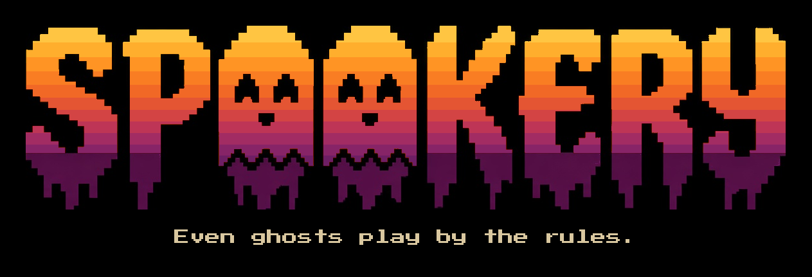

<p align="center"></p>

> Early work in progress, not a playable release yet.

Spookery is a table engine for a living world. An author writes a pack, a folder of YAML rules plus Markdown for places and people, and hosts it with `spook run`. One GM seat and up to three players take actions. The engine is the only writer of world state. Dice are seeded, and a replay repeats the recorded rolls. `spook verify` checks the journal against that record.

A model can sit the GM seat. It talks, and it asks the engine to commit. It does not edit the save. The journal is the audit trail: every commit is in the log, and verify replays it.

## Words used here

- **Pack**: a folder of text that is the world: its places, people, rules and current state.
- **Seat**: one place at the table. Each player character is a seat, and the GM is one more.
- **GM**: the storyteller seat. A person, a coding agent, or the built-in model GM can sit it. It can also stay empty.
- **Tick**: one step of game time on the world clock. Talking does not take a tick; moving and acting do.

The full glossary is in [docs/README.md](docs/README.md#glossary).

## Quick start

You need Rust 1.89 or newer from [rustup](https://rustup.rs). On Linux you also need `pkg-config` and `libssl-dev` (on Debian or Ubuntu: `sudo apt install pkg-config libssl-dev`). macOS needs the Xcode command line tools. Windows needs the MSVC C++ build tools, and a checkout with LF line endings. You do not need an AI key.

The walkthrough copies `packs/sample-d20` and plays it to the ending. `spook run` writes its save into the pack folder, so always play a copy, never the folder inside the repo. You are Lark, in the Gate Yard, carrying a tonic. Briar bars the lane until you ask. `drink` uses that item. `ask_briar` opens the lane. `travel mill_lane` takes the exit. The walk costs 15 minutes, and arriving fires the rule in `packs/sample-d20/story/ending.yaml`, which sets the world flag `finished` and prints the ending line.

`spook run` stays in the foreground. In a second terminal, from the repo folder and with the same `PATH`, run `spook play` and type the lines. With no GM seated, each line commits on its own. The CI dry run seats a stub GM that commits the same lines. Type `stop` in the host when the ending line has appeared, then run `spook verify`.

### Lines

```text
drink
ask_briar
travel mill_lane
```

### Ending

```text
The lane is empty. That is the end.
```

### Linux and macOS

```sh
git clone -c core.autocrlf=false https://github.com/legend-of-alan/spookery.git
cd spookery
cargo build --release --locked
export PATH="$PWD/target/release:$PATH"
cp -r packs/sample-d20 /tmp/yard
```

The host prints one line, `{"kind":"listening","game":"127.0.0.1:9737","door":"127.0.0.1:9738"}`, and waits.

```sh
spook run /tmp/yard
```

```sh
spook play /tmp/yard
```

```sh
spook verify /tmp/yard
```

### Windows

Clone with LF line endings, or the pack will not load. A CRLF checkout rewrites the pack, and `spook run` then exits 1 with `PACK_REV_MISMATCH`.

```powershell
git clone -c core.autocrlf=false https://github.com/legend-of-alan/spookery.git
cd spookery
cargo build --release --locked
$env:PATH = "$PWD\target\release;$env:PATH"
Copy-Item -Recurse packs\sample-d20 $env:TEMP\yard
```

```powershell
spook run $env:TEMP\yard
```

```powershell
spook play $env:TEMP\yard
```

```powershell
spook verify $env:TEMP\yard
```

`verify` prints `verified <n> records, state_rev <r>` when the journal matches. `spook replay` and `spook audit` are described in [CONTRIBUTING.md](CONTRIBUTING.md#prove-the-log).

## Transcript

This is the quick-start sitting. Lark is in the Gate Yard. The client prints:

```text
You are in Gate Yard.

Wagon ruts cross the mud. A stick leans by the post.

Here: Briar, You

You know:
The gate stands open.

Meters:
Defense: 11/25
Grace: 3/12
Hp: 8/16
Might: 40/45

Exits:
mill_lane (locked) — 15 min
loft — 0 min
```

Type `drink`, then `ask_briar`, then `travel mill_lane`. The tonic is used up, Briar steps aside, and the 15 minute walk ends on Mill Lane. The arrival rule prints the ending line. This output is from the CI dry run, where the stub GM is seated. With no GM seated there is no `Your action is queued.` line, and each line prints its own update.

```text
Your action is queued.
You are in Gate Yard.

Wagon ruts cross the mud. A stick leans by the post.

Here: Briar, You

You know:
The gate stands open.

Meters:
Defense: 11/25
Grace: 3/12
Hp: 12/16
Might: 40/45

Exits:
mill_lane (locked) — 15 min
loft — 0 min
Your hp is now 12. Your Bitter tonic was used up.
Your action is queued.
You are in Gate Yard.

Wagon ruts cross the mud. A stick leans by the post.

Here: Briar, You

You know:
The gate stands open.

Meters:
Defense: 11/25
Grace: 3/12
Hp: 12/16
Might: 40/45

Exits:
mill_lane — 15 min
loft — 0 min
Briar steps aside.
Your action is queued.
You are in Mill Lane.

The lane runs past a small mill. Flour dusts the step.

Here: Oden, You, Nell

Meters:
Defense: 11/25
Grace: 3/12
Hp: 12/16
Might: 40/45

Exits:
gate_yard — 0 min
The lane is empty. That is the end.
```

## Build from source

Install Rust 1.89 or newer with [rustup](https://rustup.rs). The workspace `rust-version` is 1.89. CI pins 1.89.0.

From the repository root:

```sh
cargo build --release --locked
```

The binary is `target/release/spook`. On Windows it is `target/release/spook.exe`.

Linux needs `pkg-config` and `libssl-dev`, or your distribution's equivalents. The model client uses reqwest with native TLS. macOS needs the Xcode command line tools. Windows needs the MSVC C++ build tools.

On Windows, check the repository out with LF line endings:

```sh
git clone -c core.autocrlf=false https://github.com/legend-of-alan/spookery.git
```

CI builds this workspace on `ubuntu-latest`, `macos-latest`, and `windows-latest` with Rust 1.89.0. The quick-start job runs the commands in the section above on each of those runners. The GitHub Ubuntu image already includes `pkg-config` and `libssl-dev`. A minimal Linux install does not.

`packs/oneshot-docks` is the engine fixture. `spook new` writes a smaller pack. The walkthrough for that pack is [docs/first-pack.md](docs/first-pack.md).

## At the table

`help` lists the verbs and the exits. `look` prints the place again. `say` plus the words after it is speech, and it does not tick. A word the table does not know says to type help.

`--addr` sets the loopback address. The default is `127.0.0.1:9737`. Passing `127.0.0.1` alone means that same port. Any other host is refused before the pack opens. The agent door is the next port, `127.0.0.1:9738`.

`--as player:<id>` sits that character. A second client for a character who is already sitting exits 1 and prints `That character is already taken. [SEAT_TAKEN]`. A fourth player exits 1 and prints `The table is full. [SESSION_FULL]`.

`spook status` prints the host digest and does not write the pack. `spook tick` and `spook migrate` write `state/`. Stop `spook run` before those two, because the server keeps the save in memory.

## Game master

### No GM

Leave the GM seat empty. Speech is stored on the tape and does not advance time. Each player move is committed as its own tick. There is no narration and no model call.

### Model GM

`spook ai-gm` sits the GM seat and calls a chat-completions endpoint. It does not start the server or the player. Start `spook run` first. The client posts to `{SPOOK_GM_URL}/chat/completions` with one tool, `act`. The model answers with that tool. The engine then commits the queued lines.

Three environment variables, and no others. All three are required. There is no default URL.

| Variable | Required | Meaning |
| --- | --- | --- |
| `SPOOK_GM_KEY` | yes | Bearer token. Read from the environment, never from the pack. |
| `SPOOK_GM_URL` | yes | Origin of the endpoint, including the `/v1` prefix the provider documents. |
| `SPOOK_GM_MODEL` | yes | Model name sent in the request. |

A missing variable is printed on stderr as `<NAME> is unset` and the process exits 1 before it dials. The variables are checked in the order `SPOOK_GM_KEY`, `SPOOK_GM_URL`, `SPOOK_GM_MODEL`.

xAI:

```sh
SPOOK_GM_KEY=your-key SPOOK_GM_URL=https://api.x.ai/v1 SPOOK_GM_MODEL=grok-4.20-0309-non-reasoning spook ai-gm /tmp/yard
```

Claude, through the chat-completions endpoint:

```sh
SPOOK_GM_KEY=your-key SPOOK_GM_URL=https://api.anthropic.com/v1 SPOOK_GM_MODEL=claude-sonnet-4-5 spook ai-gm /tmp/yard
```

Set `SPOOK_GM_MODEL` to the Claude model you want. [Ollama](https://ollama.com), running locally:

```sh
ollama pull qwen2.5:0.5b
SPOOK_GM_KEY=ollama SPOOK_GM_URL=http://127.0.0.1:11434/v1 SPOOK_GM_MODEL=qwen2.5:0.5b spook ai-gm /tmp/yard
```

On Windows, set the three variables in that terminal before `spook ai-gm`, and pass the pack path you copied (`$env:TEMP\yard`).

When the provider refuses a call, stderr shows `model call returned <status>: <text>`. The text is the provider's error body on one line, cut to 200 characters, with the key replaced by `[key]`.

`crates/spook/tests/integration/live_round.rs` plays one real round against whatever provider those three variables name. It is ignored by default. CI runs it too; see [CONTRIBUTING.md](CONTRIBUTING.md#live-ai-ci).

### Human GM

`spook gm` sits the same GM seat as `spook ai-gm`. Start `spook run` first. Both dial the agent door. `--mcp-http 127.0.0.1:<port>` dials that door instead. `spook run --addr 127.0.0.1:0` lets the operating system choose the ports, then prints the listening line. Pass that door to `--mcp-http`.

```sh
spook gm /tmp/yard
```

Type `help` for the seat commands. `spook gm --raw` prints each protocol frame as one JSON line.

## Authoring with a coding agent

`spook run` serves an agent door at `http://127.0.0.1:9738/mcp` by default. Copy the pack first, as in the quick start, and point the agent at `127.0.0.1`, not `localhost`. Config snippets for Claude Code, Grok Build, Cursor, Gemini CLI, Windsurf and Claude Desktop are in [CONTRIBUTING.md](CONTRIBUTING.md#coding-agent-clients).

The tools are `session_status`, `perceive`, `intent`, `say`, and `commit_round`. The author-pack skill in `.grok/skills/author-pack` edits a pack and checks it with `spook check`. Field reference: [docs/pack-reference.md](docs/pack-reference.md). A first pack from `spook new` is [docs/first-pack.md](docs/first-pack.md).

```sh
spook check /tmp/yard
```

`spook check` prints any pack problem in plain English and writes nothing.

## Privacy

`spook ai-gm` sends table text to the host named by `SPOOK_GM_URL`. There is no default host. The API key is the bearer token from `SPOOK_GM_KEY` in the environment. The pack does not hold the key.

The request is one chat-completions POST. The JSON body carries one user message, the model name, `"stream": false`, and one function tool named `act`. The message content is a bounded JSON prompt: the last 16 says this process has handled, the new player lines, the move menu, the queued intents, and stripped views. A follow-up after a roll adds the roll faces. A player view that is only a room census drops known facts, messages, and unknown mentions. An NPC view keeps each fact's id and text. Every fact body is dropped. The prompt includes the Markdown body of the current place and of each cast member in the views. Each of those bodies is cut at 800 characters, and a body that repeats a hidden fact is left out. It does not include `save.yaml` or the tape file. Those stay on disk under the pack. Starting `spook ai-gm` again remembers nothing from the previous process.

## Docs

- [docs/engine-guarantees.md](docs/engine-guarantees.md) states what the engine promises. The feature files test them. Where the doc and the feature files disagree, the feature files win.
- [docs/README.md](docs/README.md) has the principles, glossary and repo layout.
- [LICENSE](LICENSE)
- [CONTRIBUTING.md](CONTRIBUTING.md) has issue and PR conventions and maintainer notes.

## License

The engine is open source (AGPL-3.0). Runtime code, the tests of that code, and repository tooling and scripts are AGPL-3.0-or-later. Documentation, schemas, and packs are CC BY 4.0.

The terms are in [LICENSE](LICENSE) and [LICENSE-CC-BY-4.0](LICENSE-CC-BY-4.0).
