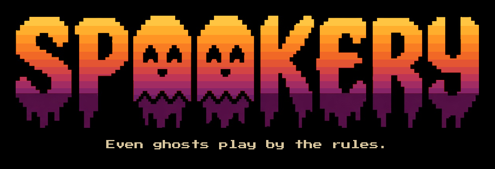

<p align="center"></p>

> Pre-alpha. Download a build from [Releases](https://github.com/legend-of-alan/spookery/releases) and expect things to change.

Spookery is the game engine underneath your AI GM. Let a model run an RPG on its own and the world slips: an NPC forgets what it said, a roll gets fudged, a locked door opens anyway. Creativity isn't discord, it's controlled chaos.

You write a world as a pack of plain YAML rules and Markdown pages for places and people. Coding agents like Claude Code and Cursor can build one with `spook new` and `spook check`. Then you host it as a living world and sit down with up to three players and a GM.

Bring a friend to GM or bring your own model key. Either way, the engine is the only thing that changes the world. The GM tells the story and asks the engine to commit.

- ⚙️ Play moves in rounds. Everyone queues a move, and the engine resolves them.
- 🎲 Dice are seeded. A d20 check can partly succeed, and NPCs roll their own checks.
- 📙 Every commit goes in a hash-chained journal, so you can replay a game and check every roll.
- ⚡ Triggers fire for in-round changes.
- 🕰️ A world clock keeps time, and NPCs keep habits, like restocking the shop.
- 🙈 Players see whether they succeeded, and only the GM sees the dice.

New words like seat and tick are explained in the [glossary](docs/README.md#glossary).

## Play

Download the archive for your computer from [Releases](https://github.com/legend-of-alan/spookery/releases): `x86_64-unknown-linux-gnu` for Linux, `aarch64-apple-darwin` for an Apple silicon Mac, `x86_64-apple-darwin` for an Intel Mac, or `x86_64-pc-windows-msvc` for Windows. Unpack it and open a terminal in the unpacked folder. It holds `spook`, the licenses and the demo pack, `packs/demo-d20`.

The builds are unsigned. If macOS refuses to open `spook`, run `xattr -d com.apple.quarantine spook` once. If Windows shows a SmartScreen warning, pick More info, then Run anyway.

The host saves into the pack folder, so copy `packs/demo-d20` to a new folder, `my-demo`, and play that. On macOS and Linux type `./spook` for `spook`, and in PowerShell `.\spook`. Start the host:

```sh
spook run my-demo
```

It prints a `listening` line and waits. Open a second terminal in the same folder and join:

```sh
spook play
```

Pick Corin when it asks who you are. You're in the Yard, and daylight is running out. With nobody in the GM seat, each line you type commits on its own. When you're done, press Ctrl+C in the host terminal. It saves and shuts down cleanly.

## Build from source

You need [rustup](https://rustup.rs), which installs the Rust version pinned in `rust-toolchain.toml`.

```sh
git clone https://github.com/legend-of-alan/spookery.git
cd spookery
cargo build --release --locked
export PATH="$PWD/target/release:$PATH"
```

That gives you one binary, `target/release/spook`, and the demo pack is at `packs/demo-d20`.

## At the table

Type `help` any time. It lists the commands you can type here and now, and what each one can name, as `travel <exit>: gate, cart, Loft, Shed`. `map` lists the places you have visited, with their exits.

| Type | What it does |
| --- | --- |
| `look` | Shows the place again |
| `say <words>` | Talks. `say Mira hi` (or `tell Mira hi`) talks to Mira. Talking takes no game time |
| `travel <exit>` | Walks to another place |
| `take <item>` | Picks something up |

`help`, `map`, `look` and `say` work in every pack. The other verbs come from the pack, so `travel` and `take` are the demo's.

## The packs

`packs/demo-d20` is the one to play first, and the one each release bundles. It's a short demo in a small yard. Corin can best Briar with a cudgel and go through the gate, or banish a goblin for its nail and take the cart, setting the wheel with `ward` or with Oden's help through `brace`. Corin loses if knocked out, or if daylight runs out before he reaches the lane. CI checks that it loads. No test plays it, so its story can change without breaking a test.

Test packs live in `tests/packs`. They are fixtures, not games. `tests/packs/docks` is the one the engine and seat tests use: three player characters at the docks, and a yard behind the street with a fight, a d20 strike beside a 2d6 check, and a lane that ends the story.

## Other commands

| Command | What it does |
| --- | --- |
| `spook new <dir>` | Writes a starter pack you can edit |
| `spook check <pack>` | Reports pack problems without writing anything |
| `spook verify <pack>` | Replays the journal and checks that it rebuilds the save |
| `spook gm` | Sits you in the GM seat |
| `spook ai-gm` | Puts a model in the GM seat |

Run `spook --help` for the full list. GM setup is in [docs/README.md](docs/README.md#game-master).

## Docs

- [docs/README.md](docs/README.md) is the index, with the glossary and host flags.
- [docs/first-pack.md](docs/first-pack.md) walks you through making a pack.
- [docs/pack-reference.md](docs/pack-reference.md) lists every pack field.
- [docs/engine-guarantees.md](docs/engine-guarantees.md) says what the engine promises.
- [docs/seat-protocol.md](docs/seat-protocol.md) is the seat protocol for clients and GMs, including how to hook up a coding agent.
- [CONTRIBUTING.md](CONTRIBUTING.md) covers issues and tests.

## License

The engine is AGPL-3.0-or-later, and the crates a game client needs are MIT. The full split is in [docs/README.md](docs/README.md#license). If AGPL doesn't fit your project, open an issue and we can talk.
