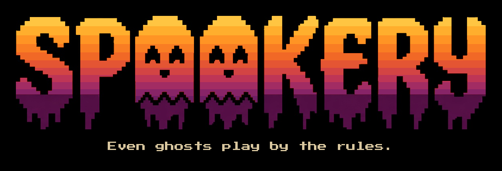

<p align="center"></p>

> Early work in progress. You can play the sample, but it isn't a release yet.

Spookery is the game engine underneath your AI GM. Let a model run an RPG on its own and the world slips: an NPC forgets what it said, a roll gets fudged, a locked door opens anyway. Creativity isn't discord, it's controlled chaos.

You write a world as a pack of plain YAML rules and Markdown pages for places and people. Coding agents like Claude Code and Cursor can build one with `spook new` and `spook check`. Then you host it as a living world and sit down with up to three players and a GM.

Bring a friend to GM or bring your own model key. Either way, the engine is the only thing that changes the world. The GM tells the story and asks the engine to commit.

- ⚙️ Play moves in rounds. Everyone queues a move, and the engine resolves actions.
- 🎲 Dice are seeded. A d20 check can partly succeed, and NPCs roll their own checks.
- 📙 Every commit goes in a hash-chained journal, so you can replay a game and check every roll.
- ⚡ Triggers fire in the round their condition comes true.
- 🕰️ A world clock keeps time, and NPCs keep habits, like restocking the shop.
- 🙈 Players see whether they succeeded, and only the GM sees the dice.

New words like seat and tick are explained in the [glossary](docs/README.md#glossary).

## Build

You need [rustup](https://rustup.rs), which installs the Rust version pinned in `rust-toolchain.toml`, plus `pkg-config` and the OpenSSL headers.

```sh
sudo apt install pkg-config libssl-dev
git clone https://github.com/legend-of-alan/spookery.git
cd spookery
cargo build --release --locked
export PATH="$PWD/target/release:$PATH"
```

That gives you one binary, `target/release/spook`.

## Play

The host saves into the pack folder, so play a copy and keep the repo clean. Start the host in one terminal:

```sh
cp -r packs/sample-d20 /tmp/yard
spook run /tmp/yard
```

It prints a `listening` line and waits. Open a second terminal in the repo folder, set the same `PATH`, and join:

```sh
spook play
```

Pick `pc_lark` when it asks who you are. You're in the Gate Yard and a mill cart is blocking the lane out. Here's the end of a short run, where you type `chock` and then `travel mill_lane`:

```text
chock
The wheel holds. The cart settles.
travel mill_lane
Oden and Nell are on the lane. That is the end.
```

With nobody in the GM seat, each line you type commits on its own. When you're done, press Ctrl+C in the host terminal. It saves and shuts down cleanly. Then check the journal:

```sh
spook verify /tmp/yard
```

You should see `verified <n> records, state_rev <r>`.

## At the table

Type `help` any time. It lists the words you can type and the exits from where you're standing. `map` lists the places you have seen since `spook play` started, with their exits.

| Type | What it does |
| --- | --- |
| `look` | Shows the place again |
| `say <words>` | Talks. Talking takes no game time |
| `travel <exit>` | Walks to another place |
| `take <item>` | Picks something up |

`help`, `map`, `look` and `say` work in every pack. The other verbs come from the pack, so `travel` and `take` are the sample's.

## The two packs

`packs/sample-d20` is the one to play first. It's one small yard with a single puzzle and a few ways to solve it. The tests play it to the ending.

`packs/oneshot-docks` is a test fixture. It has three player characters at the docks, and the engine and seat tests use it to check multi-player rules. You can host it too, but there's no story to finish.

## Other commands

| Command | What it does |
| --- | --- |
| `spook new <dir>` | Writes a starter pack you can edit |
| `spook check <pack>` | Reports pack problems without writing anything |
| `spook gm` | Sits you in the GM seat |
| `spook ai-gm` | Puts a model in the GM seat |

Run `spook --help` for the full list. GM setup is in [docs/README.md](docs/README.md#game-master).

## Docs

- [docs/README.md](docs/README.md) is the index, with the glossary and host flags.
- [docs/first-pack.md](docs/first-pack.md) walks you through making a pack.
- [docs/pack-reference.md](docs/pack-reference.md) lists every pack field.
- [docs/engine-guarantees.md](docs/engine-guarantees.md) says what the engine promises.
- [docs/seat-protocol.md](docs/seat-protocol.md) is the seat protocol for clients and GMs.
- [CONTRIBUTING.md](CONTRIBUTING.md) covers issues, tests and hooking up coding agents.

## License

The engine is AGPL-3.0-or-later, and the crates a game client needs are MIT. The full split is in [docs/README.md](docs/README.md#license). If AGPL doesn't fit your project, open an issue and we can talk.
