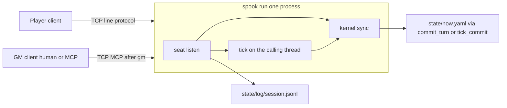

# ADR 0008: v0.1 sitting shape

- Status: Accepted
- Date: 2026-10-02
- Source: `docs/architecture_v0.1.md` §1 through §3's design paragraphs (lines 10–28, 52–56, 86–114, 149–153, 190–212, 339–341) and §7 (lines 384–404)

## Context

§1 states "Decisions already made. Do not reopen them." The sitting is one shard the players and the GM connect to. §2 states "v0 §1 through §17 still hold where this file does not name a change" and then "Intentional conflicts with v0. Do not "fix" these back." Those conflicts are the pressure: the sitting changes the process shape, and the named v0 rules stay where this file does not conflict with them.

## Decision

One shard. §1 states "One shard process. Players and the GM connect to the shard. The shard is the star. The GM is not a hop and not a server." It states "The table is the process you launched (`spook run <pack>`). Its stdout is the operator view. There is no third attached public-scene client. Public speech is an address, not a seat."

Loopback `127.0.0.1` port 9737. §1 states "Loopback only. The listener binds `127.0.0.1` and no other address. Default port `9737`. The listener is created before `open_shard`. Any other bind address is `NOT_IN_SPEC` and the process exits 1 before opening the pack. If the address is `127.0.0.1` and the bind fails, the process exits 1 with the operating-system error text on stderr, opens no pack, and writes nothing. That failure is not `NOT_IN_SPEC`. A later multi-machine version is the same acceptor and a different bind. v0.1 does not specify that bind, accounts, or a connection secret."

Seat caps are constants. §1 states "Seats: at most one player connection and one GM connection. Caps are constants (`player_slots = 1`, `gm_slots = 1`), not `Now` fields and not pack fields. A second join returns `SESSION_FULL`, writes nothing, and the client exits 1. The shard stays up." It states "A player seat binds an existing `player:<id>` actor. A missing actor is `SCHEMA` and writes nothing. Opening an NPC id, or `as=gm` on the player seat, is `SCHEMA`. `spook play <pack> --as player:mira` is that NPC case: `SCHEMA`, exit 1, writes nothing."

The GM seat is not a `ViewerId`. §1 states "A GM seat is not a `ViewerId`. `ViewerId` stays `Player` or `Npc`. `as=gm` stays legal only on `recall`, as v0 pin P24." It states "The GM seat does not increment `presence.humans`. Only a player session does. Zero players is still the idle shard, even if a GM is connected."

§1 states "Disconnect, or an explicit close, frees that seat. Removing a player session updates presence and commits with `include_tick` false (v0 pin P41): one `state_rev` bump, no tick file, when presence changed. A no-op does not bump `state_rev`. The line `stop`, or EOF on stdin, drops a held player seat the same way, drops a held GM seat with no presence write, does not flush the intent queue, does not call `run_tick`, and then exits 0. A crash that skips that path leaves presence on disk. The next `spook run` clears it before accept (§3). `open_shard`, `spook tick`, and `spook run --mcp` do not clear it."

Two framings. §1 states "MCP. The shard is the long-running process. A model connects to it as the GM seat. The first line is `gm`. That line is not JSON-RPC. After the shard accepts it, the socket uses the rmcp 0.8 codec that v0 stdio `--mcp` already uses: one compact JSON-RPC message, then one LF, no header. `spook gm` and a model are clients of those bytes. There is no second server grammar. The v0 shape where the agent process is the parent of an stdio server is not how a sitting with a player terminal works. Implement `tools/call` for the GM allowlist. The player connection does not receive those tools. It stays LF `kind` lines and never switches to this codec. `npc_act` stays `LLM_DISABLED`. The GM seat does not get pack-studio tools and does not get `patch_entity`. GM `tools/call` of `session_open` returns `NOT_IN_SPEC` and writes nothing. The player hello is the only `session_open`." It states "Speech and mechanical results are different event kinds on the wire. A spoken sentence is not a perceive object and is not an effect row."

§6 states "Two sockets. Do not give them one framing." It states "The player connection is the line protocol. One compact JSON object per line, one LF. No pretty-printing. `kind` is the first key. It is not MCP. The player receives only these. The player does not receive `faces`, `stat`, `total`, `target`, `recipients`, `seq`, or a `say` whose `recipients` omit that player. The speaking player's own line is not omitted. `recipients` contains that id."

§3 draws the same split:

No fact grant. §1 states "Fact grant is out of scope. A whispered sentence does not append to `known_facts`. Nothing in v0 can do that either, and v0.1 does not add it."

One shard thread owns `Now`. §3 states "One thread owns `Now`. Call it the shard thread. `commit_turn`, `tick_commit`, `run_tick`, the startup clear, and the disconnect presence commit run there. The accept loop and the Tokio timer may wait off that thread. They post the hello, the player line, the GM tool call, the wake, and the socket error onto the shard thread. They do not read or write `Now`. A scheduler wake that runs calls `run_tick` on the `Shard` that thread already holds. It does not load a second one from disk. The shard thread does not start a `say` in the middle of a commit. A `say` copies `tick_index` and `world_time` on that thread after the previous commit has returned, then takes `state/.session.lock` and appends. It still does not take `state/.tick.lock` and does not call `run_tick`."

§3 states "A failed hello writes nothing, sends the refused line, and closes. A valid player hello commits `session_open` on the shard thread, then marks that socket held, then sends scrollback, `resume`, and `perceive`. A socket error after that commit posts to the shard thread and runs the same drop as `close`. A kill between the commit and that drop leaves the session on disk. The next `spook run` clears it, so the following hello sets `humans` to 1." It states "EOF, a read error, or a write error on an accepted socket is that same drop. Silence is not. A player who does not type stays seated. Every accepted socket sets `SO_KEEPALIVE`, with `TCP_KEEPIDLE` equal to the pack's `tick_every_real_seconds`, `TCP_KEEPINTVL` 1, and `TCP_KEEPCNT` 3. A keepalive failure is a read error. On the docks the idle before probes is 300 seconds. A conformance test does not sleep for that. It calls the drop with a simulated error."

§3 states "Reconnect after the slot is free is a new hello and, for a player, a new `session_open`. The shard mints a new `session_id`. v0.1 does not pin that id's spelling."

§3 states "The shard writes `state/now.yaml` only through `commit_turn` or `tick_commit`. The seat layer appends `state/log/session.jsonl` for `say`. The kernel tick, `expand`, `apply_effect`, `perceive`, and `idle_digest` do not write that file. `kernel::store` is still the only module that creates files under `state/`. The seat calls `store` to append one tape line. The append does not open a `Txn`." It states "New seat and listen code lives in the root bin, under `src/cli`. That bin may use Tokio to accept and to sleep, the same way `src/cli/schedule.rs` may sleep on a Tokio timer. Posted work runs on the shard thread. The tick function and the kernel stay on that thread. No `tokio::spawn` of a tick. No `tokio::spawn` of `commit_turn`. No second thread reads `Now`."

What stays v0. §2 states "v0 §1 through §17 still hold where this file does not name a change. Load-bearing rules that stay:"

- "One writer of `state/`. Clients do not write it. `tick_commit` and `commit_turn` remain the writers of `Now`. v0 §1 and §10."
- "The kernel must not link `tokio`, `rmcp`, `spookery-tick`, `spookery-mcp`, or a model SDK. Dependency arrows stay the v0 §3 table. `v0_import_boundaries` stays."
- "No `Gm` variant on `ViewerId`. v0 §6."
- "The closed effect enum stays the v0 §5 list. No new class."
- "Inbound `llm_say` is dropped. Persisted intents store `llm_say: null`. `public_say` is not written into `Now`."
- "`npc_act` does not call a model. No cargo feature named `llm`."
- "No `--serve`. No accounts. No database. No HTTP route."
- "`pack_rev` and the `packs/oneshot-docks` bytes stay. v0.1 does not edit them. Do not edit `checks.yaml`, `schema/checks.schema.json`, or `packs/oneshot-docks` to hold a check target."
- "`replay_recorded` still replays tick files only. It does not read the session tape. v0 §7. An applied `attempt` is re-executed by calling `resolve_check` with the stored `args.check` and `args.target`."
- "`kernel::open_shard` does not drop sessions. `spook tick`, `spook status`, `spook migrate`, `spook replay`, and `spook run --mcp` do not either. A pack left with `humans` 1 still ticks live under `spook tick`. `schedule::wake` is unchanged. `tests/conformance/v0_scheduler_sleeps_then_catches_up_on_this_thread.rs` stays."
- "`session_open`'s `include_tick` false behavior is v0 pin P41. Adopted here, not redesigned. The player hello is the only caller."
- "Studio and `migrate` stay host commands, not a seat. v0 §8 studio profile and §11."

Intentional conflicts with v0. §2 states "Do not "fix" these back."

- "v0 binds one MCP profile for the life of the process, and the play door is a different way to start a process. v0.1 starts one shard and attaches seats. `spook run <pack> --mcp <profile>` stays that v0 stdio process: one profile, the v0 §8 `tools/list` order, no `say` inserted. It is not the sitting. After the shard accepts the line `gm`, the GM seat uses that same rmcp 0.8 codec: one compact JSON-RPC message, then one LF, no header. `gm` is not a JSON-RPC message. It is not a second grammar."
- "v0 `spook run <pack>` reads play lines from stdin and does not call `session_open`, so a person at the keyboard leaves `presence.humans` at 0 (pin P22, pin P45). v0.1 stdin is not a play door. Any stdin line other than `stop` prints `NOT_IN_SPEC` on stderr, does not exit, and writes nothing. `stop` and EOF drop a held player seat the way a disconnect does, drop a held GM seat with no presence write, do not flush the intent queue, do not call `run_tick`, and exit 0. The listener keeps the process up until then. EOF is a clean shutdown, not a play script. `spook run <pack> --as ...` is `NOT_IN_SPEC`, exit 1, before `open_shard`. `--as` belongs to `spook play`. A player client calls `session_open`, which sets presence. One stdin is not two actor ids. v0 player stdout is raw `idle_digest(Player)` bytes plus one perceive line. v0.1 player stdout is the §6 events. Gate A rewrote `tests/conformance/v01.rs` because it asserted the stdin door this sitting removes."
- "v0 says do not add tools and do not reorder `tools/list`. v0.1 adds `say` to the GM seat only. The stdio `pack-table` list does not gain it. `session_open` stays on the GM list, in that order, and a GM `tools/call` of it returns `NOT_IN_SPEC`."
- "v0 `expand` returns `NOT_IN_SPEC` for `talk` even during a session. v0.1 `talk` is speech, not an expand arm that mutates `Now`. `attempt` is the one live-only name that gains a kernel behavior (the existing check) and still mutates nothing. The v0 line `attempt <check>` gains a `<target>` integer. Do not pass `0`. Do not put that integer in `checks.yaml`."
- "v0 `tools/call` falls through to the library's method-not-found. The stdio server still has no `tools/call` body. v0.1 GM `tools/call` on the shard reaches the handlers. A tool the seat does not have still returns the pinned refusal (`NOT_IN_SPEC` or `LLM_DISABLED`), not a transport error invented by the library."
- "v0 `commit_turn` takes `session_id`. The GM-seat handler accepts `commit_turn` with `include_tick` true and `session_id` omitted. It does not invent a session id."
- "v0 scheduler wake always calls `run_tick`. A tick with zero applied intents still commits and advances `world_time`. v0 `schedule::wake` also runs one tick whenever less than one real hour has passed since `last_tick_at`. v0.1 overrides both while a player connection or a GM connection is actually held: that wake does not call `run_tick`, does not drain the intent queue, and does not advance `world_time`. The sitting owns the clock. A `commit_turn` or outermost `run_tick` that advances `world_time` also restarts the `spook run` sleep from that moment. A wake whose elapsed real seconds since `last_tick_at` are still below `tick_every_real_seconds` runs no tick, even when no seat is held. That is the wrapper in `spook run`. It does not change `schedule::wake`. When the wrapper ticks, it runs that same decision on the shard thread's `Shard`. `run_tick` borrows that value and reads its queue. The wake does not open a second shard. An outermost tick then clears that queue. `humans == 0` is idle catch-up and `humans > 0` is one live tick, because that is what v0 `plan_catchup` already does. Do not switch the timer to `live_tick_every_real_seconds`. An empty GM `commit_turn` still does not enter `run_tick` and does not restart the sleep."
- "v0 leaves a crashed session in `presence`, and the next wake treats `humans > 0` as people present. `spook run` does not. After `open_shard` and before accept, it clears `session_ids`, `actors_present`, and `humans` when any of them is set, with one `include_tick` false commit and no tick file. Already empty writes nothing. The next hello then sets `humans` to 1, not 2. `open_shard` itself does not clear."

§2 states "A v0 rule this file does not conflict with stays. `filter_blocklist` still rejects the five live-only move names with `LIVE_ONLY` when `humans` is 0 (pin P39). `talk` as speech never reaches that function, because it is not an intent. Pause policy and NPC derivation still run inside a tick that does run."

## Consequences

§7 states "Will not appear in this architecture:"

- "No fact grant. No effect that appends `known_facts`. Prose is not parsed into facts. A whisper does not teach a character anything."
- "No public-scene seat. No spectator protocol. Public speech is the `table` address."
- "No `Gm` variant on `ViewerId`. GM `perceive` as `gm` is `UNSCOPED_PERCEIVE`."
- "No second writer. Clients do not write `state/` or the tape."
- "No studio tools on the GM seat. No `patch_entity` from a sitting. `simulate_knowledge` stays off this seat and still must not write `known_facts`."
- "No model SDK in the kernel or the tick. `npc_act` stays `LLM_DISABLED`. No cargo feature named `llm`. No `tokio::spawn` of a tick."
- "`attack`, `give`, and `take` stay `NOT_IN_SPEC`. No inventory effect, no xp, no combat class."
- "No `--serve` on a non-loopback address, no accounts, no connection secret, no website, no database. Binding a non-loopback address is `NOT_IN_SPEC`."
- "No second GM server grammar. Typed GM lines are a client of MCP `tools/call`."
- "`say` does not tick, does not bump `state_rev`, and does not enter `Now`, rumors, messages, or resume."
- "The operator digest is not a player view. Do not send `idle_digest(Host)` to a player connection."
- "Stdin of `spook run` is not a play door. `stop` and EOF do not call `run_tick` and do not flush the intent queue. They do drop a held player seat."
- "No per-client cursor, no ack, and no outbound queue. The tape is the scrollback log."
- "Silence is not a disconnect. A live socket that sends nothing stays seated."
- "`kernel::open_shard` does not clear `presence`. Only `spook run` without `--mcp` does, and only at startup."
- "`spook gm --stdio` is not a writer and not a second grammar. It copies bytes. Grok does not open the TCP socket."

Proof items 1–21 are the F-v01-* cards. This record does not restate them.

- F-v01-seats (`v01_seats`) covers the one player hello, `SESSION_FULL`, a GM connection that does not write presence, bad hellos, and `spook play <pack> --as player:mira`.
- F-v01-drop (`v01_seat_drop`) covers disconnect, close, a quiet socket, and the simulated read error.
- F-v01-bind (`v01_bind`) covers loopback, a failed bind of `127.0.0.1`, `spook run --as`, and a client with no listener.
- F-v01-stdin (`v01_stdin_and_crash`) covers stdin, `stop`, EOF, and the crash clear before accept.
- F-v01-speech (`v01_speech`) covers `say` and `talk` on the tape.
- F-v01-queue (`v01_round_queue`) covers the round queue and a wake while a seat is held.
- F-v01-restart (`v01_round_restart`) covers an early wake and a queued `wait` that survives a GM drop.
- F-v01-attempt (`v01_attempt`) covers `attempt`, and `attack`, `give`, and `take` staying `NOT_IN_SPEC`.
- F-v01-gm (`v01_gm_allowlist`) covers the GM allowlist, `LLM_DISABLED`, `patch_entity`, and no cargo feature named `llm`.
- F-v01-say (`v01_gm_say`) covers GM `say` and `session_status`.
- F-v01-bridge (`v01_stdio_bridge`) covers `spook gm --stdio` copying bytes.

`v0_import_boundaries` covers the kernel link ban. F-v0-docks (`v0_oneshot_docks`) covers the `packs/oneshot-docks` bytes. F-v0-clock (`v0_scheduler`) covers `schedule::wake` staying unchanged. F-v0-idle (`v0_idle_ux`) covers the operator digest staying off the player view. F-v02-table (`v02_pack_table_list_only`) covers the stdio `pack-table` list not gaining `say`. F-v02-reconnect (`v02_reconnect`) covers reconnect scrollback after the slot is free.

The typed `spook gm` map is not a decision of this ADR. It is recorded under Typed GM client and in ADR-0010. Lines 168–184 and line 261 stay unquoted.

## No existing proof

These sentences in the source name an observable and are not in the feature cards. They stay listed. They are not new tests.

- "There is no third attached public-scene client."
- "`as=gm` stays legal only on `recall`, as v0 pin P24." F-v01-seats covers `as=gm` on the player seat as `SCHEMA`.
- "Every accepted socket sets `SO_KEEPALIVE`, with `TCP_KEEPIDLE` equal to the pack's `tick_every_real_seconds`, `TCP_KEEPINTVL` 1, and `TCP_KEEPCNT` 3." "On the docks the idle before probes is 300 seconds." The same paragraph says a conformance test does not sleep for that. F-v01-drop covers the simulated error.
- "v0.1 does not pin that id's spelling."
- "The append does not open a `Txn`."
- "A whispered sentence does not append to `known_facts`."
- "`replay_recorded` still replays tick files only. It does not read the session tape."
- "Do not pass `0`. Do not put that integer in `checks.yaml`."
- "`filter_blocklist` still rejects the five live-only move names with `LIVE_ONLY` when `humans` is 0 (pin P39)." F-v01-speech covers `talk` as speech.
- "`say` does not tick, does not bump `state_rev`, and does not enter `Now`, rumors, messages, or resume." F-v01-speech covers the tape line.
- "The player does not receive `faces`, `stat`, `total`, `target`, `recipients`, `seq`, or a `say` whose `recipients` omit that player." F-v01-speech covers a later actor missing that `say`.
- "No per-client cursor, no ack, and no outbound queue."
- "No `tokio::spawn` of a tick. No `tokio::spawn` of `commit_turn`. No second thread reads `Now`."

## Superseded

§7 states "No second GM server grammar. Typed GM lines are a client of MCP `tools/call`." The second sentence is the typed-line map in one line. Lines 168–184 and line 261 stay unquoted. `docs/architecture_v0.2.md` under "Still unbuilt for the minor" (line 183) replaces that sentence. It states "The typed `spook gm` client stays the v0.1 client. It accepts `close`." ADR-0010 records that decision.
