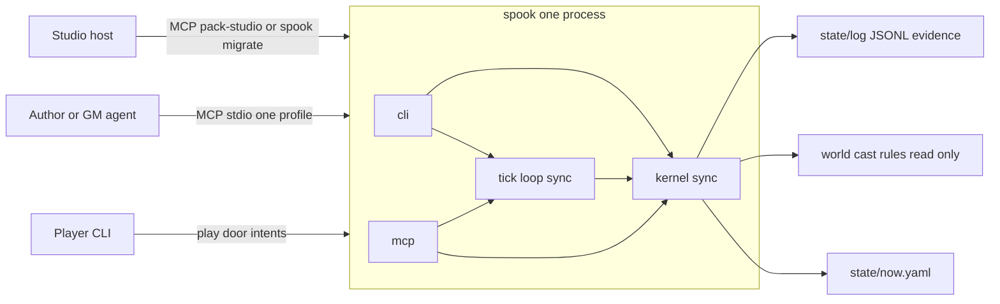

# Spookery v0 architecture

**Status:** Normative spec for v0. Implementation has not started.
**License:** CC BY 4.0 (spec). Runtime code that lands under `/src` is AGPL-3.0-or-later.
**Audience:** Founders, a reviewing programmer, and coding agents implementing crate by crate.

This file is the only normative spec. A rule that is not written here is out of v0. `product_spec.md` is non-normative business notes.

This spec lives in `docs/`. Implementation commits keep that directory name.

---

## Executive summary

1. One OS process, binary `spook` (alias `spookery`, package `spookery`), loads one pack folder and is the only process that may persist `state/`.
2. Humans and models submit intents. The only durable writers are `tick_commit` and `commit_turn`. `apply_effect` mutates an in-memory transaction.
3. The kernel is synchronous. It owns legality, inventory and resources, the knowledge firewall, checks, and the closed effect enum. It does not link MCP, Tokio, or an LLM.
4. Idle mode is `kernel_only`. `llm_npc_intents_per_tick` stays 0. This repository has no model SDK and no embedder.
5. Canon (`world/`, `cast/`, `rules/`) is read-only at runtime. `pack_rev` is BLAKE2s-256 over sorted canon bytes. A mismatch refuses ticks until the host migrates.
6. `Now` is a typed struct. `state/now.yaml` is its pinned YAML projection. JSONL is an evidence tape. Kernel-only replay re-executes recorded moves and must byte-match `now.yaml`.
7. `perceive` always takes `as=player:<id>` or `as=npc:<id>`. Host `spook status` is an omniscient idle digest. Player resume is a filter over that tape. Off-screen stock is not a login banner.
8. v0 is the pack schema and lint, the one binary, three MCP stdio profiles, the tick loop, JSONL, the named CLI, `packs/oneshot-docks`, and conformance tests 1–10.
9. Gates A and B are CLI plus MCP stdio. This architecture does not schedule `--serve`, billing, Discord, a database, or a second writer. §14 is the order.
10. Smallest commit: the three JSON Schemas, the workspace skeleton, the license split, and ignored conformance test 1 with its closed-secret fixture. No tick behavior in that commit.

A reviewer who needs a database, an idle LLM, or a second writer should reject this document rather than extend it.

### Decided rules

The rows below are decisions the earlier drafts stated in more than one way. Implement the Rule column.

| # | Conflict | Rule |
|---|---|---|
| C1 | Tick §8.1: tick `perceive` requires `as=npc:<id>` and forbids `as=gm`. Tick §11 lets a live GM call `recall` as a player or as GM. Product §10.2 adds "or system actor". Product principle 3 allows only `player:<id>` and `npc:<id>` on `perceive`. | Tick profile `perceive` and `recall` accept only `as=npc:<id>`. Table and CLI `perceive` accept `as=player:<id>` or `as=npc:<id>`. `as=gm` on `perceive`, and on every tick-profile tool, is `UNSCOPED_PERCEIVE`. There is no system viewer on `perceive`. Table `recall` accepts `as=gm` and returns every fact id and its text (pin P24). `ViewerId` has no `Gm` variant. |
| C2 | Product criterion 2 says `perceive(as=npc:mira)` never contains Mira's hidden strings. Tick test 1 forbids that string in Aldric's memories, rumors, and `perceive(as=npc:aldric)`. The `Now` example gives Mira `known_facts: [fact_ledger_short]`, and tick §8.3 returns `known_facts` as ids plus short text. | Test 1 is the suite. A viewer receives a fact's text only when that fact id is in their `known_facts`, or the fact is public and at their place. Mira can perceive a hidden fact she knows. Criterion 2's literal reading is not implemented. |
| C3 | Tick §8.1 says `recall` is "keyword/semantic". Stack says keyword plus fact-id index, and lists an embedder as out of v0. | `recall` is keyword match plus fact-id lookup inside the viewer's allowed facts. No vector index. |
| C4 | Tick §12 once illustrated `seed` as `shard:abc\|tick:1842`. The stack formula is `shard_id\|tick_index`. | Closed. `seed` stores `{shard_id}\|{tick_index}`. Tick §12's example is `abc\|1842`. One function, `seed_preimage`, is the only formatter. `rng` is one BLAKE2s-256 of that string. |
| C5 | Tick §5.2 prints `ceil(D * 60 / tick_every_real_seconds)` while `D` is real hours and `tick_every_real_seconds` is seconds. | Implement the printed formula. Do not silently substitute `D * 3600`. Also apply the §3.1 world-hour cap. The burst stops at the tighter bound. Flagged in §7. |
| C6 | `state_rev` is specified as +1 per successful `tick_commit`. `commit_turn` is also a `state/` writer. | Both successful commits increment `state_rev`. `tick_index` increments only when the tick loop runs. See §16. |
| C7 | Product §9 shows `spook ./pack`. Stack names the subcommand `run`. | The only load invocation is `spook run <pack>`. See §11 and §16. |
| C8 | Product §15 allows an optional ugly `--serve` after a week-idle fixture, inside days 71–90. The planning brief says not to schedule `--serve`. | Gate C does not include `--serve`. A later edge would be the same binary and the same kernel. This document specifies no HTTP route. Day numbers in `product_spec.md` are a pace sketch and lose to §14. |
| C9 | The `Now` example rumor `r_184` carries hidden `fact_ledger_short` and lists Aldric in `known_by`. Tick test 1 says Aldric does not know Mira's hidden fact. | The example is a shape, not fixture start state. The fixture rumor cites a public fact. Aldric's `known_facts` omit `fact_ledger_short`. |
| C10 | Product §10's opening sentence says "two servers or two tool profiles". The same section and the stack name three profiles. | One process, three profiles, one profile bound for the life of the process. |

---

## 1. Purpose and refusal

### Boxed loop

```text
author a pack → spook run <pack> → friends submit intents → tick_commit / commit_turn persist state/
```

The pack is the world. The kernel is the proof that the pack can be refereed. The spec is the refusal of a second writer. v0 ships all three as one repository. It does not ship a campaign, a table product, or a model.

### One writer

| Stage | Who | What they hold | Disk |
|---|---|---|---|
| Propose | Player CLI, GM agent, kernel derivation | `Intent` | Nothing |
| Stage | `apply_effect` inside a `Txn` | In-memory `Now` | Nothing |
| Persist | `tick_commit` or `commit_turn` | The `Txn` | `state/` via temp file, `fsync`, atomic rename |
| Canon edit | Studio `patch_entity`, host only | A canon diff | `world/` or `cast/` only. Never `state/` |

`apply_effect` is not a writer. A crash after `apply_effect` and before `tick_commit` leaves the previous `state_rev` on disk because the transaction has not touched it.

Models never patch `state/`, `world/`, or `cast/`. `llm_say` is discarded on intake. Persisted intents store `llm_say: null`.

Markdown bodies are flavor. Every number the tick uses is a YAML field or a Rust constant. A pack with every Markdown body deleted must still tick.

There is no GM perceive on the tick process. Host omniscience is the read-only CLI `spook status`, which filters the evidence tape with `viewer = host`. It is not a tick tool. The one `as=gm` read is table-profile `recall` during a live session (pin P24). It is not `perceive`, and the tick profile rejects it.

---

## 2. System context

### Actors

| Actor | Door | Profile or entry | May persist `state/` |
|---|---|---|---|
| Player on the laptop | Play door, CLI | `spook run <pack>` with `--as player:<id>` | Only by reaching `commit_turn` |
| GM / author agent | Agent door, MCP stdio | `pack-table` | Only by reaching `commit_turn` |
| Tick scheduler | In-process, gate C | Calls `tick::run_tick` | Only by reaching `tick_commit` |
| Studio / host | Agent door or CLI | `pack-studio`, plus `lint` / `status` / `migrate` | Studio `patch_entity` writes canon. `migrate` is a host commit. Models are not given this profile by the tick |

One process. One shard directory. Zero humans is a valid shard. A session is a presence window inside that process, not a second process.

v0 laptop play is one invocation. Two humans on one machine share that invocation. A play line may name `player:<id>`; `--as` is the default when it does not (pin P22). There is no local multiplayer socket in v0.



The tick loop calls kernel functions that implement the `pack-tick` allowlist. It does not open a JSON-RPC connection to itself.

---

## 3. Crate and module map

### Workspace

Cargo workspace, package name `spookery`, `publish = false` on every member. Binary names `spook` and `spookery` share `src/cli/main.rs`. Do not publish a crate named `spook`.

```text
Cargo.toml                 # workspace; bin package spookery at the repo root
src/cli/main.rs            # thin binary
src/kernel/Cargo.toml      # package spookery-kernel
src/kernel/lib.rs
src/tick/Cargo.toml        # package spookery-tick
src/tick/lib.rs
src/mcp/Cargo.toml         # package spookery-mcp
src/mcp/lib.rs
schema/                    # JSON Schema, CC BY 4.0
rulesets/                  # template of the tiny original rules; not loaded at runtime
packs/oneshot-docks/       # official fixture, CC BY 4.0
tests/conformance/         # integration tests of the root bin package
```

`edition = "2021"`. `rust-version = "1.89"` because the pinned YAML crate requires it (§16).

Dependency arrows, and the only legal ones:

| Crate | May depend on | Must not depend on |
|---|---|---|
| `spookery-kernel` | `serde`, `serde-saphyr` (the one YAML crate), `blake2`, `jsonschema`, Rust std | `tokio`, `rmcp`, `spookery-tick`, `spookery-mcp`, any model SDK, any DB crate |
| `spookery-tick` | `spookery-kernel` | `tokio`, `rmcp`, `spookery-mcp` |
| `spookery-mcp` | `spookery-kernel`, `spookery-tick`, `rmcp`, `rmcp-macros`, `tokio` | A second kernel, a model SDK |
| root bin `spookery` | `spookery-kernel`, `spookery-tick`, `spookery-mcp` | Business logic. Parsing argv and printing are the whole crate |

Tokio exists only inside `spookery-mcp` (stdio runtime) and, from gate C, inside `src/cli` for the scheduler sleep. The tick function and the kernel stay on the calling thread. No `tokio::spawn` of a tick. No cargo feature named `llm`.

`rulesets/` is the authoring template copied into a pack. The loader reads `pack/rules/` only. v0 loads one ruleset, the one in the pack directory.

### Kernel modules

All paths under `src/kernel/`.

| Module | Owns | Public surface used by tick and MCP |
|---|---|---|
| `model` | `Now`, `Intent`, `Effect`, `PcSheet`, ids, closed enums | Types |
| `error` | `Code` | `Result` |
| `codec` | The only `serde-saphyr` calls for `Now`, sheets, proposals, rules YAML | `emit_now`, `load_now` |
| `canon` | Frontmatter split, `pack_rev` | `load_canon`, `pack_rev` |
| `store` | Shard lock, `Txn`, commit, crash recovery | `tick_commit`, `commit_turn`, `open_shard` |
| `moves` | `rules/moves.yaml` allowlist | `load_moves` |
| `check` | `resolve_check` | `resolve_check` |
| `inventory` | Needs, resources, stock, PC inventory list | Used by `apply` |
| `firewall` | Fact visibility | `allows(viewer, fact_id)` |
| `lint` | Schema, frontmatter, hidden-string, strip-bodies helper | `lint_pack` |
| `perceive` | Scoped view | `perceive` |
| `recall` | Keyword and fact-id index over a view | `recall` |
| `eligibility` | Eligibility predicate | `is_eligible` |
| `derive` | `kernel_intents_for_eligible_npcs` | That function |
| `expand` | Move → effect table | `expand` |
| `apply` | Effect validators, staging into `Txn` | `apply_effect` |
| `pause` | Pause policy applied to staging clocks | `apply_pause_policy` |
| `digest` | Host vs player filter over JSONL | `idle_digest` |
| `limits` | Default budget constants | `Budget` |

`store` is the only module that calls `File::create` under `state/` or `saves/`. Other modules take `&mut Txn`.

### Tick modules

| Module | Function |
|---|---|
| `loop_` | `run_tick` — §7 |
| `advance` | `pick_advance` |
| `budget` | `prioritize`, caps, catch-up count |
| `seed` | `seed_preimage`, `shuffle_key`, `die_face` |
| `replay` | `replay_recorded` |
| `log` | One JSON object, the §12 shape |

### MCP modules

| Module | Function |
|---|---|
| `profile` | Bind `pack-table`, `pack-tick`, or `pack-studio` for the process lifetime. Stable `tools/list` order |
| `table` | Table handlers |
| `tick_tools` | Tick handlers. Same kernel functions the tick loop calls |
| `studio` | Studio handlers |

### Import test

`tests/conformance/import_boundaries.rs` fails the build if:

- `src/kernel` or `src/tick` contains `rmcp`, `tokio`, `sqlx`, `postgres`, or `redis`
- any file under `src/` contains `langchain`, `openai`, `anthropic`, `ollama`, or `reqwest`

The test is a string scan of source, present from commit 1.

---

## 4. Pack load and identity

### Encodings

| Encoding | Where | Authority |
|---|---|---|
| YAML | `pack.yaml`, `rules/*.yaml`, YAML frontmatter, `state/now.yaml`, `state/rumors.yaml` | Kernel-true data |
| Markdown body | After frontmatter in `world/**/*.md` and `cast/*.md` | Flavor only. Never mechanical |
| JSONL | `state/log/*.jsonl`, `state/memories/*.jsonl` | Evidence of what a commit did. Not a second `Now` |

JSON Schema validates the data model, not the file extension. MCP on the wire is JSON-RPC. That is the protocol, not a pack format. Do not add TOML, a JSON file per place, or a database for canon or `Now`.

### Layout

```text
<pack>/
  pack.yaml
  world/places/<id>.md
  world/factions/<id>.md
  cast/<npc>.md
  cast/<pc-template>.md
  rules/checks.yaml
  rules/moves.yaml
  rules/tick.yaml
  state/now.yaml
  state/actors/<pc-id>.yaml
  state/log/tick-NNNN.jsonl
  state/memories/<id>.jsonl
  state/rumors.yaml
  state/proposals/
  saves/
```

Canon (`world/`, `cast/`, `rules/`) is read-only at runtime. `state/` is the only live write surface. v0 loads one ruleset, the `rules/` directory of the pack it was pointed at. The official fixture uses the tiny original move list in §5. It is not an SRD.

Frontmatter is YAML between a leading `---` line and the next `---` line. The body starts after the closing delimiter. If deleting the body would change a tick, the field belongs in YAML. Bodies may be shown by `perceive` only as flavor attached to fact ids the viewer may already know. Bodies do not introduce places, items, flags, or facts.

### Load order

`kernel::open_shard(path)`:

1. Read `pack.yaml` (id, title, system, start). Refuse unknown top-level keys.
2. Read canon: `world/**/*.md`, `cast/*.md`, `rules/checks.yaml`, `rules/moves.yaml`, `rules/tick.yaml`. Split frontmatter on a leading `---` pair. Body is kept for `perceive` flavor and for the hidden-string lint. Body is not parsed for facts, exits, stock, or flags.
3. Compute `pack_rev`. Compare to `state/now.yaml`'s `pack_rev`. Unequal → `PACK_REV_MISMATCH`. The tick does not run.
4. `load_now`. Unknown top-level keys → `SCHEMA`.
5. Re-emit with the pinned emitter. Bytes differ and the command is not `migrate` → `HAND_EDIT`.
6. Load each PC sheet pointed at by `actors.<id>.sheet`.
7. Run crash recovery (§10) before any tool is served.
8. Validate the loaded `Now`, a sample intent, and a sample effect against `/schema/*.json` in tests. Runtime load uses the Rust types plus the same unknown-key refusal. Schema files are the review contract; the types are what the tick executes.

Missing `state/now.yaml` → refuse. v0 does not synthesize a `Now` from canon.

`pack.yaml` minimum:

```yaml
schema: pack/v0
id: docks-001
title: Oneshot Docks
system: oneshot-docks
start:
  place: docks_shop
  pc: pc_rowan
```

`shard_id` lives on `Now`. The fixture sets `shard_id` equal to `pack.yaml` `id`. v0 runs the directory it was pointed at. It does not fork a second shard from one pack.

### Typed struct vs disk

| Disk | Rust | Direction |
|---|---|---|
| `state/now.yaml` | `Now` | Emitter projection. Disk is never hand-patched into the tick |
| `state/actors/<pc-id>.yaml` | `PcSheet` | Same emitter, same rule |
| `world/`, `cast/` frontmatter | `Canon` | Load only |
| Markdown body | `String` on the canon entity | Flavor attachment only |
| JSONL | `TickRecord`, `MemoryRecord` | Evidence written at commit. Never loaded as `Now` |

Maps inside `Now` are `BTreeMap` so key order is sorted. Id lists that are sets (`known_facts`, `flags`, `fact_ids`, `known_by`, `owners`, `session_ids`, `actors_present`) are sorted before emit. `rumors`, `messages`, and `proposals` are sorted by id before emit. The canonicalizer runs inside `emit_now`. No other function serializes `Now`.

Emitter policy, pinned in `codec::NOW_EMIT_OPTIONS`:

- Serde serialize straight to text. No DOM rewrite, no second snapshot file.
- No anchors, no tags, no comments, no document-start marker.
- Block mappings. Plain scalars when YAML-safe; double quotes otherwise.
- UTF-8, LF, exactly one trailing newline.
- `last_tick_at` is an already formatted `String` (`YYYY-MM-DDTHH:MM:SSZ`), never a `DateTime` type that picks its own format.
- Integers only on `Now`. No floats, so float formatting cannot drift.

`serde-saphyr` 1.3.0 holds this policy under `codec::NOW_EMIT_OPTIONS` (pin P1). Verified on 2026-09-22 with rustc 1.89.0. One snapshot. Do not add `now.canonical.json`.

```rust
serde_saphyr::ser_options! {
    empty_as_braces: true,
    indent_step: 2,
    compact_list_indent: false,
    anchor_generator: None,
    min_fold_chars: usize::MAX,
    folded_wrap_chars: usize::MAX,
    tagged_enums: false,
    prefer_block_scalars: false,
    quote_all: false,
    yaml_12: false,
}
```

What those options do, and what the crate will not do:

- Non-empty maps and lists are block style, indent 2, with the dash indented under its key (`compact_list_indent: false`).
- Empty maps emit `{}`. Empty lists emit `[]`.
- Plain scalars when 1.3.0 considers them YAML-1.1-safe. Unsafe scalars use double quotes. The timestamp `2026-01-01T00:00:00Z` and the strings `yes` and `1842` are quoted. `quote_all` stays off because it emits single quotes.
- A newline inside a string is a double-quoted escape, not a block scalar.
- Integers are decimal, including negatives. Bools are `true` and `false`. No floats. No `null`. An absent PC field is omitted with `skip_serializing_if`. A present empty map is `{}`.
- Exactly one trailing LF. Round-trip through `from_str` then `to_string_with_options` is byte-equal.
- Top-level field order is struct order, the §5 table, which starts with `schema`. Map key order is `BTreeMap` order.
- `quote_all`, a document-start marker, anchors, tags, comments, and a second snapshot are all failures of this policy.

Gate A checks this sample (166 bytes, fence body plus one LF) and nothing larger. The docks `now.yaml` golden is gate B, because its `pack_rev` covers the full canon.

```yaml
schema: now/v0
last_tick_at: "2026-01-01T00:00:00Z"
flag: false
empty_map: {}
names:
  - aldric
  - mira
plain: Oil is on the shelf.
yes_word: "yes"
num_word: "1842"
```

### `pack_rev`

```text
files = every file under world/, cast/, rules/, relative path, '/' separators
sort files by raw UTF-8 path bytes
preimage = concat over files of: utf8(rel_path) || 0x00 || u64be(byte_len) || file_bytes
pack_rev = "blake2s:" || lowercase hex(BLAKE2s-256(preimage))
```

Bodies count, because they are canon bytes. `pack.yaml`, `state/`, and `saves/` do not count. A studio edit of `cast/` or `world/` changes `pack_rev`. The next tick refuses until `spook migrate` rewrites `now.pack_rev` through a real commit and bumps `state_rev`.

Hash algorithm everywhere in this document is BLAKE2s-256. The `blake2` crate type is `Blake2s256`.

### Hand edit

A mid-shard edit of `now.yaml` is a migration. `spook tick` and `spook run` refuse it with `HAND_EDIT`. `spook migrate` parses and schema-validates that file, including a hand edit that still loads. It keeps every other field. It sets `pack_rev` to the live canon hash, adds 1 to `state_rev`, and re-emits with the pinned emitter. It does not rebuild `Now` from canon and it does not run a tick, so `tick_index`, `world_time`, and `last_tick_at` stay. The write is one trip through `commit_turn`'s commit path, so `state/rumors.yaml` is rewritten as the derived copy and no tick file is added. A file that is already canonical, and whose `pack_rev` already matches, still gets that one commit and one `state_rev` bump. A load that fails schema returns `SCHEMA`, writes nothing, and leaves no evidence line. Success prints nothing.

After `now.yaml` is renamed, `kernel::store` appends one compact JSON object to `state/log/studio.jsonl` and fsyncs that file. The first append creates `state/log/` when it is absent. Key order is `op`, `pack_rev_before`, `pack_rev_after`, `state_rev_before`, `state_rev_after`. `op` is `migrate`. One trailing LF. The line is evidence, not `Now`, and it is not copied into `state/.txn/prev/` (pin P46). Migrate is a host command. It is not an MCP tool on `pack-tick` or `pack-table`.

### Canon documents

Every canon object rejects unknown keys (`SCHEMA`). JSON Schema draft 2020-12 for these objects lands at gate A (`schema/place.schema.json`, `schema/cast.schema.json`, `schema/moves.schema.json`, `schema/checks.schema.json`, `schema/tick.schema.json`, `schema/sheet.schema.json`, `schema/proposal.schema.json`), each with `additionalProperties: false`. Runtime load enforces the same refusal through the Rust types. Commit 1 still ships only the three schemas named at the bottom of this document.

A fact is one object. There is no parallel `hidden:` array (pin P25).

| Field | Type | Required |
|---|---|---|
| `id` | string | yes |
| `text` | string | yes |
| `hidden` | bool | yes |

`schema: place/v0`

| Field | Type | Required |
|---|---|---|
| `schema` | const `place/v0` | yes |
| `id` | string | yes |
| `facts` | fact array | yes |

`schema: cast/v0`

| Field | Type | Required |
|---|---|---|
| `schema` | const `cast/v0` | yes |
| `id` | string | yes |
| `kind` | `npc` or `pc_template` | yes |
| `facts` | fact array | yes |
| `tick` | tick profile | no. Missing `tick` means not eligible |

Tick profile, when present:

| Field | Type | Required |
|---|---|---|
| `eligible` | bool | yes |
| `tier` | `named`, `major`, or `minor` | no. Default `minor` |
| `plot_relevant` | bool | no. Default false |
| `range` | string array | no. Default `[]` |
| `schedule` | schedule row array | no. Default `[]` |
| `stock_rate` | map of place to map of sku to i64 | no |
| `needs` | map of key to `{ min?: i64, max?: i64 }` | no. `floor` is an unknown key |
| `resources` | map of key to `{ min?: i64, max?: i64 }` | no. Listed keys are the only resource keys |
| `flags` | string array | no. Listed keys are the only flag keys besides `busy` |
| `work` | `{ needs?: [{ key, delta }], resources?: [{ key, delta }] }` | no |
| `notes` | note array | no. Default `[]` |

Schedule row (pin P26):

| Field | Type | Required |
|---|---|---|
| `start` | i64 in `0..=24` | yes |
| `end` | i64 in `0..=24` | yes |
| `place` | string | yes |
| `activity` | `work` or `rest` | no |
| `rest_delta` | i64 | required when `activity` is `rest` |

`end: 24` with `start: 0` covers every `world_hour`, because the half-open test is `start <= h < end` and `h` is in `0..=23`. The schedule graph is the set of `place` values on the rows. A `location.to` is on the graph when it is in that set, and it must also be in `range`. Derivation's destination is the current hour's schedule place, so it satisfies both when that place is in `range`.

Step 4 matches only when the winning row has `activity: work` or `activity: rest`. `work` expands the `work` block. A missing block yields zero effects and the intent still applied. `rest` expands one `need` on key `rest` with delta `rest_delta`. A missing `activity` does not match.

`stock_rate` is keyed by place, then sku (pin P28). Step 2 matches when the actor's current place has an entry, the sku has not been restocked this tick, and `stock + stock_rate[place][sku]` stays `≥ 0`. `delta` is that integer. Several skus: lowest sku key.

A note object is pin P8. Required fields, in this order: `id`, `due_clock`, `due_value`, `to`, `place`, `fact_ids`, `text`. `leave_note` matches when `clocks[due_clock].value >= due_value` and `id` is not already in `now.messages`.

`schema: moves/v0` is `{ schema, moves: [{ name, check? }] }`. `name` is required. `check` is optional. The docks file sets no `check`.

`schema: checks/v0` is the `grit` / 2d6 object in §6, plus `schema`.

`schema: tick/v0` is the budget keys in §6 plus the pause map. Unknown keys and negative values are `SCHEMA`.

`schema: sheet/v0`, same emitter as `Now`. Field order: `schema`, `id`, `template`, `stats`, `resources`, `inventory`, `flags`.

`schema: proposal/v0`, same emitter. Field order: `schema`, `id`, `kind`, `target`, `summary`, `actor_id`, `source`, `tick_index`. `kind` is `delete_place`, `patch_entity`, or `other`. `target` may be `""`.

`schema: pack/v0` remains `id`, `title`, `system`, `start.place`, `start.pc`. Unknown top-level keys are refused.

---

## 5. Data model ownership

### Who writes what

| Type | Owner module | Disk | Who may write |
|---|---|---|---|
| `Now` | `kernel::model` | `state/now.yaml` | `tick_commit`, `commit_turn` |
| Actor live fields (NPC) | `kernel::model` | Inside `now.yaml` only | Those commits |
| `PcSheet` | `kernel::model` | `state/actors/<pc-id>.yaml` | Those commits. v0 idle ticks do not mutate sheets |
| PC live pointer | `kernel::model` | `now.actors.<pc>` | Those commits. Fields: `kind`, `place`, `sheet`, `flags`, `busy`, `known_facts` |
| Clock | `kernel::model` | `now.clocks` | Those commits, via effect `clock` or pause policy inside the same txn |
| Rumor | `kernel::model` | `now.rumors` is authoritative. `state/rumors.yaml` is rewritten at commit as a derived copy | Those commits. Readers do not tick from `rumors.yaml` |
| Message | `kernel::model` | `now.messages`. Place `notes` are ids into that list | Those commits |
| Proposal id | `kernel::model` | `now.proposals` plus `state/proposals/<id>.yaml` | Effect `proposal` inside a commit. Never `world/` or `cast/` |
| Memory record | `kernel::apply` | `state/memories/<actor_id>.jsonl` | Commit, one file per actor, full-file temp rewrite |
| Tick record | `tick::log` | `state/log/tick-NNNN.jsonl` | `tick_commit` only. `NNNN` is `tick_index` zero-padded to 4 |
| Studio evidence | `kernel::store` | `state/log/studio.jsonl` | `patch_entity` and `migrate`, append of one object, fsynced. Evidence, not `Now`. Migrate's object is pin P46 |
| Explicit snapshot | `kernel::store` | `saves/<name>.yaml` | Table tool `session_save` only. A copy of emitted `Now`. Does not change `state_rev` |
| Canon entity | `kernel::canon` | `world/**/*.md`, `cast/*.md` | `patch_entity` |
| Rules | `kernel::moves`, `limits`, `check` | `rules/*.yaml` | Authors between runs. Immutable during a tick |
| Player intent queue | Process memory on `ShardProcess` | None | `intent`. Dies on crash |

`rumors.yaml` existing and differing from `now.rumors` is overwritten from `Now` at the next successful commit. It is not a merge source.

### `Now` fields

`schema: now/v0`. Unknown top-level keys fail load.

| Field | Rust | Notes |
|---|---|---|
| `schema` | `String` | Const `now/v0`. First field. The emitter sample and the docks `now.yaml` both start with this key |
| `shard_id` | `String` | Durable |
| `pack_rev` | `String` | `blake2s:` hex |
| `state_rev` | `u64` | +1 per successful `tick_commit` or `commit_turn` |
| `tick_index` | `u64` | +1 per tick loop that runs, including a loop whose intents all reject |
| `world_time` | `u64` | Minutes since pack epoch |
| `last_tick_at` | `String` | UTC `YYYY-MM-DDTHH:MM:SSZ`. Scheduler argument. Replay copies the recorded string |
| `presence` | `Presence` | `humans: u32`, `session_ids: Vec<String>`, `actors_present: Vec<ActorId>` |
| `pause` | `PauseView` | Derived at tick start into the txn: each value `paused` or `running` |
| `places` | `BTreeMap<PlaceId, PlaceLive>` | `stock`, `hours`, `notes`, `actors` |
| `actors` | `BTreeMap<ActorId, ActorLive>` | |
| `clocks` | `BTreeMap<ClockId, Clock>` | |
| `rumors` | `Vec<Rumor>` | `id`, `fact_ids`, `origin`, `heat` in `1..=3`, `known_by`. A rumor is this object, not free text |
| `messages` | `Vec<Message>` | Field order in the record-shapes subsection |
| `proposals` | `Vec<ProposalId>` | |

`places.<id>.actors` is a derived index rebuilt from `actors.<id>.place` at canonicalization. `actors.<id>.place` is authoritative. On load, if the index disagrees, fail `SCHEMA`. Do not tick with two occupancy maps.

`places.<id>.hours` is a map of string to i64. It stays at its stored value. No v0 effect writes it. The kernel does not read the keys. Do not derive shop hours from the schedule. The docks fixture stores `{}`.

### Actor live fields

| Field | NPC | PC |
|---|---|---|
| `kind` | `npc` | `pc` |
| `place` | yes | yes |
| `flags` | profile-listed flag keys only | Tick-visible flags. Empty in the docks start |
| `busy` | stored encounter flag | stored encounter flag |
| `needs` | `BTreeMap<NeedKey, i64>` | absent |
| `resources` | `BTreeMap<ResourceKey, i64>` | absent on `Now`; the sheet holds PC resources |
| `relationships` | `BTreeMap<ActorId, Relation>` | absent unless a later pack authors them on the sheet. Idle drift reads NPC relations on `Now` |
| `reputation` | `BTreeMap<FactionId, Reputation>` | absent in the fixture |
| `known_facts` | `Vec<FactId>` sorted | `Vec<FactId>` sorted |
| `tick` | `TickCounters` | absent |
| `sheet` | absent | relative path `state/actors/<pc-id>.yaml` |

Emit an actor as one mapping, with `kind` as a field of that mapping. An externally tagged enum is a different file and fails the docks bytes. NPC field order: `kind`, `place`, `flags`, `busy`, `needs`, `resources`, `relationships`, `reputation`, `known_facts`, `tick`. PC field order: `kind`, `place`, `flags`, `busy`, `known_facts`, `sheet`. `tick` order: `last_act_tick`, `idle_acts_today`, `live_acts_this_hour`. Place order: `stock`, `hours`, `notes`, `actors`. Clock order: `value`, `max`, `requires_presence`, `owners`, `paused`. Presence order: `humans`, `session_ids`, `actors_present`.

`Relation`: `stance: i64`, `target: i64`, `last_interaction_world_time: u64`.

`Reputation`: `value: i64`, `last_world_time: u64`. The effect exists; the `Now` example omitted the field. Empty map when unused. This is pin P3 in §16.

`TickCounters`: `last_act_tick: u64`, `idle_acts_today: u32`, `live_acts_this_hour: u32`.

`Clock`: `value: i64`, `max: i64`, `requires_presence: bool`, `owners: Vec<ActorId>`, `paused: bool`.

Stored `busy` is the encounter flag. Co-location with a present player is an extra eligibility term. Co-location is computed per tick and is not written back as `busy: true`, so a player leaving does not leave a sticky flag.

`PcSheet` (`state/actors/<pc-id>.yaml`): `schema` const `sheet/v0`, `id`, `template`, `stats` (`BTreeMap<String, i64>`), `resources`, `inventory` (`Vec<ItemId>`), `flags`. Field order is that list. Sheet `flags` are sheet data. The idle predicate does not read them. It reads `Now.actors.<id>.busy` and `Now.actors.<id>.flags`. The two `flags` lists are not synced. Pin P4.

Players do not write `cast/` during play. A sheet field that should become canon is a proposal.

### Record shapes

`Message` field order: `id`, `to`, `place`, `fact_ids`, `text`. `to` and `fact_ids` are sorted. Omit `place` when the effect did not set one. When `place` is set, also append `id` to `places.<place>.notes` (sorted, unique). A duplicate `id` is `UNKNOWN_KEY`.

`Rumor` field order: `id`, `fact_ids`, `origin`, `heat`, `known_by`. `spread_rumor` adds the recipient to `known_by` and sorts it. It does not change `heat`, `fact_ids`, or `origin`.

A Now path is dot-separated field and map-key segments (pin P30). A list element that has an `id` is addressed by that id, not by index. `actors.mira.needs.rest` is one path. The same path twice counts once. A path counts only when the staged value differs from the value at txn start. Derived `places.<id>.actors` is rebuilt at emit and does not count. Commit headers do not count: `schema`, `shard_id`, `pack_rev`, `state_rev`, `tick_index`, `world_time`, `last_tick_at`, `presence`, `pause`.

| Class | Paths that count when they change |
|---|---|
| `clock` | `clocks.<id>.value` |
| `need` | `actors.<id>.needs.<key>` |
| `stock` | `places.<place>.stock.<sku>` |
| `location` | `actors.<id>.place` |
| `relationship` | `actors.<a>.relationships.<b>.stance`, `actors.<a>.relationships.<b>.last_interaction_world_time` |
| `reputation` | `actors.<id>.reputation.<faction>.value`, `actors.<id>.reputation.<faction>.last_world_time` |
| `memory` | none on `Now`. One memory write |
| `rumor` | `rumors.<id>.known_by` |
| `resource` on an NPC | `actors.<id>.resources.<key>` |
| `resource` on a PC | none on `Now`. The sheet path does not count toward 24 |
| `flag` key `busy` | `actors.<id>.busy` |
| `flag` any other key | `actors.<id>.flags.<key>` |
| `proposal` | `proposals` |
| `message` | `messages.<id>`, plus `places.<place>.notes` when `place` is set |

After an NPC intent's effects all succeed, stage `actors.<id>.tick.last_act_tick` and, when `presence.humans == 0`, `actors.<id>.tick.idle_acts_today`, otherwise `actors.<id>.tick.live_acts_this_hour`. Those paths count. Player intents do not stage them. If the next path, effect or counter, would push the distinct count past 24, do not stage it, reject that intent with JSONL reason `budget`, and drop every later candidate without perceiving them (pin P23).

`state/memories/<actor_id>.jsonl` is a full-file rewrite. Compact JSON, one object per line, one LF per line, key order `tick_index`, `actor_id`, `intent_id`, `fact_ids`, `tags`, `text`. `text` is JSON `null` when the effect omitted it. `fact_ids` is sorted.

`state/proposals/<id>.yaml` uses `NOW_EMIT_OPTIONS` and the proposal field order above.

Tick JSONL is one compact JSON object, key order of the §7 table, one trailing LF. No pretty-printing. `intents[]` use key order `id`, `tick_index`, `actor_id`, `actor_kind`, `source`, `move`, `target`, `args`, `rationale_code`, `llm_say`. `target` is an object of only the one set key, or `{}`. `llm_say` is `null`. `effects[]` use key order `class`, `as`, `intent_id`, `payload`. `as` is `player:<id>` or `npc:<id>`. `rejected[]` use `id` then `reason` when the intent has an id. JSONL reasons `budget`, `empty_perceive`, and `skipped` are those lowercase words. Every other reason is the pinned code spelling.

`tool_trace` strings, in call order: `session_status`, `perceive:<actor_id>`, `resolve_check`, `apply_effect` once per accepted effect, `tick_commit` only when this `run_tick` owns the commit. A flush trace omits `tick_commit`.

### Closed effect enum

`Effect` is a Rust enum. The YAML/JSON boundary parses `class` plus `payload` into that enum. Unknown `class` or an extra payload key returns `ILLEGAL_CLASS` and never becomes an `Effect`.

Envelope, every variant: `as_viewer: ViewerId`, `intent_id: IntentId`. JSONL and MCP write `as_viewer` under the key `as`.

| `class` | Payload | Failures |
|---|---|---|
| `clock` | `clock_id`, `delta: i64` | `PAUSED_CLOCK` if `paused` or (`requires_presence` and `presence.humans == 0`). `UNKNOWN_KEY` if the clock is absent. `OUT_OF_RANGE` if `value + delta` is outside `[0, max]`. Needs clamp; clocks do not |
| `need` | `actor_id`, `key`, `delta` | `UNKNOWN_KEY` if `key` is not in the profile needs list. Clamp to the profile range when a range is present. No range in canon → leave the value, still require the key to be listed |
| `stock` | `place`, `sku`, `delta` | `NOT_OWNER` unless `place` is in `range`, appears on a schedule row, and is a key of `stock_rate`. `OUT_OF_RANGE` if `abs(delta)` exceeds `stock_rate[place][sku]` or the result would be `< 0` |
| `location` | `actor_id`, `from`, `to` | `from` must equal live place. `to` must be in profile `range` and on the schedule graph. Otherwise `OUT_OF_RANGE`. Idle `location` whose `actor_id` is a PC → `NOT_OWNER` |
| `relationship` | `a`, `b`, `delta` in `-1, 0, +1` | At most one apply per pair per world-day. If either stored-busy or `last_interaction_world_time` is within 1 world-day → `SKIPPED` (no-op, remainder of this intent continues) |
| `reputation` | `actor_id`, `faction`, `delta` in `-1, 0, +1` | At most one per faction per world-day, tracked by `reputation.<faction>.last_world_time`. Second apply → `SKIPPED` |
| `memory` | `actor_id`, `fact_ids`, `tags`, `text?` | `text` ≤ 240 chars. `actor_id` must be the causing actor (`NOT_OWNER` otherwise). Fact ids and `text` may only mention facts in `known_facts` after earlier effects in this txn. Else `ILLEGAL_KNOWLEDGE` |
| `rumor` | `rumor_id`, `fact_ids`, `from`, `to`, `heat` 1–3 | Recipient must already be allowed each fact. Else `ILLEGAL_KNOWLEDGE`. Counts against `max_rumor_hops` |
| `resource` | `actor_id`, `key`, `delta` | `UNKNOWN_KEY` if `key` is not on the profile (NPC) or the live sheet (PC). Result `< 0` → `OUT_OF_RANGE` |
| `flag` | `actor_id`, `key`, `value: bool` | Key must be listed on the profile. `key: busy` writes `ActorLive.busy`. Any other allowed key writes `flags` |
| `proposal` | `proposal_id`, `kind`, `target`, `summary` | `kind` is `delete_place`, `patch_entity`, or `other`. Writes a proposal file inside the txn. Does not edit the target |
| `message` | `message_id`, `to`, `place?`, `fact_ids`, `text` | Queued onto `now.messages`. Duplicate id → `UNKNOWN_KEY`. Not narration |

There is no `inventory` class, no `xp` class, and no `season_advance` class. Catch-up overflow files one `proposal` with `kind: other` and summary `season_advance` (§7).

### Intent

| Field | Values |
|---|---|
| `id` | Caller-supplied for a player intent and for a library test. Kernel-minted for derivation and the season proposal (pin P37). Unique inside the txn |
| `tick_index` | The tick that will consider it |
| `actor_id` | |
| `actor_kind` | `npc`, `player`, `system` |
| `source` | `kernel`, `llm`, `player`, `system`. v0 derivation emits only `kernel`. `llm` exists so a recorded line can be replayed. v0 never creates an `llm` intent |
| `move` | Loaded allowlist. Unknown → `UNKNOWN_MOVE` |
| `target` | At most one of `place`, `actor`, `clock`, `rumor`. Two set → `SCHEMA` |
| `args` | Move-specific. Extra keys → `UNKNOWN_KEY` |
| `rationale_code` | String, audit only, not mechanical |
| `llm_say` | Persisted as null. Inbound text dropped |

Idle moves: `wait`, `travel`, `work`, `restock`, `rest`, `pay_upkeep`, `drift_relationship`, `spread_rumor`, `leave_note`, `file_proposal`, `advance_clock`.

Live-only names, rejected with `LIVE_ONLY` when `presence.humans == 0`: `talk`, `attempt`, `attack`, `give`, `take`.

Pin P37. A kernel-minted id is the lowercase hex of `BLAKE2s-256("{shard_id}|{tick_index}|{actor_id}|{move}")`, 64 characters. It is minted when the intent object is built, before `filter_blocklist` and before `prioritize`, so a later rejection keeps that id. `kernel_intent_id("cap", 1, "n2", "work")` is `daa186f67613ae8ea1275b3fd03c38d52eea99e976235e499b5c2b0853c0d819`. The CLI mints a UUID v4 for a play line. Library tests and trace B set the id themselves. Replay copies the stored id and does not mint again. A duplicate id inside the txn is `SCHEMA`.

`expand` returns `NOT_IN_SPEC` for those five even during a session. They may be declared in `moves.yaml` so the fixture matches the move list. They do not mutate inventory. Do not add an effect class to make `give` work.

### Move → effect

| Move | Effects | Args the kernel reads |
|---|---|---|
| `wait` | none. Does not count against `max_npcs_acting` | none |
| `travel` | one `location` | `target.place` is `to`. `from` is the live place |
| `work` | `need` and/or `resource` only as a canon `work` block declares. Missing block → zero effects. The intent still applied | the block |
| `restock` | one `stock` | `sku`, `delta` |
| `rest` | one `need` on key `rest` | `delta` |
| `pay_upkeep` | `resource` and/or `need` | `key`, `delta` |
| `drift_relationship` | one `relationship` | `target.actor` is `b`. `delta` from the drift formula below |
| `spread_rumor` | one `rumor` | `target.rumor` or args `rumor_id`, `to` |
| `leave_note` | one `message` | message fields |
| `file_proposal` | one `proposal` | proposal fields |
| `advance_clock` | one `clock` | `target.clock`, `delta` default 1 |

Truncate to `max_effects_per_intent` (default 4). Do not invent a further effect from `rationale_code`, `llm_say`, or a Markdown body.

Derivation stores the target and args `expand` reads. Replay uses those stored intents. It does not derive a second time. `restock` stores args `sku` and `delta` (`stock_rate[place][sku]`) and no target; the effect's `place` is the live place. `travel` stores `target.place`. `leave_note` copies `message_id`, `to`, `place`, `fact_ids`, and `text` from the canon note into args. `spread_rumor` stores `target.rumor` and args `to`; expand copies `fact_ids` and `heat` off the rumor and sets `from` to the actor. `work` stores `{}` and expand walks the canon `needs` list, then `resources`, in list order. `advance_clock` stores `target.clock` and `delta: 1`. `drift_relationship` stores `target.actor` and the clamped `delta`. `rest` stores `rest_delta`.

---

## 6. Kernel internals

Illegal combinations are enums plus private fields, not booleans the caller can mix.

- `Effect` is an enum. A string class does not cross the parse boundary.
- `ViewerId` is `Player(ActorId)` or `Npc(ActorId)`. It has no `Gm` variant.
- `Txn` is not `Clone`, not `Send`, and has no public "write files" method.
- `Canon` is owned by `Shard` behind `&`. Tick code cannot get `&mut Canon`.
- `MoveName` is a newtype validated against `moves.yaml`. The idle expansion is a `match` on the eleven idle names. A new mechanical move is a new match arm plus a conformance test. There is no move expression language. Eligibility is the §4.3 predicate, not a string DSL.
- Adding a name to `moves.yaml` without a match arm fails at expand: `UNKNOWN_MOVE` if the name is absent from the allowlist, `NOT_IN_SPEC` if it is listed and has no arm. The fixture lists exactly the sixteen names in §5 (eleven idle plus five live-only).

### Budgets (constants in `kernel::limits`, overlaid by `rules/tick.yaml`)

Defaults from tick §5 and §3. Absent keys use these. Unknown `tick.yaml` keys → `SCHEMA`. Negative values → `SCHEMA`. `llm_npc_intents_per_tick: 0` is valid and required in v0.

| Key | Default |
|---|---|
| `max_intents_applied` | 12 |
| `max_npcs_acting` | 8 |
| `llm_npc_intents_per_tick` | 0 |
| `max_effects_per_intent` | 4 |
| `max_state_keys_mutated` | 24 distinct `Now` paths (pin P23) |
| `max_memory_writes` | 8 |
| `max_rumor_hops` | 2 |
| `idle_acts_per_world_day` | 3 |
| `live_acts_per_world_hour` | 6 |
| `tick_every_real_seconds` | 300 |
| `live_tick_every_real_seconds` | 60 |
| `idle_minutes_per_tick` | 60 |
| `live_minutes_per_tick` | 5 |
| `idle_catchup_max_ticks` | 12 |
| `idle_max_world_hours_per_real_hour` | 8 |

v0 accepts only these pause values: `named_plot_clocks: pause_when_empty`, `subsistence_clocks: always_run`, `relationship_drift: always_run`, `travel: run_if_schedule`. Any other value → `SCHEMA`.

World-minute modulus, pin P5: one world-hour is 60 minutes, one world-day is 1440. `world_hour = (world_time / 60) % 24`. Schedule ranges are half-open `[start, end)` and may wrap (pin P19). Hour `h` is inside `[start, end)` when `start < end` and `start <= h < end`, or when `start > end` and (`h >= start` or `h < end`). The docks rows `[6, 18]` and `[18, 6]` put hour 6 in the shop and hour 18 in the rooms. If two rows still both contain the hour, the first listed row wins.

`max_state_keys_mutated` counts distinct `Now` paths staged in the txn (pin P23). `actors.mira.needs.rest` is one key. A second write to that same path does not count again. One effect that stages three new paths counts three. An effect is not one key, and a top-level field such as `actors` is not one key. The loop stops with `BUDGET` when the next effect would push the distinct-path count past 24. Later intents are dropped, not queued.

### `resolve_check`

Idle moves in the fixture do not roll. The function still exists and is deterministic.

```text
in:  as, intent_id, check_id, target
out: roll faces, stat, total, target, success
```

`rules/checks.yaml` for the fixture declares one check:

```yaml
checks:
  - id: grit
    dice: { count: 2, sides: 6 }
    stat: grit
```

Unknown `check_id` → `UNKNOWN_KEY`. The `stat` named by the check is an i64 on the PC sheet of a `player:<id>` viewer, at `stats.<stat>`. A missing stat is `UNKNOWN_KEY`. An `as=npc:<id>` viewer has no sheet, so `resolve_check` returns `UNKNOWN_KEY` and does not roll (pin P42). The die cursor does not advance on `UNKNOWN_KEY`. Output key order is `faces`, `stat`, `total`, `target`, `success`. No XP, no spell list, no ability-score block.

Dice, pin P6: `rng = BLAKE2s-256(seed_preimage)` once per tick. Die `n` (from 0) is `face = (u32le(rng[4n .. 4n+4]) % sides) + 1`. The die index is not part of the preimage. Two d6s fit in the 32-byte digest. A check that would read past byte 32 is outside v0. `total = sum(faces) + stat`. `success = total >= target`. Replay calls the same function. It does not read a stored face. No RNG crate.

### Inventory and resources

- NPC purse and needs live on `ActorLive`.
- PC purse and `inventory: [item ids]` live on `PcSheet`.
- Stock lives on `PlaceLive.stock`. Result is never negative.
- `give` / `take` do not move inventory in v0 (`NOT_IN_SPEC`).
- The kernel cannot mint a resource key, a sku, an item id, or a flag key that canon did not list.

### Knowledge firewall

`allows(viewer, fact_id)` is true when `fact_id` is in `now.actors[viewer].known_facts`, or the fact is not hidden and is attached to the viewer's current place or to a visible actor's public fact list.

Hidden means `facts[].hidden: true` (pin P25). A top-level `hidden:` array is an unknown key (`SCHEMA`). There is no `gm_secret` field in v0. The blocklist sentence that mentions `gm_secret` is satisfied by the hidden flag.

A viewer who fails `allows` does not receive the fact id, the text, or the body. `unknown_mentioned` is the §9 list of public fact ids whose bodies were stripped. It does not carry hidden fact ids, and it does not carry actor names.

Rumor hop and memory text call `allows`. Failure is `ILLEGAL_KNOWLEDGE`.

`perceive` builds `known_facts` by resolving text only through `allows`. Flavor bodies are attached only to fact ids that survived that filter. Bodies never add a fact.

### Hidden-string lint

Collect every hidden fact `text`. Scan every Markdown body in the pack. Substring, case-sensitive. A hit fails `spook lint`, including a hit in the owner's body. Test 1 is allowed to stay string-level: the same strings are grepped in Aldric's `perceive` output, `state/memories/aldric.jsonl`, and rumor texts.

The fixture secret, taken from the encoding law's own example, is the text `The lamp-oil ledger is short.` on fact `fact_ledger_short`. Mira's body must not contain that sentence. The encoding-law sample body ("Mira keeps the shop neat and the tin out of sight.") does not contain it. Use that body.

### Eligibility

`is_eligible(npc, now, presence, budget)` is true when all of these hold:

1. Canon `tick.eligible == true`. Missing `tick` block → not eligible.
2. `kind == npc`.
3. `not actor.busy` and not co-located with an `actors_present` player.
4. `tick.tier` is `named` or `major`, or `tick.plot_relevant == true`, or `tick.schedule` is non-empty.
5. `actor.tick.last_act_tick != now.tick_index` (at most once per tick).
6. If `presence.humans == 0`: `idle_acts_today < idle_acts_per_world_day`.
7. If `presence.humans > 0`: `live_acts_this_hour < live_acts_per_world_hour`.

At tick start, if `world_time / 1440` changed during `pick_advance`, set every actor's `idle_acts_today` to 0. If `world_time / 60` changed, set `live_acts_this_hour` to 0.

### `kernel_intents_for_eligible_npcs`

Pure function of canon frontmatter plus staging `Now`. At most one intent per NPC. No model. No randomness. First match wins:

| Step | Move | Match |
|---|---|---|
| 1 | `pay_upkeep` | A listed needs key has a `floor` and the live value is at or below it. The canon schema rejects `floor` (pin P27). No key matches. The step falls through. Do not invent floor 0 |
| 2 | `restock` | The actor's place is a `stock_rate` key (pin P28), the sku is due, and `stock + rate` stays `≥ 0`. "Due" means not already restocked this tick. Several skus → lowest sku key (pin P7). `delta` is `stock_rate[place][sku]` |
| 3 | `travel` | Only if pause travel is `running` (`run_if_schedule` and a schedule applies, or `always_run`). The current `world_hour` schedule place ≠ live place. Destination is that schedule place, so it is on the graph, and it is in `range` |
| 4 | schedule `work` or `rest` | Already in the scheduled place, and that row's `activity` is `work` or `rest` (pin P26). Missing `activity` does not match. `work` expands the canon `work` block. `rest` expands one `need` on key `rest` with `rest_delta` |
| 5 | `drift_relationship` | Only if relationship drift is `running`. A declared pair has `stance != target`, last interaction ≥ 1 world-day ago, neither stored-busy. Several pairs → lexicographically smallest `(a, b)` (pin P7) |
| 6 | `spread_rumor` | A rumor with `heat >= 1` is known by this actor (`known_by` contains them), an adjacent recipient is firewall-allowed, hop budget remains. Adjacent means same place or a declared relationship key. Several rumors → lowest rumor id. Several recipients → lowest actor id (pin P7) |
| 7 | `leave_note` | A canon note trigger is due (pin P8) |
| 8 | `advance_clock` | A clock this actor owns is not paused, `value < max`. Several → lowest clock id. `delta` 1 |
| 9 | none | Do not emit `wait` |

`file_proposal` is a legal move and is not in this table. The kernel does not add a tenth step. The catch-up path files the season proposal itself (§7).

Drift delta, for a declared pair whose `stance != target`:

```text
delta = clamp(target - stance, -1, +1)
```

`target` and `stance` are the fields on `now.actors.<id>.relationships.<other>`. Apply at most once per world-day. This step does not match when either actor is stored-busy or `last_interaction_world_time` is within 1 world-day. There is no allies list and no memory-tag stance.

### `apply_effect` validators

Order for every effect: class already parsed → viewer matches the intent actor → budget counters (`BUDGET` stops the remainder of this intent and, on global caps, stops the loop) → class validator from the table in §5 → stage into `Txn`.

`SKIPPED` (relationship or reputation day-cap) does not consume `max_effects_per_intent`, does not reject the remainder, and is recorded on the tick line's `rejected` list with reason `skipped`.

A failed effect rejects the remainder of that intent for every code except `SKIPPED`.

Pause policy runs at the start of the tick, inside the txn, before derivation:

- `presence.humans == 0` and policy `pause_when_empty` → set `paused = true` on clocks with `requires_presence`.
- `presence.humans > 0` → set `paused = false` on those clocks. v0 has no second pause source.
- Subsistence clocks (`requires_presence: false`) stay unpaused by this policy.

### Failure codes

Codes from `apply_effect`:

| Code | Meaning |
|---|---|
| `ILLEGAL_CLASS` | Unknown class or extra payload key |
| `ILLEGAL_KNOWLEDGE` | Firewall refusal |
| `OUT_OF_RANGE` | Travel, stock rate, stock below 0, resource below 0, clock outside `[0, max]`, location |
| `BUDGET` | A §5 cap |
| `PAUSED_CLOCK` | Paused or presence-gated clock |
| `UNKNOWN_KEY` | Clock, need, flag, resource, sku, check, or args key that canon did not list |
| `NOT_OWNER` | Stock place outside range, memory of another actor, idle move of a PC |

The JSONL `rejected` reason for a budget drop is the lowercase word `budget`. The tool `code` field is `BUDGET`.

Pinned tokens. The spec requires the failure and does not name the token. Use these spellings and no others:

| Code | When |
|---|---|
| `PACK_REV_MISMATCH` | Canon hash ≠ `now.pack_rev`. Refuse the tick |
| `UNKNOWN_MOVE` | Not in `rules/moves.yaml` |
| `LIVE_ONLY` | Live-only move while `presence.humans == 0` |
| `UNSCOPED_PERCEIVE` | Missing `as`, empty id, or any prefix other than `player` or `npc`. Also `as=gm`, except table-profile `recall` (pin P24) |
| `DENIED_TOOL` | Tool not on this process's profile, or tick calling a denylisted tool |
| `COMMIT_CONFLICT` | Lock held, or `state_rev` changed under this process |
| `HAND_EDIT` | `now.yaml` bytes are not the pinned emitter's bytes |
| `LLM_DISABLED` | `npc_act` while `llm_npc_intents_per_tick == 0` |
| `SCHEMA` | Unknown key, two targets, bad pause value, negative budget |
| `NOT_IN_SPEC` | Live-only expansion, missing `now.yaml`, any request this document refuses |
| `SKIPPED` | Legal no-op under the day cap |

---

## 7. Tick loop architecture

### Functions and lock scope

`tick::run_tick(shard, reason, now_wall, catchup: Catchup)` runs the loop below. `now_wall` is the `last_tick_at` string the caller supplies. It is not a clock read. `reason` is `scheduler`, `catchup`, `flush` (`include_tick`), or `manual`. `manual` is host `spook tick` and tests.

Outermost callers (`scheduler`, `catchup`, `manual`, and replay) take the shard lock and hold it until `tick_commit` or a clean abort. `commit_turn` holds that same lock. When it calls `run_tick` with `reason=flush`, the tick does not lock, does not `tick_commit`, and does not unlock (pin P20). The turn writes once after the tick returns.

No concurrent ticks. A second outermost call while the lock is held returns `COMMIT_CONFLICT`. The lock is an exclusive `flock(2)` on `state/.tick.lock` (pin P9). The lock file is under `state/` and is outside `pack_rev`. Nested `run_tick` is not a second caller.

```text
tick_index += 1                                      before seed_preimage
lock shard, unless reason=flush                    store::lock_shard
status = session_status()                           kernel::session_status
world_minutes = pick_advance(status, catchup)       tick::pick_advance
reset act counters if the day or hour changed
apply_pause_policy                                   kernel::apply_pause_policy
candidates = collect_player_queued_intents()        in-memory queue
           + kernel_intents_for_eligible_npcs()     kernel::derive
           + maybe_one_llm_intent()                 returns []  (budget is 0)
candidates = filter_blocklist(candidates, presence) kernel::filter_blocklist
candidates = prioritize(candidates)[:max_intents]   tick::prioritize
applied = []
for intent in candidates:
    view = perceive(as = intent.actor)              kernel::perceive
    if view.known_facts is empty: reject empty_perceive; continue
    if not legal(intent, view): reject; continue    kernel::legal
    if needs_roll(intent): resolve_check(seeded)    kernel::resolve_check
    accepted = 0
    for effect in expand(intent)[:max_effects]:
        apply_effect(effect) or reject remainder    kernel::apply_effect
        accepted += 1 on success
        on BUDGET: drop later candidates; break
    if accepted > 0 or (expand was empty and the intent was not rejected):
        stage npc tick counters                      pin P30
        applied.append(intent)
if catch-up skipped ticks and this is the last tick run:
    apply the season proposal, no perceive           pin P10
if run_tick owns the commit:                        pin P20
    tick_commit(...)                                 kernel::store::tick_commit
    unlock
else:
    return the staged txn to commit_turn
```

An intent is listed in JSONL `intents` when at least one effect was accepted, or when expand produced nothing and the intent was not rejected. `wait`, and a `work` block that expands to nothing, qualify. A rejection before any accepted effect leaves the id only in `rejected`. Effects already accepted stay if a later effect in that intent hits `BUDGET`, and that intent stays in `intents`. The season proposal is not a candidate, so the loop does not perceive it.

### Counter timing

`tick_index` increments at the start of `run_tick`, before `seed_preimage`. The JSONL `tick_index` and `seed` use that new value. `state_rev` increments once, inside the commit that owns the write. `pick_advance` updates `world_time` before derivation, pause policy, and the day and hour counter resets. Schedule hours read the advanced value. `last_tick_at` is the caller-supplied string. `spook tick` passes the string already stored on `Now` and does not read the wall clock.

`maybe_one_llm_intent` returns an empty list. It does not call `npc_act`. It exists so the loop shape stays fixed when the budget is 0.

`filter_blocklist`, when `presence.humans == 0`, rejects an intent whose move is `talk`, `attempt`, `attack`, `give`, or `take` (pin P39). The JSONL reason is `LIVE_ONLY`. That intent is not perceived and does not spend a `max_npcs_acting` slot. The function does not read `rationale_code`, `llm_say`, or Markdown. v0 has no effect class for a kill, a maim, combat, XP, a teleport, or a canon edit, so those words are not a second scan.

Idle `location` whose actor is a PC, travel outside `range`, a paused clock, another actor's memory, and a fact that fails `allows` are the §5 validators. They run only after `filter_blocklist` has let the intent through. `proposal` / `delete_place` is allowed through to `apply_effect`, which writes `state/proposals/` and leaves the markdown file in place (test 10). There is no clock exception that destroys a player item. `give` and `take` do not move inventory.

`legal(intent, view)` checks the move allowlist, that target ids exist, that every fact id in args is allowed for `intent.actor`, and that a `kernel` intent's actor is eligible. It does not require off-screen stock to appear in the view.

`needs_roll` is true only when that move's `moves.yaml` entry names a `check`. Fixture idle moves do not.

On `perceive` yielding a view whose `known_facts` array is empty, the actor's intent is rejected with JSONL reason `empty_perceive` and the loop continues (pins P21, P29). Stocks, actors, clocks, and flavor do not make the view non-empty. The kernel does not emit `wait`. That actor does not count toward `max_npcs_acting`. The loop keeps walking the priority list, so a later NPC can still act inside the cap of 8.

Budget exceeded mid-loop: stop applying. The commit owner writes what passed. Outermost `run_tick` calls `tick_commit`. A flush returns, and `commit_turn` writes once.

`tick_commit` conflict or I/O error: drop the txn, keep the previous `state_rev`, unlock if this call took the lock, return `COMMIT_CONFLICT`. A flush reports the error to `commit_turn` and does not unlock.

LLM timeout does not exist in v0 because the model is not called. The §13 row is satisfied by `maybe_one_llm_intent` returning empty.

### `pick_advance`

Inputs are the status, the rules, and a scheduler-supplied downtime. The kernel does not read the wall clock. `last_tick_at` is the string the scheduler passes in.

| Situation | World minutes | Tick count |
|---|---|---|
| Humans present, normal tick | `live_minutes_per_tick` (default 5) | 1 |
| Humans present, catch-up pending | one tick of `live_minutes_per_tick`, then yield. Remainder stays pending | at most 1 |
| Shard empty, scheduler tick | `idle_minutes_per_tick` (default 60) | 1 |
| Shard empty, wake after `D` real hours | each tick advances `idle_minutes_per_tick` | see below |

Catch-up count, formula as printed in tick §5.2 (conflict C5):

```text
ticks_to_run = min(
  ceil(D * 60 / tick_every_real_seconds),
  idle_catchup_max_ticks          # default 12
)
```

Also cap world minutes in that burst by `idle_max_world_hours_per_real_hour * D * 60`. If the printed tick count would exceed that minute cap, run fewer ticks.

Ticks that the cap does not run collapse into one `proposal`, `kind: other`, summary `season_advance` (pin P10). `source: system`. `actor_id` and effect `as` are the same id: the lexicographically first PC, or, when the pack has no PC, the lexicographically first NPC who owns any clock. `actor_kind` is `player` or `npc` to match that id. `ViewerId` stays closed. There is no `season_advance` effect class. If the pack has neither a PC nor a clock-owning NPC, do not file the proposal. Apply it after the candidate loop on the last tick of the burst, through `expand` and `apply_effect`, with no `perceive`. Plot clocks stay on `Now`, paused. They are not deleted.

A tick with zero applied intents still has one commit: `tick_index` and `state_rev` increment, and `world_time` advances. Outermost `run_tick` writes it. A flush leaves that write to `commit_turn`.

### Priority

Sort ascending by this tuple. Keep a prefix until `max_intents_applied`. While adding, distinct NPC actors may not exceed `max_npcs_acting`, except an NPC rejected for an empty `perceive`, who does not take a slot (pin P21). Further NPC intents die with reason `budget`. They are not queued. When an empty-`perceive` rejection leaves a free slot, continue to the next NPC in this order instead of stopping at eight candidates. Player intents do not consume the NPC slot. `wait` does not consume it. The kernel does not emit `wait`.

| Key | Order |
|---|---|
| 0 | `actor_kind == player` before `npc` before `system`. Player intents outrank NPC idle intents |
| 1 | Intent targets a clock whose `owners` contain a PC |
| 2 | `target.actor` is in `actors_present`, or `target.place` is that player's place, or a `message.to` contains them |
| 3 | Canon `tier` in `{named, major}` or `plot_relevant` |
| 4 | Move is `file_proposal` |
| 5 | `shuffle_key = BLAKE2s-256("{shard_id}\|{tick_index}\|{npc_id}")` bytewise |

"Claimed assets" in §5.4 are, in v0, the player's current place, messages addressed to them, and clocks they own. There is no asset registry.

### Presence and busy skip

At eligibility time, an NPC whose `place` equals the place of any id in `presence.actors_present` produces no idle intent (test 5). Other places still run subsistence: a shop across town may `restock`.

Opening a session does not stop `world_time`. It pauses `requires_presence` clocks only while the shard is empty, via the policy above.

### Seed

```text
seed_preimage(shard_id, tick_index) = shard_id || "|" || decimal(tick_index)
rng = BLAKE2s-256(seed_preimage)
```

The JSONL field `seed` stores that preimage. Shard `abc` at tick `1842` logs `abc|1842`, which is the tick §12 example. It is not a digest, and it is not `shard:abc|tick:1842`.

`resolve_check` reads this one digest as a stream (§6). Shuffle uses `shuffle_key` above. Neither reads `/dev/urandom`. Neither reads the wall clock.

### Replay

`spook replay <pack>`:

1. Load the start `Now` (fixture start, or the snapshot path the caller names).
2. Read `state/log/tick-*.jsonl` in `tick_index` order onto a temp copy of the pack. Replay does not clobber the source shard.
3. For each line, run `run_tick` with the recorded intents, `presence_humans` from that line, and `last_tick_at` from that line.
4. `source: llm` uses the stored `move`. It does not call a model. `replay_mode = recorded`.
5. Recompute `seed_preimage`. If it differs from the line's `seed`, refuse.
6. Compare `state_rev` to the line's `state_rev_after`.
7. After the last line, byte-compare `now.yaml` to the golden.

Replay applies moves through `expand` and `apply_effect`. It does not paste logged effect diffs into `Now`. JSONL is not a second `Now`.

`SystemTime::now` is forbidden inside `run_tick`, `expand`, `apply_effect`, `emit_now`, and `replay_recorded`.

### Tick JSONL

One file per tick, one JSON object, path `state/log/tick-{tick_index:04}.jsonl`.

Fields from tick §12, plus one pinned field required for byte-equal replay:

| Field | Source |
|---|---|
| `tick_index` | loop |
| `state_rev_before`, `state_rev_after` | commit |
| `world_time_before`, `world_time_after` | commit |
| `presence_humans` | status |
| `seed` | preimage string |
| `last_tick_at` | scheduler argument, copied on replay (pin P11) |
| `intents` | applied, with `llm_say: null` |
| `rejected` | `{ id or actor, reason }` |
| `effects` | accepted effects |
| `tool_trace` | kernel call names actually made, e.g. `session_status`, `perceive:mira`, `apply_effect`, `tick_commit` |

An accepted rumor effect counts one toward `max_rumor_hops` (pin P35). The third accepted rumor effect in a tick is `BUDGET`.

JSONL is compact. Key order is the table above, then the record-shapes subsection. One object, one trailing LF.

`public_say` is absent in v0 because `npc_act` is never called.

---

### Worked traces

Four traces. Each one is input, outcome, and the JSONL object. `tick_index` increments at the start of `run_tick`, before `seed_preimage`. `world_time` advances in `pick_advance`, before derivation and before the day and hour resets. `state_rev` increments once, in the commit that owns the write. `spook tick` passes the `last_tick_at` already stored on `Now` and does not read the wall clock.

#### Trace A — empty tick

Start from the §12 pack on a temp copy. Set `tick.eligible` to false on `mira` and `bram`, recompute `pack_rev`, and write that hash into `now.pack_rev` with `NOW_EMIT_OPTIONS`. The §12 golden hash is then wrong for this copy, and `PACK_REV_MISMATCH` would refuse the tick. Derivation emits nothing. `presence.humans` is 0.

One outermost `run_tick`, `reason=manual`. `world_time` goes from 1080 to 1140. `tick_index` and `state_rev` go from 0 to 1. No actor field changes. `assassination_debt` stays `value: 2`, `paused: true`.

`state/log/tick-0001.jsonl` is this object plus one LF:

```json
{"tick_index":1,"state_rev_before":0,"state_rev_after":1,"world_time_before":1080,"world_time_after":1140,"presence_humans":0,"seed":"docks-001|1","last_tick_at":"2026-01-01T00:00:00Z","intents":[],"rejected":[],"effects":[],"tool_trace":["session_status","tick_commit"]}
```

#### Trace B — flush

Shard `ex`. One PC `pc_rowan` at place `gate`. No NPC. Canon place `gate` has one public fact, so the view's `known_facts` is non-empty. `presence.humans` is 1, `actors_present` is `[pc_rowan]`, and `pause.named_plot_clocks` is `running`. `world_time`, `tick_index`, and `state_rev` start at 0. `commit_turn` is called with `include_tick: true` and one queued intent, move `wait`, id `00000000-0000-4000-8000-000000000001`, `source: player`.

`run_tick` uses `reason=flush`. It does not lock, does not call `tick_commit`, and does not unlock. `commit_turn` writes once. `state_rev` goes 0 to 1, not 0 to 2. `tick_index` goes 0 to 1. `world_time` goes 0 to 5 (`live_minutes_per_tick`). One file `state/log/tick-0001.jsonl`. `tool_trace` has no `tick_commit`.

```json
{"tick_index":1,"state_rev_before":0,"state_rev_after":1,"world_time_before":0,"world_time_after":5,"presence_humans":1,"seed":"ex|1","last_tick_at":"2026-01-01T00:00:00Z","intents":[{"id":"00000000-0000-4000-8000-000000000001","tick_index":1,"actor_id":"pc_rowan","actor_kind":"player","source":"player","move":"wait","target":{},"args":{},"rationale_code":"","llm_say":null}],"rejected":[],"effects":[],"tool_trace":["session_status","perceive:pc_rowan"]}
```

#### Trace C — 24 paths

Shard `cap`, `presence.humans` 0, `world_time` 0. Place `yard` has one public fact. NPCs `n1` through `n5` stand there. Each is eligible, `tier: minor`, `plot_relevant: false`, `range: [yard]`, and has one schedule row `{ start: 0, end: 24, place: yard, activity: work }`. Needs are `k1` through `k4`, each 0, with `min` and `max` and no `floor`. The `work` block lists those four keys at `delta: 1`. No `stock_rate`. Derivation stops at step 4 for every one of them.

Priority keys 0–4 tie. Shuffle order of `BLAKE2s-256("cap|1|{npc}")` is `n2`, `n3`, `n5`, `n4`, `n1`. Intent ids in the JSONL are `kernel_intent_id("cap", 1, <actor>, "work")` (pin P37).

Each applied NPC adds four need paths and then two counter paths (`last_act_tick`, `idle_acts_today`).

| Actor | Need paths | Counter paths | Total after |
|---|---|---|---|
| `n2` | 4 | 2 | 6 |
| `n3` | 4 | 2 | 12 |
| `n5` | 4 | 2 | 18 |
| `n4` | 4 | 2 | 24 |
| `n1` | the next need would be 25 | not staged | stop |

`n2`, `n3`, `n5`, and `n4` apply. `n1` is perceived, then rejected with reason `budget`, and is not queued. `n1`'s needs stay 0. Applied needs become 1. `state_rev` 1, `tick_index` 1, `world_time` 60.

```json
{"tick_index":1,"state_rev_before":0,"state_rev_after":1,"world_time_before":0,"world_time_after":60,"presence_humans":0,"seed":"cap|1","last_tick_at":"2026-01-01T00:00:00Z","intents":[{"id":"daa186f67613ae8ea1275b3fd03c38d52eea99e976235e499b5c2b0853c0d819","tick_index":1,"actor_id":"n2","actor_kind":"npc","source":"kernel","move":"work","target":{},"args":{},"rationale_code":"","llm_say":null},{"id":"0fe4c5c426ba070578c0f3b2db69a66a5b23fd1118b1403bb107c641c42156ee","tick_index":1,"actor_id":"n3","actor_kind":"npc","source":"kernel","move":"work","target":{},"args":{},"rationale_code":"","llm_say":null},{"id":"f8ffe70dfa42ab6fad611f54168246a7107403ac64f7f89298c6eae0b5253456","tick_index":1,"actor_id":"n5","actor_kind":"npc","source":"kernel","move":"work","target":{},"args":{},"rationale_code":"","llm_say":null},{"id":"6cdc1ede0d70121d3b48897b79fc3f91d2dcce0c00ed5f550e4963ae2e4430fa","tick_index":1,"actor_id":"n4","actor_kind":"npc","source":"kernel","move":"work","target":{},"args":{},"rationale_code":"","llm_say":null}],"rejected":[{"id":"7219eb49746a25b404200f3b6f070d3059ba154afd79f63dab2c847188b7130b","reason":"budget"}],"effects":[{"class":"need","as":"npc:n2","intent_id":"daa186f67613ae8ea1275b3fd03c38d52eea99e976235e499b5c2b0853c0d819","payload":{"actor_id":"n2","key":"k1","delta":1}},{"class":"need","as":"npc:n2","intent_id":"daa186f67613ae8ea1275b3fd03c38d52eea99e976235e499b5c2b0853c0d819","payload":{"actor_id":"n2","key":"k2","delta":1}},{"class":"need","as":"npc:n2","intent_id":"daa186f67613ae8ea1275b3fd03c38d52eea99e976235e499b5c2b0853c0d819","payload":{"actor_id":"n2","key":"k3","delta":1}},{"class":"need","as":"npc:n2","intent_id":"daa186f67613ae8ea1275b3fd03c38d52eea99e976235e499b5c2b0853c0d819","payload":{"actor_id":"n2","key":"k4","delta":1}},{"class":"need","as":"npc:n3","intent_id":"0fe4c5c426ba070578c0f3b2db69a66a5b23fd1118b1403bb107c641c42156ee","payload":{"actor_id":"n3","key":"k1","delta":1}},{"class":"need","as":"npc:n3","intent_id":"0fe4c5c426ba070578c0f3b2db69a66a5b23fd1118b1403bb107c641c42156ee","payload":{"actor_id":"n3","key":"k2","delta":1}},{"class":"need","as":"npc:n3","intent_id":"0fe4c5c426ba070578c0f3b2db69a66a5b23fd1118b1403bb107c641c42156ee","payload":{"actor_id":"n3","key":"k3","delta":1}},{"class":"need","as":"npc:n3","intent_id":"0fe4c5c426ba070578c0f3b2db69a66a5b23fd1118b1403bb107c641c42156ee","payload":{"actor_id":"n3","key":"k4","delta":1}},{"class":"need","as":"npc:n5","intent_id":"f8ffe70dfa42ab6fad611f54168246a7107403ac64f7f89298c6eae0b5253456","payload":{"actor_id":"n5","key":"k1","delta":1}},{"class":"need","as":"npc:n5","intent_id":"f8ffe70dfa42ab6fad611f54168246a7107403ac64f7f89298c6eae0b5253456","payload":{"actor_id":"n5","key":"k2","delta":1}},{"class":"need","as":"npc:n5","intent_id":"f8ffe70dfa42ab6fad611f54168246a7107403ac64f7f89298c6eae0b5253456","payload":{"actor_id":"n5","key":"k3","delta":1}},{"class":"need","as":"npc:n5","intent_id":"f8ffe70dfa42ab6fad611f54168246a7107403ac64f7f89298c6eae0b5253456","payload":{"actor_id":"n5","key":"k4","delta":1}},{"class":"need","as":"npc:n4","intent_id":"6cdc1ede0d70121d3b48897b79fc3f91d2dcce0c00ed5f550e4963ae2e4430fa","payload":{"actor_id":"n4","key":"k1","delta":1}},{"class":"need","as":"npc:n4","intent_id":"6cdc1ede0d70121d3b48897b79fc3f91d2dcce0c00ed5f550e4963ae2e4430fa","payload":{"actor_id":"n4","key":"k2","delta":1}},{"class":"need","as":"npc:n4","intent_id":"6cdc1ede0d70121d3b48897b79fc3f91d2dcce0c00ed5f550e4963ae2e4430fa","payload":{"actor_id":"n4","key":"k3","delta":1}},{"class":"need","as":"npc:n4","intent_id":"6cdc1ede0d70121d3b48897b79fc3f91d2dcce0c00ed5f550e4963ae2e4430fa","payload":{"actor_id":"n4","key":"k4","delta":1}}],"tool_trace":["session_status","perceive:n2","apply_effect","apply_effect","apply_effect","apply_effect","perceive:n3","apply_effect","apply_effect","apply_effect","apply_effect","perceive:n5","apply_effect","apply_effect","apply_effect","apply_effect","perceive:n4","apply_effect","apply_effect","apply_effect","apply_effect","perceive:n1","tick_commit"]}
```

#### Trace D — 72-hour catch-up

Shard `ex`, `presence.humans` 0, one PC `pc_rowan`, no eligible NPC, `world_time` 0. `D` is 72 real hours. `tick_every_real_seconds` is 300. `idle_minutes_per_tick` is 60. `idle_catchup_max_ticks` is 12. `idle_max_world_hours_per_real_hour` is 8.

```text
printed = ceil(72 * 60 / 300) = ceil(14.4) = 15
minute_cap = 8 * 72 * 60 = 34560 world minutes
15 * 60 = 900, which is under the minute cap
ticks_to_run = min(15, 12) = 12
```

The three ticks that do not run collapse into one proposal, not three. It is applied after the candidate loop on tick 12, and that loop does not perceive it. `source: system`. `actor_id` and `as` are `pc_rowan` (the only PC). `actor_kind` is `player`. `kind` is `other`. `summary` is `season_advance`. `proposal_id` is `season_advance`. `target` is `""`. The intent id is `kernel_intent_id("ex", 12, "pc_rowan", "file_proposal")` (pin P37). This path does not call `perceive`.

Twelve outermost commits. `state_rev` ends at 12. `tick_index` ends at 12. `world_time` ends at 720. Ticks 1–11 write an empty tick file. Tick `n` uses `seed` `ex|{n}`, `state_rev_before` `n-1`, `world_time_before` `(n-1)*60`.

Tick 1:

```json
{"tick_index":1,"state_rev_before":0,"state_rev_after":1,"world_time_before":0,"world_time_after":60,"presence_humans":0,"seed":"ex|1","last_tick_at":"2026-01-01T00:00:00Z","intents":[],"rejected":[],"effects":[],"tool_trace":["session_status","tick_commit"]}
```

Tick 12 also writes `state/proposals/season_advance.yaml` through the commit, and does not edit canon:

```yaml
schema: proposal/v0
id: season_advance
kind: other
target: ""
summary: season_advance
actor_id: pc_rowan
source: system
tick_index: 12
```

```json
{"tick_index":12,"state_rev_before":11,"state_rev_after":12,"world_time_before":660,"world_time_after":720,"presence_humans":0,"seed":"ex|12","last_tick_at":"2026-01-01T00:00:00Z","intents":[{"id":"793b67bc1f8a5ded18c1375e2c371758b0c9063500e69195df66ad001fff669a","tick_index":12,"actor_id":"pc_rowan","actor_kind":"player","source":"system","move":"file_proposal","target":{},"args":{"proposal_id":"season_advance","kind":"other","target":"","summary":"season_advance"},"rationale_code":"","llm_say":null}],"rejected":[],"effects":[{"class":"proposal","as":"player:pc_rowan","intent_id":"793b67bc1f8a5ded18c1375e2c371758b0c9063500e69195df66ad001fff669a","payload":{"proposal_id":"season_advance","kind":"other","target":"","summary":"season_advance"}}],"tool_trace":["session_status","apply_effect","tick_commit"]}
```

---

## 8. MCP surface

One process. The profile is chosen by the CLI flag at start and does not change. A client cannot escalate from `pack-tick` to `pack-studio`. There are no accounts and no tokens. Authz is the profile plus argument checks.

Start: `spook run <pack> --mcp <profile>` with profile one of `pack-table`, `pack-tick`, `pack-studio`.

Stable `tools/list` order:

| Profile | Order |
|---|---|
| `pack-table` | `session_open`, `session_status`, `perceive`, `intent`, `resolve_check`, `apply_effect`, `npc_act`, `commit_turn`, `recall`, `session_save` |
| `pack-tick` | `session_status`, `perceive`, `recall`, `npc_act`, `resolve_check`, `apply_effect`, `tick_commit` |
| `pack-studio` | `pack_info`, `read_entity`, `patch_entity`, `lint_pack`, `simulate_knowledge`, `run_conformance`, `compile_preview` |

Do not add tools. Do not reorder them.

### Tick profile contracts

`perceive`

| | |
|---|---|
| in | `{ as: "npc:<id>", focus?: "place" or "actor", budget_tokens?: 800 }` |
| out | The §9 perceive object |
| authz | `as` must be `npc:<id>`. Missing, `gm`, `player:`, or `system` → `UNSCOPED_PERCEIVE` |
| writes | none |
| denylist | Unscoped call. Reading another NPC's hidden fact into this view. Returning Markdown that failed `allows` |

`budget_tokens`, `unknown_mentioned`, and the stocks rule are §9. `focus` is accepted and ignored. A value other than `place`, `actor`, or absent is `SCHEMA`.

`recall`

| | |
|---|---|
| in | `{ as: "npc:<id>", query?: string, fact_id?: string }` |
| out | `{ facts: [{ id, text }] }` already passed through `allows` |
| authz | Same `as` rule as `perceive` |
| writes | none |
| denylist | Vector search. Facts the viewer may not know. Tick profile `as=player` |

Match is exact `fact_id` if supplied, otherwise case-sensitive substring on the allowed fact text. Empty query returns the allowed id list with text.

`npc_act`

| | |
|---|---|
| in | `{ actor_id, perceive_ref, allowed_moves[] }` |
| out | v0 always `{ code: "LLM_DISABLED" }` |
| authz | Tick profile, and `llm_npc_intents_per_tick > 0`, and this actor has not acted this tick |
| writes | none |
| denylist | Any model call. A second call for an actor who already acted (`DENIED_TOOL`). Writing `public_say` into `Now` |

The tool stays on `tools/list` because the profile names it. The handler does not link a model.

`resolve_check`

| | |
|---|---|
| in | `{ as: "npc:<id>", intent_id, check_id, target }` |
| out | `{ faces, stat, total, target, success }` |
| authz | Tick or table profile. Seed from the open txn's `tick_index` |
| writes | none, other than advancing the per-tick die cursor |
| denylist | Unseeded randomness |

`apply_effect`

| | |
|---|---|
| in | `{ intent_id, class, payload, as: "npc:<id>" }` |
| out | `{ accepted: bool, code?, diff? }` |
| authz | Class must be one of §5. `as` required. Viewer must be the intent's actor |
| writes | The open `Txn` only |
| denylist | Unknown class. Canon paths. `patch_entity`. Persisting before `tick_commit` |

`diff` is the list of `Now` field paths the staging copy changed. It is not a file write.

`session_status`

| | |
|---|---|
| in | `{}` |
| out | `{ presence, pause, world_time, tick_index, state_rev, pack_rev, last_tick_at }` |
| writes | none |

`tick_commit`

| | |
|---|---|
| in | `{ tick_index, world_minutes_advanced, applied_intent_ids[], effects[], memory_writes[], proposals[] }` |
| out | `{ state_rev, diff_summary, log_path }` |
| authz | Tick profile, or the in-process loop. The effects must already be accepted on this txn. A payload that disagrees with the txn → `COMMIT_CONFLICT` and no write |
| writes | The §10 commit set |
| denylist | A second commit for the same `tick_index`. Partial write left in place on failure |

Tick denylist, whole profile: `intent`, `patch_entity`, `read_entity`, `session_open`, `session_save`, `run_conformance`, every studio tool, `apply_effect` with a class outside §5, `perceive` without `as`, `npc_act` for an actor who already acted.

### Table profile

Players are not given this profile. The CLI play door calls kernel functions with a player `ViewerId`. It never calls `apply_effect`.

| Tool | in | out | writes | denylist |
|---|---|---|---|---|
| `session_open` | `{ session_id, as: "player:<id>" }` | presence after the commit | Adds the session and the player to `presence`, then `commit_turn` with `include_tick` false (pin P41) | Opening as GM. Tick profile |
| `session_status` | `{}` | same as tick | none | |
| `perceive` | `{ as: "player:<id>" or "npc:<id>", focus?, budget_tokens? }` | the §9 object | none | Missing `as`, `as=gm` |
| `intent` | one Intent with `source: player` | `{ queued: id }` | Process memory queue only | `apply_effect` smuggled in args. Keeping `llm_say` |
| `resolve_check` | as table viewer | check result | per-tick die cursor only | |
| `apply_effect` | effect envelope | accepted, code, diff | `Txn` only | Unknown class. Called by the player CLI |
| `npc_act` | same as tick | `LLM_DISABLED` in v0 | none | Model SDK |
| `commit_turn` | `{ include_tick: bool, session_id }` | `{ state_rev, diff_summary, log_path }` | `include_tick` true is pin P20: one `state_rev` step and one tick file. `include_tick` false is pin P41: player intents only, no tick file. A no-op does not bump `state_rev` | A second writer. A nested `tick_commit`. Catch-up burst |
| `recall` | `{ as, query?, fact_id? }` | `as=player:<id>` or `as=npc:<id>`: facts that pass `allows`. `as=gm`: every fact id and its text (pin P24) | none | `as=gm` on the tick profile. Vector search. Using the GM result as a `perceive` view |
| `session_save` | `{ name }` | `{ path }` | `saves/<name>.yaml` emitted copy. `state_rev` unchanged | Tick profile. Restore-as-live-patch. Restoring a save is `spook migrate` on a host-chosen file, a new commit, not a tick tool |

CLI play sends `include_tick: true` (pin P12) so subsistence clocks do not stall during a sitting. That is one tick, then yield. It is not a catch-up burst.

`commit_turn` with `include_tick: true` calls `run_tick` with `reason=flush` under the lock already held. The tick stages, consumes the queue, and returns without `tick_commit`. The turn then writes once (pin P20). `log_path` is the tick file. `diff_summary` is the sorted list of Now paths that commit staged.

`commit_turn` with `include_tick: false` does not call `run_tick` (pin P41). `tick_index`, `world_time`, and `last_tick_at` stay as they are. Queued player intents are applied in queue order through `perceive`, `legal`, `expand`, and `apply_effect`. There is no NPC derivation and no `maybe_one_llm_intent`. The call writes no `state/log/tick-NNNN.jsonl`, and rejections are not put on the tape. If no effect was accepted and `presence` is unchanged, `state_rev` stays and the tool returns `{ state_rev, diff_summary: [], log_path: null }`. If an effect was accepted or `presence` changed, one commit bumps `state_rev` by 1 and writes the §10 set without a tick file. `log_path` is null. `diff_summary` is the sorted list of Now paths that commit staged. `replay_recorded` does not apply this commit. It replays tick files only. CLI play uses `include_tick: true`, so a played intent is on that tape.

`session_open` appends `session_id` to `presence.session_ids` and the player id to `presence.actors_present`, then sorts both unique, and sets `presence.humans` to the number of session ids. The player id must already be an actor, or the tool returns `SCHEMA` and changes nothing. It then commits with `include_tick` false. Opening as GM returns `UNSCOPED_PERCEIVE` and changes nothing. A session id that is already present changes nothing and does not bump `state_rev`.

Table `recall` with `as=gm` is the live-session call from tick §11. Match is still exact `fact_id` or a case-sensitive substring, over every fact rather than `allows`. It does not construct a `ViewerId`. `perceive` on this profile still rejects `as=gm`. The tick profile's `recall` does too.

### Studio profile

| Tool | in | out | writes | denylist |
|---|---|---|---|---|
| `pack_info` | `{}` | `{ id, title, pack_rev, state_rev, tick_index }` | none | |
| `read_entity` | `{ path }` under `world/`, `cast/`, `rules/` | raw file text, frontmatter included | none | Paths outside canon. Tick profile |
| `patch_entity` | `{ path, new_text }` canon only | `{ pack_rev_after, audit: "state/log/studio.jsonl" }` | The canon file, temp + fsync + rename. Then ticks refuse until `migrate` because `pack_rev` changed | Any path under `state/`. Applying the edit inside a tick. A model on `pack-tick` |
| `lint_pack` | `{}` | lint report | none | |
| `simulate_knowledge` | `{ as, fact_id }` | `{ allowed: bool, code? }` | none | A write of `known_facts` |
| `run_conformance` | `{}` | suite result | A temp copy of the pack only. The host shard's `state/` is not the working directory | Ticking the live shard in place |
| `compile_preview` | `{ as }` | `{ perceive, lint }` both read-only | none | A digest sentence that is not a filtered row |

`compile_preview` is named and unspecified. The contract above is the whole tool (pin P13).

`patch_entity` records one JSONL object: `{ op, path, pack_rev_before, pack_rev_after, blake2s of new bytes }`. It does not edit `now.proposals`. Removing an accepted proposal id from `Now` happens on a later `commit_turn` or `migrate`, which is the state writer.

---

## 9. Perception and idle UX

Three pure functions. None of them calls a model. None of them writes a digest file.

| Surface | Function | Viewer | Rows |
|---|---|---|---|
| `spook status` | `idle_digest(Host)` | host | Every effect class on the tape, plus clock rows from `Now` (`paused` included) |
| Session resume | `idle_digest(Player(id))` | that player | `message` whose `to` contains the player; `rumor` whose `known_by` contains the player; `clock` whose `owners` contain the player |
| In place | `perceive(as)` | `player:<id>` or `npc:<id>` | Current place only: stock, messages whose `place` is here, present actors, public facts, known facts |

The player digest reads `now.messages`, `now.rumors`, and `now.clocks`. It does not read the tape and it does not read `places.*.stock`. A rumor the player does not know is absent. The host digest reads the tape for effect rows and reads `Now` for clock rows.

The product sentence that also shows a message "left at their last place" on resume loses to tick §11 and the encoding table. A message with an empty `to` is a place fact and appears only in `perceive`. A message with `to: [pc_rowan]` appears on that player's resume and in `perceive` at `place`.

The door note `note_mira_door` is addressed to `pc_rowan`, so resume may show its text. Resume still must not show `lamp_oil` stock deltas. Criterion 9 is that test: Rowan in `mira_rooms` does not see `docks_shop` stock; Rowan who travels to `docks_shop` and perceives does.

`spook status` after the thirteen-tick script shows a `stock` effect, a `message` effect, a `rumor` effect, and clock `assassination_debt` still paused at 2. The digest rows in this section are that output. It is not a paragraph.

### Perceive object

Every `perceive` returns one object. Field order is the table. Tests compare parsed fields. They do not byte-compare MCP framing.

| Field | Value |
|---|---|
| `viewer` | `npc:<id>` or `player:<id>` |
| `place` | The viewer's current `actors.<id>.place` |
| `visible_actors` | Sorted actor ids whose place equals that place, including the viewer. Ids only |
| `known_facts` | Sorted by id. One object per fact that passes `allows`, key order `id`, `text`, `body`. `text` is the fact text. `body` is the markdown body of the canon file that declares the fact, or `""` when that body is empty |
| `messages` | Sorted by id. Include a message when its `place` is the viewer's place or its `to` contains the viewer. Field order is the `Message` order. `fact_ids` are those that pass `allows`. If any original fact id fails `allows`, omit the message |
| `unknown_mentioned` | Sorted public fact ids (`hidden: false`) whose `body` was cleared or truncated by the cap. Hidden fact ids are absent |
| `clocks` | Sorted by id. Clocks whose `owners` contain the viewer. Key order `id`, `value`, `max`, `paused` |
| `stocks` | The viewer's place only, sorted by sku. Key order `sku`, `qty` |
| `schedule_hint` | JSON `null` for a player, and for an NPC with no winning row. Otherwise key order `place`, `activity`. `activity` is JSON `null` when the row omits it. The winning row is pin P19 |

`budget_tokens` defaults to 800. One token is one Unicode scalar of `body`. The cap is the sum of those scalars. It does not change which fact ids are visible. When the sum exceeds the cap, set `body` to `""` from the highest fact id downward until the sum fits. When one remaining body still exceeds the cap, truncate it to the scalars that still fit. A public fact whose body was cleared or truncated is listed in `unknown_mentioned`. A hidden fact the viewer knows keeps its `id` and `text` and stays out of that list. Do not drop a `known_facts` entry to meet the cap.

### Digest rows

`idle_digest` returns UTF-8. One row per line, an LF after every row, including the last. No rows is an empty string.

Host order:

1. Tick files in ascending `tick_index`. Each accepted effect, in file order, is `effect <class> <tick_index> <payload>`. `<payload>` is compact JSON whose keys follow the §5 payload column.
2. Clocks on `Now`, sorted by id. `clock <id> <value> <max> paused` when `paused` is true, and `clock <id> <value> <max> running` when it is false.

Player order, for `Player(id)`:

1. Messages whose `to` contains that id, sorted by message id: `message <id> <text>`. `<text>` is the rest of the line. An empty `to` produces no row.
2. Rumors whose `known_by` contains that id, sorted by rumor id. For each fact id on that rumor that passes `allows`, sorted: `rumor <rumor_id> <fact_id>`.
3. Clocks whose `owners` contain that id, using the same `clock` line as the host.

The player digest has no `effect` row and no stock quantity. After the thirteen ticks the host digest contains a line that begins `effect stock`, a line that begins `effect message`, a line that begins `effect rumor`, and the line `clock assassination_debt 2 6 paused`. Rowan's digest may contain `message note_mira_door Back at dusk. Oil on the shelf.` and does not contain `lamp_oil`.

The play door prints that resume, then the perceive object as one compact JSON line (pin P45). Field order is the table above. Tests parse the line and compare fields. They do not byte-compare it.

If the only way for a host to see that the world moved is to diff `now.yaml`, criterion 9 fails. If a player learns off-screen stock from resume, the firewall failed.

---

## 10. Persistence, crash, replay

### What one commit fsyncs

Held under the shard lock, inside `tick_commit` or `commit_turn`:

1. Copy each live file this commit will replace into `state/.txn/prev/`, keeping the path relative to `state/`. `state/now.yaml` lands at `state/.txn/prev/now.yaml`. A file this commit only creates, such as a new tick JSONL or a new proposal, is not copied. `fsync` each copy and the directory. Write an empty `state/.txn/COMPLETE` last, `fsync` that file, and `fsync` the directory again. No other name is written under `.txn`.
2. Write the new bytes to `<target>.tmp` beside each target: `now.yaml`, each touched `state/actors/<pc>.yaml`, `state/rumors.yaml` (derived), `state/log/tick-NNNN.jsonl` when a tick ran, each touched `state/memories/<actor>.jsonl` (the whole file), and each new `state/proposals/<id>.yaml`. `fsync` each temp and the directory.
3. Rename the non-`now` temps onto their targets.
4. Rename `now.yaml.tmp` onto `now.yaml` last. Its `state_rev` is the commit marker. `fsync` the directory.
5. Delete `state/.txn/`.

The intended new rev is the `state_rev` inside `state/.txn/prev/now.yaml` plus 1. There is no second file that stores it (pin P43).

`session_save` uses the same temp + fsync + rename for `saves/<name>.yaml` and does not touch `state_rev` or `.txn`.

`state/.txn/` is commit scratch. It is not a second `Now`. `spook lint` does not touch it. No tick reads it as the live world. Open resolves it with the table below before serving tools, then deletes every file under `state/` whose name ends in `.tmp`.

### Recovery

On `open_shard`, before tools:

| Disk condition | Action |
|---|---|
| No `.txn` directory. `now.yaml` parses and the emitter bytes match | Normal load. `state_rev` on that file wins |
| `.txn` exists and `COMPLETE` is absent | Delete `.txn`. Live files were not replaced |
| `COMPLETE` exists and live `now.state_rev` equals `prev/now.yaml`'s `state_rev` plus 1 | Commit finished. Delete `.txn` |
| `COMPLETE` exists and live `now.state_rev` equals `prev/now.yaml`'s `state_rev` | Commit did not finish. Move each `prev` file back onto its live path, `fsync` the directory, delete `.txn` |
| `COMPLETE` exists and the two revisions match neither of those rows, or `prev/now.yaml` is missing | `SCHEMA`. Do not guess |
| A tick JSONL object whose `state_rev_after` is greater than `now.state_rev`, or whose line does not parse | Delete that file |
| A memory line whose `tick_index` has no surviving tick record | Drop the line and rewrite the memory file through the same rename path once, as recovery, before serving |
| A proposal file whose id is not in `now.proposals` | Delete the file |
| `rumors.yaml` differs from `now.rumors` | Regenerate from `Now` |

Apply the `.txn` rows first. Then apply the tick, memory, proposal, and rumor rows to the `Now` that resolution left.

Test 6 kills the process after `apply_effect` and before `tick_commit`. `apply_effect` has not created `.txn`. Restart loads the previous `state_rev`. The test asserts that, and asserts no new proposal, memory, or stock value.

A kill during `tick_commit` is the table above. Both paths leave one `Now`. A tick file or proposal created in step 3, then abandoned by a restore, is removed by the orphan rows because its `state_rev_after` or proposal id is ahead of the restored `Now`.

### Replay proof

Section 7. The ship gate is byte-equal `now.yaml` from the pinned emitter after a kernel-only 20-tick replay (test 7), on a temp copy, with wall-clock APIs absent from the pure path.

Typed `Now` equality is available for debugging. It is not the gate.

---

## 11. CLI and process model

Argv is parsed with `std::env::args` (pin P14). Closed subcommands:

| Command | Calls | Writes |
|---|---|---|
| `spook run <pack>` | `open_shard`, player queue, `commit_turn` with `include_tick: true` | `state/` only through `commit_turn` |
| `spook run <pack> --mcp <profile>` | MCP stdio on that profile | Whatever that profile's commit tools write |
| `spook run <pack> --as player:<id>` | Default play-line actor (pin P22). Omitted `--as` uses `start.pc` from `pack.yaml` | |
| `spook lint <pack>` | `kernel::lint` | Nothing |
| `spook tick <pack>` | `run_tick` once, `reason=manual` | One `tick_commit` |
| `spook replay <pack>` | `replay_recorded` on a temp copy | The temp copy only. v0 replay refuses to write the source pack |
| `spook conformance [pack]` | The suite. Default pack `packs/oneshot-docks` | Temp copies |
| `spook status <pack>` | `idle_digest(Host)` | Nothing |
| `spook migrate <pack>` | Host re-emit, bump `state_rev`, rewrite `pack_rev` | One commit |

`spookery` is the same binary and the same argv.

There is no bare `spook <pack>` in v0. Agents and docs use `spook run <pack>` only.

Gates A and B: these commands and MCP stdio. The `--serve` flag is not implemented. A later `--serve` would be the same binary, calling the same `commit_turn` / `tick_commit`, and would not be a second authority. This document does not define that flag's routes.

The scheduler (gate C) lives in `src/cli/schedule.rs`. It may use Tokio's timer. Each wake computes downtime from the last recorded `last_tick_at` and calls `run_tick` on the calling thread, one at a time. Live play does not depend on the scheduler. If the scheduler crash-loops, `spook run` still accepts intents and `commit_turn`.

Terminal play reads lines until EOF (pin P45). Each accepted line calls `commit_turn` with `include_tick: true` (pins P12, P22). The door does not call `session_open` and does not change `presence`. Players do not see YAML. After each accepted line, stdout is the exact bytes of `idle_digest(Player(id))`, then one compact JSON object for `perceive(as=player:<id>)` on the following line, with one trailing LF. An empty resume is an empty prefix, so stdout is only that JSON line. That is the whole UI. EOF exits 0.

A grammar failure (`UNKNOWN_MOVE` or `SCHEMA`) prints that code on stderr, commits nothing, and reads the next line. A startup failure (`NOT_IN_SPEC`, `PACK_REV_MISMATCH`, `HAND_EDIT`, or `SCHEMA` on load) prints that code on stderr and exits 1.

Play-line grammar (pin P33). Tokens split on a single space. The actor prefix is optional and only at the start. Otherwise the actor is `--as`, and omitted `--as` is `start.pc`. The CLI mints a UUID v4 for the intent id. Library tests set the id themselves. Kernel derivation and the season proposal use pin P37 instead.

| Line | Intent |
|---|---|
| `wait` | move `wait`, empty args |
| `travel <place>` | `target.place` |
| `work` | move `work`, empty args. Effects come from the canon block |
| `restock <sku> <delta>` | args `sku`, `delta` |
| `rest <delta>` | args `delta` |
| `pay_upkeep <key> <delta>` | args `key`, `delta` |
| `drift_relationship <actor>` | `target.actor` |
| `spread_rumor <rumor> <actor>` | `target.rumor`, args `to` |
| `leave_note <id> <clock> <due> <actor> <place> <text...>` | args `message_id`, `due_clock`, `due_value`, `to` (one id), `place`, `text`. `text` is the remainder of the line |
| `file_proposal <id> <kind> <target> <summary...>` | args `proposal_id`, `kind`, `target`, `summary`. `summary` is the remainder of the line |
| `advance_clock <clock>` | `target.clock`, delta 1 |
| `advance_clock <clock> <delta>` | delta from the token |
| `talk <actor>`, `attack <actor>` | `target.actor`. Expand returns `NOT_IN_SPEC` |
| `attempt <check>` | args `check`. Expand returns `NOT_IN_SPEC` |
| `give <item> <actor>`, `take <item> <actor>` | args `item`, `target.actor`. Expand returns `NOT_IN_SPEC` |

An integer token is an optional `-` and then digits. An unknown verb is `UNKNOWN_MOVE`. A missing token is `SCHEMA`.


---

## 12. Fixture and schemas on commit 1

### Schemas

Land on commit 1, `additionalProperties: false`, JSON Schema draft 2020-12 (pin P15). Field tables in §5 are the normative shape. Required highlights:

**`schema/now.schema.json`** — `schema` const `now/v0`, required `shard_id`, `pack_rev`, `state_rev`, `tick_index`, `world_time`, `last_tick_at`, `presence`, `pause`, `places`, `actors`, `clocks`, `rumors`, `messages`, `proposals`. An actor is `oneOf` an NPC object and a PC object. The NPC object requires `needs`, `resources`, `relationships`, `reputation`, and `tick`, and forbids `sheet`. The PC object requires `sheet` and forbids those five. `reputation` values are `{ value, last_world_time }`. Place `hours` is an object of string to integer.

**`schema/intent.schema.json`** — fields in §5. `move` is a string (the allowlist is pack data, not a schema enum of one game), `actor_kind` and `source` are the closed string sets. `llm_say` is null.

**`schema/effect.schema.json`** — `oneOf` the twelve classes. Each payload lists its keys as required and forbids extras. This is what makes an unknown class fail before it is an `Effect`.

### `rulesets/`

Byte-copies of the fixture's `rules/*.yaml` in §12. Runtime does not load this directory.

`rules/moves.yaml` names exactly:

```text
wait travel work restock rest pay_upkeep
drift_relationship spread_rumor leave_note file_proposal advance_clock
talk attempt attack give take
```

`rules/checks.yaml` is the single `grit` / 2d6 profile in §6.

`rules/tick.yaml` is the tick-spec default block, including `llm_npc_intents_per_tick: 0` and the docks pause policy.

### `packs/oneshot-docks` contract

The bytes in this section are the pack. `rulesets/*.yaml` are copies of `rules/*.yaml` here. `pack_rev` over the ten canon files (`cast/`, `world/`, `rules/`), and not over `pack.yaml` or `state/`, is `blake2s:311fba8fa0b3678adfe606ba8113246ffcee6886a640138bf2adb015ee753ef4`.

`state/now.yaml` and the PC sheet were emitted by `serde-saphyr` 1.3.0 with `NOW_EMIT_OPTIONS` and round-tripped byte-equal on 2026-09-22, rustc 1.89.0. Gate B checks these files. Gate A's emitter check is the smaller sample in §4.

Commit 1 may omit `bram`, `docks_street`, `mira_rooms`, and the PC sheet. Its `now.yaml` is schema-valid and is not this golden, because `pack_rev` covers only the canon that exists. The change that lands the emitter re-emits that file with `NOW_EMIT_OPTIONS`. It stays a different file from the golden below until the rest of the canon is present. Every other commit-1 file that shares a path with this section is these bytes.

| Id | Role |
|---|---|
| `mira` | NPC. Knows `fact_ledger_short`. Shop hours 6–18, rooms 18–6. `stock_rate` 4 for `lamp_oil` at `docks_shop` |
| `bram` | Third NPC. Night watch, street 18–6 and shop 6–18. Spreads `r_184` |
| `aldric` | NPC. `tick.eligible: false`. `known_facts` empty. Does not know the ledger |
| `pc_rowan` | PC. Sheet below. Template `cast/pc-harbormouse.md`. Starts at `docks_shop` |
| `docks_shop`, `docks_street`, `mira_rooms` | Places. Each has one public fact so a perceive there is non-empty |
| `lamp_oil` | Sku. Start stock 4. Rate 4 |
| `assassination_debt` | `requires_presence: true`, owner `pc_rowan`, `value: 2`, `max: 6`, `paused: true` while the shard is empty |
| `shop_day` | Owner `mira`, `requires_presence: false`, `value: 1`, `max: 1`, `paused: false` |
| `note_mira_door` | Mira's note. Due at `shop_day >= 1`. Text `Back at dusk. Oil on the shelf.` |
| `r_184` | Rumor. Public fact `fact_oil_on_shelf`, text `Oil is on the shelf.` `known_by` starts as `[bram]` |
| `fact_ledger_short` | Hidden on Mira. Text `The lamp-oil ledger is short.` Absent from every Markdown body |

`shop_day` starts at its max so derivation step 8 does not match. The note is already due. Mira's night row and both of Bram's rows omit `activity`, so step 4 does not match there. At the shop, step 2 restock matches before step 4, so the `work` block does not fire in the scripted window. Needs have `min` and `max` and no `floor`, so step 1 does not match. Those choices are load-bearing. A start value of 0 on `shop_day` makes Mira spend her idle acts on the clock and she never restocks.

#### Scripted idle

Start at `world_time` 1080, which is hour 18. Each idle tick adds 60 minutes before derivation. `idle_acts_per_world_day` is 3. The day index changes when `world_time` crosses 1440, on tick 6, and the counters reset. Mira used one act on tick 1, then the reset clears it. She has a full budget again before hour 6.

Shuffle keys are `BLAKE2s-256("docks-001|{tick}|{npc}")`. On tick 12, `bram` sorts before `mira`. On tick 13, `mira` sorts before `bram`.

| Tick | `world_time` after | Hour | Applied intents | What changed |
|---|---|---|---|---|
| 1 | 1140 | 19 | Mira `leave_note` | `messages` gains `note_mira_door`. `places.docks_shop.notes` gains that id. Mira `idle_acts_today` is 1 |
| 2–5 | 1200–1380 | 20–23 | none | Commit only. `tick_index` and `state_rev` still advance |
| 6 | 1440 | 0 | none | Day index changes. `idle_acts_today` resets to 0 |
| 7–11 | 1500–1740 | 1–5 | none | Commit only |
| 12 | 1800 | 6 | Bram `travel`, then Mira `travel`, both to `docks_shop` | Both places update. No restock yet |
| 13 | 1860 | 7 | Mira `restock`, then Bram `spread_rumor` to `aldric` | `lamp_oil` goes 4 to 8. `r_184.known_by` becomes `[aldric, bram]` |

Ticks 2–11 emit no NPC intent because the note already exists, `shop_day` is at max, the night rows have no `activity`, and Bram has no adjacent recipient who is allowed `fact_oil_on_shelf` until he is in the shop. Aldric never acts.

Product check 9 is thirteen `spook tick` calls from this golden, not a catch-up burst. A burst stops at 12 commits and ends on the travel tick, before the stock and rumor effects. After tick 13, `spook status` shows a `stock` effect, a `message` effect, a `rumor` effect, and clock `assassination_debt` still paused at 2. Rowan in `mira_rooms` does not see `lamp_oil` on resume. Resume may show `note_mira_door` because `to` contains `pc_rowan`.

`last_tick_at` stays `2026-01-01T00:00:00Z` across these thirteen ticks.

#### Normative bytes

Fence body plus one LF is the file. Lengths count that LF. No extra blank line.

#### `packs/oneshot-docks/pack.yaml` (115 bytes)

```yaml
schema: pack/v0
id: docks-001
title: Oneshot Docks
system: oneshot-docks
start:
  place: docks_shop
  pc: pc_rowan
```

#### `packs/oneshot-docks/cast/aldric.md` (131 bytes)

```markdown
---
schema: cast/v0
id: aldric
kind: npc
facts: []
tick:
  eligible: false
---
Aldric sweeps the shop and does not keep the books.
```

#### `packs/oneshot-docks/cast/bram.md` (383 bytes)

```markdown
---
schema: cast/v0
id: bram
kind: npc
facts: []
tick:
  eligible: true
  tier: named
  plot_relevant: false
  range:
    - docks_street
    - docks_shop
  schedule:
    - start: 6
      end: 18
      place: docks_shop
    - start: 18
      end: 6
      place: docks_street
  needs:
    rest:
      min: 0
      max: 5
---
Bram walks the night watch between the street and the shop.
```

#### `packs/oneshot-docks/cast/mira.md` (805 bytes)

```markdown
---
schema: cast/v0
id: mira
kind: npc
facts:
  - id: fact_ledger_short
    text: The lamp-oil ledger is short.
    hidden: true
tick:
  eligible: true
  tier: named
  plot_relevant: false
  range:
    - docks_shop
    - docks_street
    - mira_rooms
  schedule:
    - start: 6
      end: 18
      place: docks_shop
      activity: work
    - start: 18
      end: 6
      place: mira_rooms
  stock_rate:
    docks_shop:
      lamp_oil: 4
  needs:
    rest:
      min: 0
      max: 5
  work:
    needs:
      - key: rest
        delta: 1
    resources: []
  notes:
    - id: note_mira_door
      due_clock: shop_day
      due_value: 1
      to:
        - pc_rowan
      place: docks_shop
      fact_ids: []
      text: Back at dusk. Oil on the shelf.
---
Mira keeps the shop neat and the tin out of sight.
```

#### `packs/oneshot-docks/cast/pc-harbormouse.md` (130 bytes)

```markdown
---
schema: cast/v0
id: pc_harbormouse
kind: pc_template
facts: []
---
Rowan keeps a room above the shop and a knife in the belt.
```

#### `packs/oneshot-docks/rules/checks.yaml` (94 bytes)

```yaml
schema: checks/v0
checks:
  - id: grit
    dice:
      count: 2
      sides: 6
    stat: grit
```

#### `packs/oneshot-docks/rules/moves.yaml` (326 bytes)

```yaml
schema: moves/v0
moves:
  - name: wait
  - name: travel
  - name: work
  - name: restock
  - name: rest
  - name: pay_upkeep
  - name: drift_relationship
  - name: spread_rumor
  - name: leave_note
  - name: file_proposal
  - name: advance_clock
  - name: talk
  - name: attempt
  - name: attack
  - name: give
  - name: take
```

#### `packs/oneshot-docks/rules/tick.yaml` (549 bytes)

```yaml
schema: tick/v0
max_intents_applied: 12
max_npcs_acting: 8
llm_npc_intents_per_tick: 0
max_effects_per_intent: 4
max_state_keys_mutated: 24
max_memory_writes: 8
max_rumor_hops: 2
idle_acts_per_world_day: 3
live_acts_per_world_hour: 6
tick_every_real_seconds: 300
live_tick_every_real_seconds: 60
idle_minutes_per_tick: 60
live_minutes_per_tick: 5
idle_catchup_max_ticks: 12
idle_max_world_hours_per_real_hour: 8
pause:
  named_plot_clocks: pause_when_empty
  subsistence_clocks: always_run
  relationship_drift: always_run
  travel: run_if_schedule
```

#### `packs/oneshot-docks/world/places/docks_shop.md` (167 bytes)

```markdown
---
schema: place/v0
id: docks_shop
facts:
  - id: fact_oil_on_shelf
    text: Oil is on the shelf.
    hidden: false
---
The shop faces the water. Tins sit in a row.
```

#### `packs/oneshot-docks/world/places/docks_street.md` (172 bytes)

```markdown
---
schema: place/v0
id: docks_street
facts:
  - id: fact_street_quiet
    text: The street is quiet.
    hidden: false
---
The street runs between the shop and the rooms.
```

#### `packs/oneshot-docks/world/places/mira_rooms.md` (165 bytes)

```markdown
---
schema: place/v0
id: mira_rooms
facts:
  - id: fact_room_lamp
    text: A lamp burns in the room.
    hidden: false
---
A lamp burns past the shop's back stair.
```

#### `packs/oneshot-docks/state/now.yaml` (2006 bytes)

```yaml
schema: now/v0
shard_id: docks-001
pack_rev: blake2s:311fba8fa0b3678adfe606ba8113246ffcee6886a640138bf2adb015ee753ef4
state_rev: 0
tick_index: 0
world_time: 1080
last_tick_at: "2026-01-01T00:00:00Z"
presence:
  humans: 0
  session_ids: []
  actors_present: []
pause:
  named_plot_clocks: paused
  relationship_drift: running
  subsistence_clocks: running
  travel: running
places:
  docks_shop:
    stock:
      lamp_oil: 4
    hours: {}
    notes: []
    actors:
      - aldric
      - pc_rowan
  docks_street:
    stock: {}
    hours: {}
    notes: []
    actors:
      - bram
  mira_rooms:
    stock: {}
    hours: {}
    notes: []
    actors:
      - mira
actors:
  aldric:
    kind: npc
    place: docks_shop
    flags: []
    busy: false
    needs:
      rest: 3
    resources: {}
    relationships: {}
    reputation: {}
    known_facts: []
    tick:
      last_act_tick: 0
      idle_acts_today: 0
      live_acts_this_hour: 0
  bram:
    kind: npc
    place: docks_street
    flags: []
    busy: false
    needs:
      rest: 3
    resources: {}
    relationships: {}
    reputation: {}
    known_facts: []
    tick:
      last_act_tick: 0
      idle_acts_today: 0
      live_acts_this_hour: 0
  mira:
    kind: npc
    place: mira_rooms
    flags: []
    busy: false
    needs:
      rest: 3
    resources: {}
    relationships: {}
    reputation: {}
    known_facts:
      - fact_ledger_short
    tick:
      last_act_tick: 0
      idle_acts_today: 0
      live_acts_this_hour: 0
  pc_rowan:
    kind: pc
    place: docks_shop
    flags: []
    busy: false
    known_facts: []
    sheet: state/actors/pc_rowan.yaml
clocks:
  assassination_debt:
    value: 2
    max: 6
    requires_presence: true
    owners:
      - pc_rowan
    paused: true
  shop_day:
    value: 1
    max: 1
    requires_presence: false
    owners:
      - mira
    paused: false
rumors:
  - id: r_184
    fact_ids:
      - fact_oil_on_shelf
    origin: bram
    heat: 1
    known_by:
      - bram
messages: []
proposals: []
```

#### `packs/oneshot-docks/state/actors/pc_rowan.yaml` (118 bytes)

```yaml
schema: sheet/v0
id: pc_rowan
template: cast/pc-harbormouse.md
stats:
  grit: 1
resources: {}
inventory: []
flags: []
```

## 13. Conformance architecture

Agents add or update a conformance test in the same change as the feature. Tests call library functions or the `spook` binary (`CARGO_BIN_EXE_spook`). They do not reimplement the firewall in the test.

Synthetic packs (50 NPCs, kill-mid-commit) live under `tests/conformance/fixtures/`. They are not extra official worlds. The official world is `packs/oneshot-docks`.

### Engine tests

| Test | File | Module that makes it pass | Assert |
|---|---|---|---|
| 1 Closed secret | `tests/conformance/tick_01_closed_secret.rs` | `kernel::firewall`, `kernel::perceive` | 100 idle ticks. The ledger sentence is absent from Aldric's perceive, memories, and rumors |
| 2 No self-win | `tick_02_no_self_win.rs` | `kernel::pause`, `kernel::apply` | `assassination_debt` unchanged across 12 empty ticks |
| 3 Shop lives | `tick_03_shop_lives.rs` | `kernel::inventory`, `apply` stock | `lamp_oil` changes by at most `stock_rate` per tick and stays `≥ 0` |
| 4 Catch-up cap | `tick_04_catchup_cap.rs` | `tick::advance` | Trace D: 72h downtime → exactly 12 commits, exactly one `season_advance` proposal, `tick_index` 12, `world_time` 720 |
| 5 Busy skip | `tick_05_busy_skip.rs` | `kernel::eligibility` | A present player in `docks_shop` → Mira has no idle move. Another place may still act |
| 6 Atomic commit | `tick_06_atomic_commit.rs` | `kernel::store` | Kill after `apply_effect` and before `tick_commit`. Restart `state_rev` unchanged |
| 7 Replay | `tick_07_replay.rs` | `tick::replay`, `kernel::codec` | 20 kernel-only ticks, replay, byte-equal `now.yaml` |
| 8 Budget | `tick_08_budget.rs` | `tick::budget` | 50 eligible NPCs, one tick, `≤ 8` act, `≤ 12` intents applied |
| 9 Tool scope | `tick_09_tool_scope.rs` | `mcp::tick_tools` | `perceive` with no `as` on the tick profile → `UNSCOPED_PERCEIVE` |
| 10 Proposal only | `tick_10_proposal_only.rs` | `kernel::apply` proposal | Idle delete-place → `state/proposals/<id>.yaml` exists and the place markdown still exists |

### Acceptance criteria

| # | Criterion | Where it passes |
|---|---|---|
| 1 | Load a folder, MCP stdio | `product_01_load_mcp.rs` spawns `spook run <pack> --mcp pack-table` and checks `tools/list` order |
| 2 | Mira perceive vs hidden strings | Wording conflict C2. The automated assert is test 1, plus Mira's perceive contains `fact_ledger_short` text because she knows it |
| 3 | 100 ticks, Aldric still ignorant | Test 1 |
| 4 | Presence clock | Test 2 |
| 5 | Stock rate | Test 3 |
| 6 | Kill between apply and commit | Test 6 |
| 7 | Byte-equal replay | Test 7 |
| 8 | 50 NPCs | Test 8 |
| 9 | Fixture plays, host digest vs player resume vs in-place perceive | `product_09_idle_ux.rs`. Uses `spook status` and `idle_digest(Player)` and `perceive` |
| 10 | Another agent can add a move from the docs | Review gate, not a runtime test. The docs name `moves.yaml` plus a match arm plus a test in the same change |
| 11 | Strip Markdown bodies on `packs/oneshot-docks`. Tests 1, 2, 3, 5, 6, and 7 still pass | `product_11_strip_bodies.rs` copies that pack, deletes every Markdown body, and reruns those six asserts |
| 12 | Hidden-string lint on bodies | `product_12_hidden_string_lint.rs` → `kernel::lint` |

Test 4 and test 8 stay on the packs those tests build. Test 4 asserts Trace D on shard `ex` from `world_time` 0. Test 8 asserts 50 eligible NPCs, at most 8 acting and at most 12 intents applied. This criterion does not name a strip of those packs.

After commit 1, make test 1 fail for real (remove `ignore`), then land the firewall, `perceive`, and the tick path that test runs, until it passes. That is gate A. Do not start at MCP tool bodies, the scheduler, or `npc_act`.

---

## 14. Gates

The order is three gates. Commit 1 stays the behavior-free file list at the end of this document. Later commits are not file lists. A commit is wide enough to make the next proof true, and no wider. `product_spec.md` still mentions day numbers. Those are a pace sketch. These gates win.

### Gate A — kernel proof

Green: tests 1, 2, and 6, `import_boundaries`, schema load, `pack_rev` refusal, and the emitter sample in §4.

Test 1 is 100 idle ticks. This gate includes `perceive`, the firewall, pause, apply, and enough of `run_tick` to run that assertion. It is not a perceive-only change.

`spookery-mcp` compiles and registers no tools. `replay` may return `NOT_IN_SPEC` until the emitter sample matches. Canon JSON Schemas from §4 land here.

Still absent: MCP tool bodies, the scheduler, `npc_act` beyond the `LLM_DISABLED` stub, `--serve`, a second snapshot, inventory transfers for `give` / `take`.

### Gate B — doors and the docks fixture

Green: tests 9 and 10, product checks 1, 9, 11, and 12, CLI `run`, `status`, and `migrate`, and the three MCP profiles with the §8 tool order.

`packs/oneshot-docks` matches the §12 bytes, including `state/now.yaml`. Product check 9 is the thirteen-tick script in §12.

Handlers v0 cannot honor stay on `tools/list` and return the pinned error (`LLM_DISABLED`, `NOT_IN_SPEC`).

Still absent: the scheduler, any model crate, a website.

### Gate C — clock

Green: tests 3, 4, 5, 7, and 8. JSONL matches §7, including `last_tick_at`. The scheduler in `src/cli/schedule.rs` sleeps `tick_every_real_seconds` on a Tokio timer and calls `run_tick` on the calling thread.

`spook status` may print RSS and ticks per real day as numbers. That line is not a conformance test and not a billing UI.

Still absent: a new writer, a new crate, `--serve`, Discord, accounts, Postgres, SQLite, an embedder, multi-ruleset load.

After gate C the work is bugfix on these crates. Each bug lands with the conformance test that failed. Company gates in the product notes are not tasks in this document.

---

## 15. Threats to the refusal

| How a second writer appears | Countermeasure |
|---|---|
| Client resolves a hit, a stock change, or a secret locally and patches YAML | Play door submits `Intent` only. CLI has no path that opens `now.yaml` for write. Clients are not in this repo |
| GM agent calls `apply_effect` and expects durability | `apply_effect` stages a `Txn`. Only `commit_turn` / `tick_commit` rename files |
| `npc_act` or a memory summarizer appends `state/memories/*.jsonl` | No LLM crate. `npc_act` returns `LLM_DISABLED`. Memory lines are written inside the commit, from effect `memory`, after the firewall |
| `llm_say` or `public_say` copied into `Now`, a rumor, or resume | Inbound `llm_say` dropped. v0 does not call `npc_act`, so `public_say` is never stored. Digest prints effect rows only |
| `spook status` output reused as the player login banner | Separate functions. `product_09_idle_ux.rs` asserts stock deltas appear in host status and do not appear in player resume |
| Host edits `now.yaml` in an editor and runs `spook tick` | `HAND_EDIT` unless the command is `spook migrate`, which bumps `state_rev` and re-emits |
| Replay applies JSONL `effects` as the new state | `replay_recorded` re-executes moves through `expand` and `apply_effect` on a temp copy |
| Two ticks in flight (MCP request plus scheduler) | One `flock` around `run_tick` and `commit_turn`. Second caller gets `COMMIT_CONFLICT`. Tick code is synchronous |
| `patch_entity` also updates `now.yaml` | `patch_entity` writes canon paths only. `pack_rev` then mismatches and ticks refuse until `migrate` |
| Studio `run_conformance` ticks the live shard | Suite runs on a temp copy |
| A new effect class added in a handler (`xp`, `inventory`, `narration`) | Parse boundary returns `ILLEGAL_CLASS`. Schema `oneOf` forbids extras |
| `perceive()` with no `as`, or `as=gm`, inside the tick | `ViewerId` has no GM variant. Tick profile rejects anything but `npc:<id>`. Test 9 |
| `places.actors` edited independently of `actors.place` | Load fails `SCHEMA` on disagreement. Emit rebuilds the index from `actors.*.place` |
| `state/rumors.yaml` edited and treated as live | Ignored as a source. Next commit rewrites it from `now.rumors` |
| Feature flag `llm` defaulted on | No such feature. `maybe_one_llm_intent` returns `[]` |
| Tokio task per shard inside the kernel | Kernel and tick crates cannot name `tokio`. Scheduler lives in the binary edge |
| Hand-rolled dice or `rand::thread_rng` | `die_face` is BLAKE2s. Replay test 7 fails if a face drifts |
| Markdown body used as an exit, a stock count, or a hidden fact | Strip-bodies test. Lint fails when a body contains a hidden string |
| Second snapshot `now.canonical.json` | Forbidden until `emit_now` is shown unable to pin. One snapshot |
| Publishing crate `spook` | Package name `spookery`, `publish = false` |

---

## 16. Pins

Earlier drafts left these unspecified. Each pin is closed. Do not reopen brand, license, language, idle LLM, price, or path B.

| Id | Gap | Pin | Reason |
|---|---|---|---|
| P1 | Which YAML crate | `serde-saphyr` exactly `1.3.0` and the `NOW_EMIT_OPTIONS` in §4 | Verified 2026-09-22, rustc 1.89.0. The crate holds the policy under those options. A different version, or a failure to match the §4 sample, stops the work. Do not add a second snapshot |
| P2 | CLI load form | `spook run <pack>` only | Stack names `run`. Product's `spook ./pack` is a sketch. One grammar, so `--mcp` and later flags have a place to sit |
| P3 | Where reputation lives | `now.actors.<id>.reputation.<faction>.{value, last_world_time}` | The effect and the per-day cap need a home. The `Now` example omitted it. Empty when unused |
| P4 | Flags on both `Now` and the PC sheet | Idle predicate reads `Now` only. Sheet flags are not synced | Both files contain `flags` and the spec does not say they mirror |
| P5 | World-day length | 60 minutes per world-hour, 1440 per world-day | Spec uses both units and does not define the modulus |
| P6 | Dice from BLAKE2s | One `BLAKE2s-256(seed)` per tick. Die `n` is `u32le(rng[4n .. 4n+4]) % sides + 1`. No per-die preimage | Closed. `rng = blake2s(seed)` is that one stream. Past byte 32 is outside v0 |
| P7 | Tie-breaks inside derivation | Lowest sku, lowest `(a, b)`, lowest rumor id, lowest recipient id, lowest clock id | First-match does not say which candidate wins when several match. Sorting keys keeps the pure function pure |
| P8 | Note-due shape | `tick.notes[]` as in §12 | "Profile or clock says a note is due" has no fields. Criterion 9 needs a `message` effect to fire. The sample sentence is the spec's |
| P9 | Lock path | `flock(2)` on `state/.tick.lock` | Spec requires a shard dir lock and does not name the file |
| P10 | `as` on the season proposal | `source: system`. `actor_id` and `as` are the lexicographically first PC, else the lexicographically first NPC who owns a clock. `actor_kind` matches that id. Neither exists → do not file | Closed. `ViewerId` stays `player` or `npc`. A pack with no PC still files the proposal tick §13 requires |
| P11 | `last_tick_at` on the tape | Recorded on the tick JSONL line and copied on replay | Byte-equal `now.yaml` loses if replay stamps the replay machine's clock. The §12 sample omitted the field |
| P12 | CLI `include_tick` | `true` | Spec says commit may request it so clocks do not stall, and does not set the CLI default |
| P13 | `compile_preview` | Read-only `{ perceive, lint }` | The tool is named and has no contract |
| P14 | CLI parser | `std::env::args` | The subcommand set is closed. No CLI framework crate |
| P15 | Schema dialect | JSON Schema draft 2020-12 | Spec requires `/schema` and does not name a dialect |
| P16 | Seed preimage | `{shard_id}\|{tick_index}` stored in JSONL `seed`. Shard `abc`, tick `1842` logs `abc\|1842` | Closed. Tick §12 matches this string. Do not restore `shard:` / `tick:` prefixes, and do not store the digest |
| P17 | `state_rev` and `commit_turn` | Both commit functions increment `state_rev`. `tick_index` increments only inside `run_tick` | Conflict C6. One monotonic commit counter keeps crash recovery unambiguous |
| P18 | Catch-up arithmetic | Printed `D * 60 / tick_every_real_seconds`, and the world-hour cap, tighter bound wins | Conflict C5 |
| P19 | Schedule endpoints | Half-open `[start, end)`, wrap allowed. Docks hour 6 is the shop; hour 18 is the rooms. Two matches: first listed row | Closed. The modulus is P5. The ends are not in both rows |
| P20 | Tick nested in `commit_turn` | `reason=flush` stages and returns. `commit_turn` is the only write: one `state_rev`, one tick file. Outermost `run_tick` still `tick_commit`s | Closed. A player line must not commit twice |
| P21 | Empty `perceive` | Reject when `known_facts` is empty (pin P29). Reason `empty_perceive`. Do not emit `wait`. Do not spend a slot | Closed. Stocks and actors do not fill the view. Tick §13's "`wait`" is this rejection |
| P22 | Two humans, one CLI | A line may begin with `player:<id>`. Otherwise the actor is `--as`, default `start.pc` | Closed. One process, two actor ids. No second socket and no player MCP profile |
| P23 | One state key | One distinct `Now` path staged in the txn, such as `actors.mira.needs.rest`. Same path twice counts once. Stop at 24 with `BUDGET` | Closed. The cap is a field diff, not one tick of `actors` |
| P24 | Live GM `recall` | Table profile `as=gm` returns every fact id and its text. Tick profile and every `perceive` reject `as=gm` | Closed. Tick §11 allows the live call. It is not a `ViewerId` and not a tick-process read |
| P25 | Two hidden representations | A fact object `{ id, text, hidden }`. A top-level `hidden:` array is `SCHEMA` | §6 named both a flag and an array. One shape |
| P26 | Schedule row and graph | `{ start, end, place, activity?, rest_delta? }`. Graph = the set of row places. Missing `activity` skips step 4 | P19 closed the hours. The row had no fields |
| P27 | Work block and needs | `work` lists `{ key, delta }` under `needs` and `resources`. Needs allow `min` and `max` only | Step 1 stays a fall-through because `floor` is not a field |
| P28 | `stock_rate` shape | Map of place to map of sku to i64. `delta` is that integer | "Place they have stock_rate for" had no keys |
| P29 | Empty perceive | The view's `known_facts` array is empty | "Usable facts" had no test |
| P30 | Now path spelling | Dot path, id not index. Per-class table in §5. Counters count. Derived occupancy does not | P23 named one example |
| P31 | Memory line | Compact JSON, key order `tick_index`, `actor_id`, `intent_id`, `fact_ids`, `tags`, `text` | The file rewrite had no fields |
| P32 | Proposal file | `proposal/v0` field order in §4, same emitter | The effect wrote a file with no shape |
| P33 | Play line | The verb table in §11. Remainder-of-line for note text and proposal summary | P22 closed the actor prefix and not the rest |
| P34 | Third NPC and the idle script | `bram`, and the thirteen-tick table in §12 | The fixture had no name and no schedule that reaches stock, message, and rumor under the act cap |
| P35 | Rumor hops | One accepted rumor effect is one hop. Third in a tick is `BUDGET` | "Counts against max_rumor_hops" did not say when |
| P36 | Counter timing | `tick_index` at loop start. `world_time` before derivation. `spook tick` copies stored `last_tick_at` | Replay drifts if either clock is reread |
| P37 | Kernel intent id | Lowercase hex of `BLAKE2s-256("{shard_id}\|{tick_index}\|{actor_id}\|{move}")`, minted when the intent is built. Caller ids stay caller ids. Replay copies the stored id | Trace C's suffixes followed actor order and trace D's suffix was the tick index. One digest covers both. The worked example is `kernel_intent_id("cap", 1, "n2", "work")` |
| P38 | `schema` field order | `schema` is the first field of `Now`. Actor, place, clock, and presence field order is the docks `now.yaml` order in §5 | The §5 table used to start at `shard_id` while every sample starts with `schema` |
| P39 | `filter_blocklist` | When `humans == 0`, reject the five live-only move names with `LIVE_ONLY`, before `perceive`, with no slot spent. No text scan | The old list named kills, XP, and teleports, and v0 has no effect class for them |
| P40 | Perceive object and digest rows | The §9 object and the `effect` / `message` / `rumor` / `clock` lines | The view named fields and did not define them. Status was "structured rows" with no row grammar |
| P41 | `include_tick: false` | No `run_tick`, no tick file, no clock advance. A commit happens only when an effect was accepted or `presence` changed. `session_open` is this path | The old sentence said "still one write", including the case where nothing changed |
| P42 | NPC `resolve_check` | Stat comes from the viewed PC's sheet. `as=npc:<id>` returns `UNKNOWN_KEY` and does not roll or advance the die cursor | Tick profile allows `as=npc`, and an NPC has no sheet |
| P43 | Intended `state_rev` | `state/.txn/prev/now.yaml`'s `state_rev` plus 1. Empty `COMPLETE` marks a finished copy. No sidecar | Recovery named "the txn's intended new rev" and did not say where it was stored |
| P44 | Catch-up test | Test 4 is trace D exactly: 12 commits, one `season_advance`, `tick_index` 12, `world_time` 720 | The old assert was `≤ 12`, so a short burst still passed |
| P45 | Play-door lines | Read until EOF. Resume is the `idle_digest(Player)` bytes. The next line is the §9 perceive object as compact JSON. Grammar errors commit nothing | §11 named perceive rows and did not name the lines. P40 closed the view as an object |
| P46 | Migrate evidence | Key order `op`, `pack_rev_before`, `pack_rev_after`, `state_rev_before`, `state_rev_after`. `op` is `migrate`. One `state_rev` bump. No canon rebuild. No tick file | §4 named a studio line and did not name its keys. The `patch_entity` object records a canon edit |
| Other crate versions | `rmcp`, `rmcp-macros`, `blake2`, `jsonschema`, `tokio`, `serde` | Exact versions are whatever commit 1's `Cargo.lock` resolves. No caret bumps without a new golden | Stack: pick versions in the first implementation commit. Do not tour alternatives |

Pins that stay closed, so they are not reopened as small features:

- Need floors stay out of the canon schema. `pay_upkeep` falls through until a later spec names a `floor` field.
- Live-only moves do not expand in v0.
- `hours` is not recomputed from the schedule.
- No `now.canonical.json`.
- No player MCP profile. The CLI calls the kernel directly for the play door.

---

## 17. Non-goals checklist

Will not appear in this architecture, in the crate graph, or in gates A–C:

- Web framework, PWA, public website
- Discord bot
- `--serve` and any HTTP or WebSocket route (unscheduled, including gate C)
- Marketplace, accounts, billing UI
- Postgres, SQLite, Redis, an ORM
- Embedder, vector database, recall beyond keyword and fact-id
- Game engine, tile editor, visual VTT, battle maps, character controller, spatial netcode
- Official model SDK, LangChain, an LLM crate, idle `npc_act`, `llm_npc_intents_per_tick` above 0
- Multi-ruleset load, D&D branding, SRD/ORC as the official fixture, an official campaign
- Model-edited `cast/` or `world/` during play
- A second writer of `state/`
- Concurrent ticks
- Path B (Spookery as the default consumer AI RPG)

Shells, when they exist later, submit intents. They do not resolve them. They are not designed here.

---

## Smallest change before implementation

Do not implement the tick loop in the first commit. Land the contract the loop will be reviewed against.

### Exact first commit

```text
LICENSE                          # AGPL-3.0-or-later, covers /src
docs/architecture.md             # this file, CC BY 4.0
schema/now.schema.json           # CC BY 4.0, draft 2020-12, §5
schema/effect.schema.json
schema/intent.schema.json
Cargo.toml                       # workspace, package spookery, publish = false
Cargo.lock                       # serde-saphyr = 1.3.0 exact; other crates locked, not toured
src/cli/main.rs                  # argv matches §11 and returns NOT_IN_SPEC for every command except --version
src/kernel/Cargo.toml            # spookery-kernel, no tokio, no rmcp
src/kernel/lib.rs                # module declarations only
src/tick/Cargo.toml
src/tick/lib.rs
src/mcp/Cargo.toml               # depends on rmcp; registers zero tools
src/mcp/lib.rs
rulesets/moves.yaml              # the sixteen names
rulesets/checks.yaml             # grit 2d6
rulesets/tick.yaml               # defaults, llm_npc_intents_per_tick: 0
packs/oneshot-docks/             # commit-1 subset from §12, secret on mira, absent on aldric
tests/conformance/import_boundaries.rs
tests/conformance/tick_01_closed_secret.rs
```

`tick_01_closed_secret.rs` contains the real assertion (100 idle ticks, ledger sentence absent from Aldric's perceive, memories, and rumors) and is `#[ignore = "empty fixture; firewall not landed"]`. The ignore comes off in the change that makes gate A green: the firewall, `perceive`, and the tick path the assertion runs.

Commit 1 does not contain a green tick, a golden `now.yaml` byte claim, an MCP tool, or a scheduler. The §4 emitter sample is the gate A golden. The §12 docks bytes are the gate B golden.
