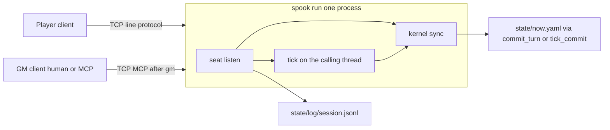

# Spookery v0.1 architecture

Status: Frozen. Normative spec for the v0.1 sitting. Gates A–E in §9 are proved. Where this file names a change, it wins over `docs/architecture_v0.md`. Every v0 rule this file does not name still holds. A rule written in neither file is out of scope. §9 does not open another gate.
License: CC BY 4.0, same as the v0 spec. Runtime code under /src stays AGPL-3.0-or-later.

This file is the frozen spec for the sitting. `docs/architecture_v0.md` remains the frozen spec for the kernel rules this file does not change. This file does not copy it. §9 records the order in which the sitting became authority.

---

## 1. What changes

Decisions already made. Do not reopen them.

One shard process. Players and the GM connect to the shard. The shard is the star. The GM is not a hop and not a server.

The table is the process you launched (`spook run <pack>`). Its stdout is the operator view. There is no third attached public-scene client. Public speech is an address, not a seat.

Loopback only. The listener binds `127.0.0.1` and no other address. Default port `9737`. The listener is created before `open_shard`. Any other bind address is `NOT_IN_SPEC` and the process exits 1 before opening the pack. If the address is `127.0.0.1` and the bind fails, the process exits 1 with the operating-system error text on stderr, opens no pack, and writes nothing. That failure is not `NOT_IN_SPEC`. A later multi-machine version is the same acceptor and a different bind. v0.1 does not specify that bind, accounts, or a connection secret.

Seats: at most one player connection and one GM connection. Caps are constants (`player_slots = 1`, `gm_slots = 1`), not `Now` fields and not pack fields. A second join returns `SESSION_FULL`, writes nothing, and the client exits 1. The shard stays up.

A player seat binds an existing `player:<id>` actor. A missing actor is `SCHEMA` and writes nothing. Opening an NPC id, or `as=gm` on the player seat, is `SCHEMA`. `spook play <pack> --as player:mira` is that NPC case: `SCHEMA`, exit 1, writes nothing.

A GM seat is not a `ViewerId`. `ViewerId` stays `Player` or `Npc`. `as=gm` stays legal only on `recall`, as v0 pin P24.

The GM seat does not increment `presence.humans`. Only a player session does. Zero players is still the idle shard, even if a GM is connected.

Disconnect, or an explicit close, frees that seat. Removing a player session updates presence and commits with `include_tick` false (v0 pin P41): one `state_rev` bump, no tick file, when presence changed. A no-op does not bump `state_rev`. The line `stop`, or EOF on stdin, drops a held player seat the same way, drops a held GM seat with no presence write, does not flush the intent queue, does not call `run_tick`, and then exits 0. A crash that skips that path leaves presence on disk. The next `spook run` clears it before accept (§3). `open_shard`, `spook tick`, and `spook run --mcp` do not clear it.

`say` is immediate speech. It never ticks, never enters `Now`, never grants `known_facts`, and is never parsed into an effect.

Addresses are `table`, `place`, and `actor`.

| Address | Who is shown the line |
|---|---|
| `table` | Every seated player, and the GM |
| `place` | Seated players whose character is in that place, and the GM |
| `actor` | The named character's connection, the speaking player, and the GM |

When `from` is `player:<id>`, that id is a recipient. The speaking player's own line is part of the history that actor sees on reconnect. Other players still receive an actor-addressed line only when they are the named recipient. The GM is shown every line and is not a recipient id. Recipient ids are §4.

Other players receive nothing for an actor-addressed line. Not a blank. Not a redaction.

The shard stores the session tape at `state/log/session.jsonl`. It is an append-only log. It is not a queue. The shard stores no per-client cursor and accepts no ack. Reconnect of `player:<id>` is a new `session_open` after the slot is free. The shard then sends the stored lines whose recipient set contains that actor, in `seq` order, as scrollback. The client replaces what it was showing. It does not append that history onto lines it already printed. The GM receives the whole tape the same way. A new actor does not inherit another actor's whispers.

`talk` is a player `say`, not an intent. Zero effects. It is refused `LIVE_ONLY` when `presence.humans` is 0. It stops returning `NOT_IN_SPEC` once a player is seated.

`attempt` stays an intent. The play line is `attempt <check> <target>`. On the tick that applies it, `resolve_check` is called with that integer. `success` is v0's `total >= target`. `Now` does not change because of the roll. The GM sees faces, stat, total, target, and success. The acting player sees success or failure only. `attack`, `give`, and `take` stay `NOT_IN_SPEC`. Do not add an inventory effect, an xp effect, a combat class, or a fact-grant effect.

Round close. With no GM seated, a player line other than `say` / `talk` commits on send with `include_tick` true. One live tick, then yield. With a GM seated, those player lines only queue. The GM's `commit_turn` closes the round once. `say` / `talk` never wait for that close. While a player connection or a GM connection is actually held, a scheduler wake does not tick. A commit that advances `world_time` restarts that sleep. A wake still inside `tick_every_real_seconds` of `last_tick_at` does not tick after the seats drop. The sitting owns the clock. `spook run` clears sessions a dead process left behind before the first wake, so a crash does not resume as a live tick.

MCP. The shard is the long-running process. A model connects to it as the GM seat. The first line is `gm`. That line is not JSON-RPC. After the shard accepts it, the socket uses the rmcp 0.8 codec that v0 stdio `--mcp` already uses: one compact JSON-RPC message, then one LF, no header. `spook gm` and a model are clients of those bytes. There is no second server grammar. The v0 shape where the agent process is the parent of an stdio server is not how a sitting with a player terminal works. Implement `tools/call` for the GM allowlist. The player connection does not receive those tools. It stays LF `kind` lines and never switches to this codec. `npc_act` stays `LLM_DISABLED`. The GM seat does not get pack-studio tools and does not get `patch_entity`. GM `tools/call` of `session_open` returns `NOT_IN_SPEC` and writes nothing. The player hello is the only `session_open`.

Speech and mechanical results are different event kinds on the wire. A spoken sentence is not a perceive object and is not an effect row.

Fact grant is out of scope. A whispered sentence does not append to `known_facts`. Nothing in v0 can do that either, and v0.1 does not add it.

### Laptop sitting

This is the session this spec is for. One machine. The pack is `packs/oneshot-docks`.

| Terminal | Command | Role |
|---|---|---|
| Table | `spook run packs/oneshot-docks` | The shard. Operator stdout. |
| GM, optional | Grok, with MCP command `spook gm packs/oneshot-docks --stdio` | The GM. Omit the terminal and the player commits on send. |
| Player | `spook play packs/oneshot-docks` | Rowan, `start.pc`. |

Docks play is `say`, `talk`, `wait`, and `attempt <check> <target>`. `attack`, `give`, and `take` stay refused. A player line `travel <place>` is `NOT_IN_SPEC` and queues nothing. `travel` remains the kernel move NPC derivation already uses. The player sees §6 JSON lines, not a written scene. Grok does not open the TCP socket. The `--stdio` process does.

### Demo goal

When all five gates are green, a person can show a partner this sitting on one laptop. Earlier gates do not meet it. Gate B can store the compliment. Grok cannot answer until Gate E.

The operator opens the table with `spook run packs/oneshot-docks`. A second terminal runs Grok, whose MCP command is `spook gm packs/oneshot-docks --stdio`. The operator tells that model, in the chat, that it is the GM, that it answers NPC speech in character with `say`, and that it calls `session_status` when no notification arrived. The kernel does not ship that persona. A third terminal runs `spook play packs/oneshot-docks`.

Rowan starts in `docks_shop`. World time `1080` is 18:00. Mira is in `mira_rooms`. Aldric is in the shop. The player types `talk mira you have nice hair`. The id is lowercase. The shard does not require her to be in the room. The line is speech. It does not tick. The player's own line is printed as JSON. Grok sees it as a `spook/event` notification or by `session_status` with `since`. Grok calls `say`. The player client prints that reply when it arrives, while still waiting for the next typed line. The reply's `from` is `gm`. The text may say that Mira is not there, or, after a later tick has moved Rowan, "thank you very much, stranger." The `from` field is not `mira`.

With Grok seated, `wait` returns `queued` and does not advance world time. The player can still `talk`. Grok's `commit_turn` runs one tick. World time advances once. The sleep restarts. A wake already due does not add a second step. Resume and perceive show the world after that tick. Rowan stays in `docks_shop`.

Stopping Grok drops the GM seat and does not tick. The next mechanical line commits on its own. A `wait` that was only queued stays queued until that line. Stopping the shard and starting it again clears the leftover session. `spook play` shows the compliment and the reply on the tape when those lines were fsynced. An uncommitted queue is gone. If the shard is not running, `spook play` and `spook gm` exit 1 and the pack is unchanged.

This goal does not include plain-English play, a line whose `from` is `mira`, `attack`, `give`, `take`, or a spoken secret becoming a `known_facts` entry.

---

## 2. What stays v0

v0 §1 through §17 still hold where this file does not name a change. Load-bearing rules that stay:

- One writer of `state/`. Clients do not write it. `tick_commit` and `commit_turn` remain the writers of `Now`. v0 §1 and §10.
- The kernel must not link `tokio`, `rmcp`, `spookery-tick`, `spookery-mcp`, or a model SDK. Dependency arrows stay the v0 §3 table. `import_boundaries` stays.
- No `Gm` variant on `ViewerId`. v0 §6.
- The closed effect enum stays the v0 §5 list. No new class.
- Inbound `llm_say` is dropped. Persisted intents store `llm_say: null`. `public_say` is not written into `Now`.
- `npc_act` does not call a model. No cargo feature named `llm`.
- No `--serve`. No accounts. No database. No HTTP route.
- `pack_rev` and the `packs/oneshot-docks` bytes stay. v0.1 does not edit them. Do not edit `checks.yaml`, `schema/checks.schema.json`, or `packs/oneshot-docks` to hold a check target.
- `replay_recorded` still replays tick files only. It does not read the session tape. v0 §7. An applied `attempt` is re-executed by calling `resolve_check` with the stored `args.check` and `args.target`.
- `kernel::open_shard` does not drop sessions. `spook tick`, `spook status`, `spook migrate`, `spook replay`, and `spook run --mcp` do not either. A pack left with `humans` 1 still ticks live under `spook tick`. `schedule::wake` is unchanged. `tests/conformance/scheduler.rs` stays.
- `session_open`'s `include_tick` false behavior is v0 pin P41. Adopted here, not redesigned. The player hello is the only caller.
- Studio and `migrate` stay host commands, not a seat. v0 §8 studio profile and §11.

Intentional conflicts with v0. Do not "fix" these back.

- v0 binds one MCP profile for the life of the process, and the play door is a different way to start a process. v0.1 starts one shard and attaches seats. `spook run <pack> --mcp <profile>` stays that v0 stdio process: one profile, the v0 §8 `tools/list` order, no `say` inserted. It is not the sitting. After the shard accepts the line `gm`, the GM seat uses that same rmcp 0.8 codec: one compact JSON-RPC message, then one LF, no header. `gm` is not a JSON-RPC message. It is not a second grammar.
- v0 `spook run <pack>` reads play lines from stdin and does not call `session_open`, so a person at the keyboard leaves `presence.humans` at 0 (pin P22, pin P45). v0.1 stdin is not a play door. Any stdin line other than `stop` prints `NOT_IN_SPEC` on stderr, does not exit, and writes nothing. `stop` and EOF drop a held player seat the way a disconnect does, drop a held GM seat with no presence write, do not flush the intent queue, do not call `run_tick`, and exit 0. The listener keeps the process up until then. EOF is a clean shutdown, not a play script. `spook run <pack> --as ...` is `NOT_IN_SPEC`, exit 1, before `open_shard`. `--as` belongs to `spook play`. A player client calls `session_open`, which sets presence. One stdin is not two actor ids. v0 player stdout is raw `idle_digest(Player)` bytes plus one perceive line. v0.1 player stdout is the §6 events. Gate A rewrote `tests/conformance/cli_run.rs` because it asserted the stdin door this sitting removes.
- v0 says do not add tools and do not reorder `tools/list`. v0.1 adds `say` to the GM seat only. The stdio `pack-table` list does not gain it. `session_open` stays on the GM list, in that order, and a GM `tools/call` of it returns `NOT_IN_SPEC`.
- v0 `expand` returns `NOT_IN_SPEC` for `talk` even during a session. v0.1 `talk` is speech, not an expand arm that mutates `Now`. `attempt` is the one live-only name that gains a kernel behavior (the existing check) and still mutates nothing. The v0 line `attempt <check>` gains a `<target>` integer. Do not pass `0`. Do not put that integer in `checks.yaml`.
- v0 `tools/call` falls through to the library's method-not-found. The stdio server still has no `tools/call` body. v0.1 GM `tools/call` on the shard reaches the handlers. A tool the seat does not have still returns the pinned refusal (`NOT_IN_SPEC` or `LLM_DISABLED`), not a transport error invented by the library.
- v0 `commit_turn` takes `session_id`. The GM-seat handler accepts `commit_turn` with `include_tick` true and `session_id` omitted. It does not invent a session id.
- v0 scheduler wake always calls `run_tick`. A tick with zero applied intents still commits and advances `world_time`. v0 `schedule::wake` also runs one tick whenever less than one real hour has passed since `last_tick_at`. v0.1 overrides both while a player connection or a GM connection is actually held: that wake does not call `run_tick`, does not drain the intent queue, and does not advance `world_time`. The sitting owns the clock. A `commit_turn` or outermost `run_tick` that advances `world_time` also restarts the `spook run` sleep from that moment. A wake whose elapsed real seconds since `last_tick_at` are still below `tick_every_real_seconds` runs no tick, even when no seat is held. That is the wrapper in `spook run`. It does not change `schedule::wake`. When the wrapper ticks, it runs that same decision on the shard thread's `Shard`. `run_tick` borrows that value and reads its queue. The wake does not open a second shard. An outermost tick then clears that queue. `humans == 0` is idle catch-up and `humans > 0` is one live tick, because that is what v0 `plan_catchup` already does. Do not switch the timer to `live_tick_every_real_seconds`. An empty GM `commit_turn` still does not enter `run_tick` and does not restart the sleep.
- v0 leaves a crashed session in `presence`, and the next wake treats `humans > 0` as people present. `spook run` does not. After `open_shard` and before accept, it clears `session_ids`, `actors_present`, and `humans` when any of them is set, with one `include_tick` false commit and no tick file. Already empty writes nothing. The next hello then sets `humans` to 1, not 2. `open_shard` itself does not clear.

A v0 rule this file does not conflict with stays. `filter_blocklist` still rejects the five live-only move names with `LIVE_ONLY` when `humans` is 0 (pin P39). `talk` as speech never reaches that function, because it is not an intent. Pause policy and NPC derivation still run inside a tick that does run.

---

## 3. The one process

`spook` and `spookery` stay one binary. Argv stays `std::env::args` (pin P14).

| Command | Calls | Writes |
|---|---|---|
| `spook run <pack>` | Bind `127.0.0.1:9737`, then `open_shard`, then the startup session clear, then the accept loop and the in-process scheduler | `state/` through `commit_turn`, `tick_commit`, the startup clear, or a tape append. Stdin is not a play door |
| `spook run <pack> --bind <addr>` | Same listener. `<addr>` must be the string `127.0.0.1` | Same. Any other `<addr>` is `NOT_IN_SPEC` on stderr, exit 1, and `open_shard` is not called. The listener is not left open |
| `spook run <pack> --as ...` | Nothing | `NOT_IN_SPEC` on stderr, exit 1, before `open_shard`. `--as` belongs to `spook play` |
| `spook run <pack> --mcp <profile>` | v0 stdio MCP. Does not bind `9737` | Whatever that v0 profile already writes |
| `spook play <pack>` | Connects to `127.0.0.1:9737` as the player seat | Nothing under the pack. Optional `--as player:<id>`. Omitted `--as` reads `pack.yaml` `start.pc` (pin P22) and does not call `open_shard` |
| `spook play <pack> --as player:mira` | Does not take a seat | `SCHEMA` on stderr, exit 1, writes nothing. This replaces `cli_run_as_rejects_a_non_pc` |
| `spook gm <pack>` | Connects to `127.0.0.1:9737` as the GM seat | Nothing under the pack. Maps operator lines to `tools/call` |
| `spook gm <pack> --stdio` | Connects to `127.0.0.1:9737`, sends `gm`, then copies bytes | Nothing under the pack. The process a model host spawns. Not a typed-line client |
| `lint`, `tick`, `replay`, `conformance`, `status`, `migrate` | v0 §11 | Unchanged. Not seats |

`--mcp` together with `--bind` is `NOT_IN_SPEC` before `open_shard`. There is no port flag. There is no `--serve`.

Bind `127.0.0.1:9737` before `open_shard`. If that bind fails because the address is in use or the process lacks permission, exit 1. Stderr is the operating-system error text. No new failure code. The pack is not opened. Nothing under the pack is written. `NOT_IN_SPEC` is the wrong code for that case.

Stdin of `spook run` is not a play door. The listener is what keeps the process up.

| Stdin | Result |
|---|---|
| The line `stop`, or EOF | Drop a held player seat the way a disconnect does: remove that session from presence and commit `include_tick` false when presence changed. Drop a held GM seat with no presence write. Do not flush the intent queue. Do not call `run_tick`. Then exit 0. With neither seat held, that exit writes nothing |
| Any other line | Print `NOT_IN_SPEC` on stderr. Do not exit. Write nothing |

A crash that is not `stop` or stdin EOF skips that drop. Presence stays on disk. The next `spook run` fixes it, and nothing else does.

Startup order for `spook run` without `--mcp`. Bind first. Then `open_shard`. Then, on the shard thread, if `presence.session_ids` is non-empty, or `presence.actors_present` is non-empty, or `presence.humans` is not 0, set all three to empty and 0 and commit `include_tick` false. One `state_rev` bump, no tick file, no `run_tick`. If all three are already empty, write nothing. Then accept, and only then arm the scheduler. A kill during that commit is the v0 §10 recovery table. The next start runs the clear again. `spook tick`, `spook status`, `spook migrate`, `spook replay`, `spook run --mcp`, and `kernel::open_shard` skip this clear. A fixture that stored `humans: 1` still has it when those commands open the pack.

One thread owns `Now`. Call it the shard thread. `commit_turn`, `tick_commit`, `run_tick`, the startup clear, and the disconnect presence commit run there. The accept loop and the Tokio timer may wait off that thread. They post the hello, the player line, the GM tool call, the wake, and the socket error onto the shard thread. They do not read or write `Now`. A scheduler wake that runs calls `run_tick` on the `Shard` that thread already holds. It does not load a second one from disk. The shard thread does not start a `say` in the middle of a commit. A `say` copies `tick_index` and `world_time` on that thread after the previous commit has returned, then takes `state/.session.lock` and appends. It still does not take `state/.tick.lock` and does not call `run_tick`.

A failed hello writes nothing, sends the refused line, and closes. A valid player hello commits `session_open` on the shard thread, then marks that socket held, then sends scrollback, `resume`, and `perceive`. A socket error after that commit posts to the shard thread and runs the same drop as `close`. A kill between the commit and that drop leaves the session on disk. The next `spook run` clears it, so the following hello sets `humans` to 1.

EOF, a read error, or a write error on an accepted socket is that same drop. Silence is not. A player who does not type stays seated. Every accepted socket sets `SO_KEEPALIVE`, with `TCP_KEEPIDLE` equal to the pack's `tick_every_real_seconds`, `TCP_KEEPINTVL` 1, and `TCP_KEEPCNT` 3. A keepalive failure is a read error. On the docks the idle before probes is 300 seconds. A conformance test does not sleep for that. It calls the drop with a simulated error.

The first line of a connection declares the role. One LF-terminated line. Bytes after an accepted line depend on the role. Before any MCP codec, and before the play loop, a refused or unknown hello is one compact JSON line and one LF: `{"kind":"refused","code":"<CODE>"}`. The shard then closes that connection. The client exits 1. No new code.

| First line | Result |
|---|---|
| `player:<id>` | Player seat bound to that actor. The actor must already exist and `kind` must be `pc`. The shard then runs v0 §8 `session_open` with a shard-chosen `session_id` and `include_tick` false. Bytes after this line are the player line protocol in §4 and §6. Not MCP. This socket never switches to the JSON-RPC codec |
| `gm` | GM seat. One seat. `spook gm` and a model both send this line. The line is not JSON-RPC. After it is accepted, the socket uses the rmcp 0.8 codec: one compact JSON-RPC message, then one LF, no header. The same bytes v0 stdio `--mcp` already uses. There is no second server grammar. Does not call `session_open`. Does not write presence |
| `npc:<id>`, or `as=gm`, or `player:<id>` whose id is an NPC or is not an actor | `SCHEMA`. The refused line above. No seat taken. No write |
| Empty, or any other first line | `SCHEMA`. The same refused line. No seat taken. No write |

A second `player:<id>` while a player seat is held is `SESSION_FULL`, even if the id differs. A second `gm` while the GM seat is held is `SESSION_FULL`. Both use that refused line, before the MCP codec and before the play loop. The seated client is unchanged. The shard stays up.

EOF on a connection, a read error, a write error, a keepalive failure, or a player line whose only token is `close`, frees that seat. Freeing a player seat that is in presence drops that session id and that actor from presence, sets `humans` to the remaining session count, and commits `include_tick` false. Freeing a GM seat writes no presence. Freeing a connection that never took a seat writes nothing. A player who sends no line, on a socket that still answers keepalive, stays seated.

`spook gm` is not a second server. It sends `gm`, then speaks the rmcp 0.8 codec. A typed line is mapped to `tools/call` as follows. The remainder rules are pin P33, plus the `attempt` target token from §5.

| Typed line | Call |
|---|---|
| `say <text...>` | `say` `{ address: table, text }` |
| `say place <place> <text...>` | `say` `{ address: place, place, text }` |
| `say actor <id> <text...>` | `say` `{ address: actor, actor, text }` |
| `perceive <as>` | `perceive` `{ as }` |
| `recall <as>` | `recall` `{ as }` |
| `recall <as> <query...>` | `recall` `{ as, query }` |
| `intent <play-line>` | `intent`. The remainder is one v0 play line. `source` is `player`, as v0 §8 already requires. A leading `npc:<id>` or `player:<id>` selects the actor |
| `commit` | `commit_turn` `{ include_tick: true }`. `session_id` is omitted. The handler accepts that omission. It does not invent a session id |
| `npc_act` | `npc_act`. Result stays `LLM_DISABLED` |
| `save <name>` | `session_save` `{ name }` |
| `apply <json>` | `apply_effect`. The remainder is the v0 effect envelope as one JSON object |
| `check <as> <intent_id> <check_id> <target>` | `resolve_check` |
| `close` | Drop the connection and free the GM seat. No presence write |

A model does not open the TCP socket and does not send `gm`. `spook gm <pack> --stdio` does. The model host spawns that command and speaks MCP on its stdin and stdout. The bridge connects to `127.0.0.1:9737`, writes the line `gm`, and then copies bytes in both directions. It does not call `open_shard`, does not write `state/`, and does not interpret a tool call. A refused hello is written to the bridge's stderr, not its stdout, and the bridge exits 1. EOF on the host stdin closes the socket. EOF or an error on the socket makes the bridge exit 1. Human `spook gm` without `--stdio` stays the typed-line client. Both take the one GM seat.

If `spook play`, `spook gm`, or `spook gm --stdio` cannot connect, the process exits 1. Stderr is the operating-system error text. Stdout is empty. Nothing under the pack is written.

Reconnect after the slot is free is a new hello and, for a player, a new `session_open`. The shard mints a new `session_id`. v0.1 does not pin that id's spelling.



The shard writes `state/now.yaml` only through `commit_turn` or `tick_commit`. The seat layer appends `state/log/session.jsonl` for `say`. The kernel tick, `expand`, `apply_effect`, `perceive`, and `idle_digest` do not write that file. `kernel::store` is still the only module that creates files under `state/`. The seat calls `store` to append one tape line. The append does not open a `Txn`.

New seat and listen code lives in the root bin, under `src/cli`. That bin may use Tokio to accept and to sleep, the same way `src/cli/schedule.rs` may sleep on a Tokio timer. Posted work runs on the shard thread. The tick function and the kernel stay on that thread. No `tokio::spawn` of a tick. No `tokio::spawn` of `commit_turn`. No second thread reads `Now`.

`spook run` starts the in-process scheduler. It is not a connection. The timer stays `tick_every_real_seconds`. On the docks that value is 300. Do not switch it to `live_tick_every_real_seconds`. The sleep is restarted from any `commit_turn` or outermost `run_tick` that advances `world_time`. An empty commit does not restart it. The in-flight sleep is cancelled. The next wake is one full interval after that stamp.

| Wake, on the shard thread | Result |
|---|---|
| A player connection is held, or a GM connection is held | Do not call `run_tick`. Do not drain the intent queue. Do not advance `world_time`. The sitting owns the clock |
| No connection is held, and elapsed real seconds since `last_tick_at` are below `tick_every_real_seconds` | Do not call `run_tick`. Do not advance `world_time`. A round that just closed does not tick again because the old sleep expired |
| Otherwise | The shard thread runs the v0 scheduler decision on the `Shard` it holds. `humans == 0` is idle catch-up. `humans > 0` is one live tick (`plan_catchup`). That tick reads the in-memory queue and clears it. `schedule::wake` with a path is that same decision for a caller that has no live shard. `spook run` has already cleared a crashed session, so a leftover `humans` is not how a restart resumes |

A wake does not hold `state/.tick.lock` across the timer sleep or across a socket read.

`flock(2)` on `state/.tick.lock` still covers `commit_turn` and `run_tick` (pin P9). A `say` does not take that lock. A `say` does not call `run_tick`. The tape append takes a different flock, `state/.session.lock`, for the truncate, the append, and the fsync only. `commit_turn` and `run_tick` do not take `.session.lock`. The locks do not nest. The shard thread finishes a commit before it copies clocks for a `say`. `say` does not wait on `.tick.lock`. `.session.lock` is outside `pack_rev`, same as `.tick.lock`. Do not hold either lock across a socket read.

GM allowlist, `tools/list` order. `say` is inserted after `intent`:

`session_open`, `session_status`, `perceive`, `intent`, `say`, `resolve_check`, `apply_effect`, `npc_act`, `commit_turn`, `recall`, `session_save`.

`pack-tick` and `pack-studio` do not gain `say`. Those lists stay v0 §8. The player connection has no `tools/list`. A `tools/list` or `tools/call` on the player connection is `NOT_IN_SPEC` and runs no handler.

GM `tools/call` of `session_open` returns `NOT_IN_SPEC` and writes nothing. The name stays on the list so the order does not change except for `say` after `intent`. The player hello is the only `session_open`.

| Caller | May | May not |
|---|---|---|
| Player client | v0 §11 play-line grammar, plus §4 speech, plus `attempt <check> <target>` | `apply_effect`. `recall` with `as=gm`. `commit_turn` while a GM is seated. `patch_entity`. Any studio tool. MCP |
| GM seat | The allowlist above, except a call of `session_open`. `perceive` only as `player:<id>` or `npc:<id>`. `recall` may use `as=gm` (pin P24). `commit_turn` is the round close. `resolve_check` still takes `target` as v0 specifies | `session_open` (`NOT_IN_SPEC`, no write). `perceive` as `gm` (`UNSCOPED_PERCEIVE`). Studio tools. `patch_entity` (`NOT_IN_SPEC`). A model call from `npc_act` |
| Table stdout | v0 `idle_digest(Host)` on each commit, plus each tape line in full, including actor-addressed lines | It is not a player view. Do not send `idle_digest(Host)` to a player connection |
| Scheduler | The v0 scheduler decision on the shard thread's `Shard`, only when no connection is held and elapsed real seconds since `last_tick_at` are at least `tick_every_real_seconds`. `humans == 0` is idle catch-up. `humans > 0` is one live tick. The tick reads and clears the in-memory queue | A tick while a connection is held. A tick before that interval has elapsed. A second shard opened for that wake. A connection |

---

## 4. Speech and the session tape

`from` is the seat. It is `gm` or `player:<id>`. The caller does not supply it. A caller-supplied `from` is `SCHEMA` and appends nothing. The shard will not store a spoofed actor as `from`.

`address` is `table`, `place`, or `actor`. `place` is required when `address` is `place`, and otherwise JSON null. `actor` is required when `address` is `actor`, and otherwise JSON null. A non-null `place` on another address, or a non-null `actor` on another address, is `SCHEMA`. `text` is one line, no U+000A, at most 2000 Unicode scalars. Over the cap, an empty text, a missing id, an unknown address, or an unknown key is `SCHEMA` and appends nothing.

Player lines use v0 pin P33 tokenization. Tokens split on a single space. Text is the remainder of the line. The seat's actor is the speaker. A leading `player:<id>` that is not the seated actor is `SCHEMA` and appends nothing and commits nothing. The player connection is this line protocol. It is not MCP.

| Line | Address |
|---|---|
| `say <text...>` | `table` |
| `talk <actor> <text...>` | `actor`. The actor must exist, or `SCHEMA` and append nothing |
| `talk place <text...>` | `place`. The place is the speaker's current `actors.<id>.place`. The player does not type it |

The first token `place` selects the place form. `say` or `talk` with no text is `SCHEMA` and appends nothing.

`talk` with `presence.humans == 0` is `LIVE_ONLY` and appends nothing. It does not return `NOT_IN_SPEC` once a player is seated. A seated player has already run `session_open`, so that refusal is a GM-less shard before `session_open`, or a direct handler call. Player `say` is speech and is not an intent. It is not the `LIVE_ONLY` check. A GM `say` with `humans == 0` still appends.

The GM server has no say-line grammar. `say` is the tool in §3. `spook gm` maps typed lines to that tool. The handler is the same one a model's `tools/call` reaches.

Tool input is `{ address, place?, actor?, text }`. `from` is not a field. A supplied `from` is `SCHEMA`.

| Tool `address` | Stored address |
|---|---|
| `table` | `table`. `place` and `actor` are null |
| `place` | `place`. `place` is the id |
| `actor` | `actor`. `actor` is the id |

Delivery is computed at append time and stored. Later reads do not recompute it.

| Address | `recipients` before the speaker rule |
|---|---|
| `table` | Every player actor id in `presence.actors_present` |
| `place` | Those seated player actors whose current place equals the named place. For `talk place`, the named place is the speaker's place |
| `actor` | That one id, and only if that id currently has a player session. If it does not, this set is empty and the line is still stored |

When `from` is `player:<id>`, add that id. Then sort unique. The speaking player is included so the line is in the history that actor is sent on reconnect. Do not omit the speaker. An actor-addressed line still adds no other player who is not the named id. When `from` is `gm`, do not add a speaker id. The GM is not a recipient id. The GM connection is shown every line, including a line a player sent. The operator stdout prints every stored object. A player connection is sent a line only when `recipients` contains that player.

Tape append, under `state/.session.lock`. Before appending, truncate a trailing partial line. `seq` is then one past the last complete object, or 1 when no complete object remains. Then append one compact JSON object and one trailing LF, through `store`, and fsync `state/log/session.jsonl`. A crash after that fsync keeps the line. A crash before it loses that one line. On read, a trailing incomplete line is not a record. Earlier complete lines stay. The append does not rewrite `now.yaml`, does not bump `state_rev`, does not write a tick file, and does not open a `Txn`. `replay_recorded` ignores the file. `pack_rev` does not cover it. `idle_digest` does not read it.

Key order: `seq`, `from`, `address`, `place`, `actor`, `recipients`, `text`, `tick_index`, `world_time`.

`seq` is a `u64`. It is not `state_rev` and not `tick_index`. `place` and `actor` are JSON null when they do not apply. `recipients` is a sorted array of actor ids. `tick_index` and `world_time` are copied from `Now` and not advanced.

Shape example, not a golden. The speaker is the only seated player:

```json
{"seq":1,"from":"player:pc_rowan","address":"actor","place":null,"actor":"mira","recipients":["pc_rowan"],"text":"psst","tick_index":0,"world_time":0}
```

`mira` has no player session, so the address rule adds no one. The speaker rule adds `pc_rowan`. A later different actor is not in `recipients`.

Scrollback. On `session_open`, a player connection is sent every stored object whose `recipients` contain that player, in `seq` order, before `resume` and `perceive`. The client replaces its scrollback with that sequence. A later append sends only the new object. The shard does not record which `seq` the client has seen, and the client does not ack. The GM connection is sent every object on connect, and the GM client replaces its scrollback the same way. Table stdout prints every object as it is appended. A later `session_open` of a different actor, after the first seat is freed, does not receive lines whose `recipients` omit that actor. The speaking player does receive their own lines on reconnect.

---

## 5. Round close and live moves

Presence and the clock stay v0 §7 and §8, with these seat rules.

- The player hello's `session_open` sets presence the way v0 §8 specifies, then commits `include_tick` false. One `state_rev` bump, no tick file.
- GM connect does not write presence.
- `humans == 0` keeps idle pace and `pause_when_empty`. `humans >= 1` is the live pace, including one seated player and no GM. A connected GM does not by itself make the shard live.
- The scheduler does not advance that clock while a player connection or a GM connection is actually held. §3. A commit that advances `world_time` restarts the sleep. A later wake inside `tick_every_real_seconds` of `last_tick_at` does not tick. `spook run` clears a crashed session before the first wake, so a leftover `humans > 0` does not reach that wake. `schedule::wake` itself still live-ticks when `humans > 0`. `spook tick` relies on that.

| GM seated | Player line other than `say` / `talk` | `say` / `talk` |
|---|---|---|
| No | Queue, then `commit_turn` with `include_tick` true. One tick, then yield. Not a catch-up burst | Append a tape line. Do not queue. Do not commit |
| Yes | Queue only, the v0 `intent` tool. The player cannot `commit_turn`. The shard sends `queued` and the player client reads the next line | Same. Do not wait for the GM |

The GM's `commit_turn` with `include_tick` true closes the round once (pin P20): one `state_rev` step and one tick file when the tick runs. `session_id` may be omitted. Do not invent one. That tick stamps `last_tick_at` and restarts the `spook run` sleep from that moment. It does not arm a second tick. A GM commit with no queued intents follows the v0 no-op: if nothing was accepted and presence is unchanged, `state_rev` stays, `run_tick` is not entered, `world_time` stays, and the sleep is not restarted. Narration alone does not move `world_time`. Do not turn that commit into the v0 empty tick that advances `world_time`.

A wake that then arrives, including one whose sleep started before the commit, runs no tick while a connection is held. It also runs no tick when no connection is held if the elapsed real seconds since `last_tick_at` are still below `tick_every_real_seconds`. `schedule::wake` is not modified. A direct call of it, as `tests/conformance/scheduler.rs` does, still opens a shard from disk and ticks. The skip is the wrapper in `spook run`. When that wrapper ticks, it passes the shard thread's `Shard` into the same decision. That tick is the only owner of `Now`.

Zero players and a GM: the GM may queue NPC intents and commit. That tick is an idle tick because `humans` is 0. `pick_advance` uses `idle_minutes_per_tick`. The scheduler does not run that tick while the GM connection is held. `say` still does not tick.

Dropping the GM seat does not flush the intent queue and does not call `run_tick`. Queued intents stay queued. The next player mechanical line while no GM is seated commits on send, and that tick consumes the queue, including the new line. A wake that runs, with no seat held and the interval elapsed, also consumes that queue, because it ticks the same `Shard`. An outermost tick clears the queue after it reads it. A skipped wake does not. The in-memory intent queue still dies on crash (v0 §5). The tape file does not. There is no outbound queue and no stored cursor. `stop` and stdin EOF do not flush that intent queue and do not call `run_tick`. They do drop a held player seat and commit `include_tick` false when presence changed. A crash that skips them leaves presence on disk. The next `spook run` clears it before accept and before the first wake, then idles. `spook tick` on that same file, without a `spook run` in between, still sees the leftover `humans` and ticks live.

`attempt`. The line is `attempt <check> <target>`. `<target>` is the v0 integer token: an optional `-`, then digits. A missing target is `SCHEMA` and queues nothing. The intent stores move `attempt`, args `check`, and args `target`. It does not roll when the line is typed. `expand` of `attempt` returns zero effects and does not return `NOT_IN_SPEC`. The check id is `args.check`, not the optional `moves.yaml` check name. The docks `moves.yaml` entry stays without a check. Do not edit that file, `checks.yaml`, `schema/checks.schema.json`, or `packs/oneshot-docks`.

On the tick that applies it, call `resolve_check` (v0 §6) with the acting player as the viewer, `args.check` as the check id, and `args.target` as the integer. Do not pass `0`. `success` stays `total >= target`. Seed and the per-tick die cursor stay the v0 rule. An unknown check is `UNKNOWN_KEY`, the die cursor does not advance, and the intent is rejected the way a failed `resolve_check` is already rejected. A known check is stored on the tick JSONL like any other applied intent, so replay can call `resolve_check` again with the same `args.check` and `args.target`. Replay does not read a stored face and does not pass `0`. The tick object keeps the v0 §7 keys. `intents[].args` may contain `check` and `target`. The tick object does not gain `faces`, `stat`, `total`, `target`, or `success`. The integer input lives under `args` only. Do not write the roll into `Now`.

The roll writes no `Now` path. Pause policy and NPC derivation still run as v0 on a tick that runs. v0.1 does not claim those paths stay unchanged, and it does not claim a docks tick changes only commit headers.

The GM `resolve_check` tool still takes `target` as v0 specifies. A queued `attempt` uses `args.target`. It does not read the tool's argument.

After that tick, the acting player is sent a check event whose only result field is `success` (JSON boolean; `false` is the failure). The GM is sent the v0 `resolve_check` output with `kind` prepended, as a `spook/event` notification (§6). An `UNKNOWN_KEY` check sends `refused` with that code and does not send a check event.

`attempt` stays `LIVE_ONLY` when `humans == 0`, same as the other four live-only names. `attack`, `give`, and `take` still expand to `NOT_IN_SPEC` and do not move inventory. They are still intents. They are not speech. A player whose expand returns `NOT_IN_SPEC` is sent `refused` with that code. The tick `rejected` row stays the v0 row.

`talk` is not an expand arm and is not stored as an intent. The tape line is the record. A queued intent whose move is `talk` is a listed name with no arm, so `expand` returns `NOT_IN_SPEC` (v0 §6). That path is not speech. The sixteen names stay in `moves.yaml`.

---

## 6. Records

Two sockets. Do not give them one framing.

The player connection is the line protocol. One compact JSON object per line, one LF. No pretty-printing. `kind` is the first key. It is not MCP. The player receives only these. The player does not receive `faces`, `stat`, `total`, `target`, `recipients`, `seq`, or a `say` whose `recipients` omit that player. The speaking player's own line is not omitted. `recipients` contains that id.

| `kind` | Keys after `kind` |
|---|---|
| `say` | `from`, `address`, `text` |
| `queued` | `id` |
| `check` | `success` |
| `perceive` | The v0 §9 perceive fields, in that order |
| `resume` | `text`. `text` is the v0 `idle_digest(Player)` string |
| `refused` | `code` |

After the hello's `session_open`, the seated player is sent scrollback, then `resume`, then `perceive`. After each later `commit_turn` that runs a tick while that player is seated, the player is sent `resume`, then `perceive`, and not the older tape lines again. A mechanical line that only queues sends `queued` and does not send `resume` or `perceive`. The player client prints that line and reads the next stdin line. It does not wait for the GM before accepting `say`. `say` and `talk` are `say` events, not `queued`. `say` does not enter resume.

The GM connection, after the accepted line `gm`, is the rmcp 0.8 codec: one compact JSON-RPC message, then one LF, no header. `gm` is not parsed as JSON-RPC. There is no HTTP route on `9737`. The player socket never uses this codec.

A `tools/call` result is the handler object below. Do not give it an extra `kind` except where this table already prepends `kind`. The `tools/call` response is not also sent as a notification.

A server event that is not a tool result is an MCP notification. The method is `spook/event`. The params are the object below. A player `say`, a `queued` intent, and a check push are that notification. `spook gm` prints result objects and notification params as JSON lines. A model host may drop notifications. The sitting `session_status` is the pull that still works.

Sitting `session_status` accepts `{}` or `{ since: <u64> }`. Any other key is `SCHEMA` and reads nothing. The output is the v0 object, then `queued`, then `last_seq`. `queued` is the in-memory intents in queue order, each `{ id, actor_id, move }`. `last_seq` is the last complete tape `seq`, or `0` when there is none. When `since` is present, the output also ends with `events`: stored tape objects whose `seq` is greater than `since`, in order, in the GM `say` shape. Stdio `--mcp` `session_status` stays the v0 input `{}` and the v0 output. It does not gain these fields.

Each sitting GM tool description tells the model these facts, in its own words: a player mechanical line queues until `commit_turn`; `say` does not tick; `perceive` requires `as` of `player:<id>` or `npc:<id>`; this seat does not call `session_open` or `patch_entity`; `session_status` with `since` returns player speech and the queue when a notification did not arrive. The description text is not pinned. Those facts are.

| `kind` or result | Keys | When `kind` is present |
|---|---|---|
| `say` | `seq`, `from`, `address`, `place`, `actor`, `recipients`, `text` | Yes. First key |
| `queued` | `id`, `actor_id`, `move` | Yes. First key. One notification per queued intent |
| `check` | `faces`, `stat`, `total`, `target`, `success` | Yes. The v0 `resolve_check` output, `kind` prepended |
| `perceive` | The v0 §9 fields, in that order | Yes. First key |
| `resume` | `text` | Yes |
| `refused` | `code` | Yes |
| `commit_turn` | v0 keys `state_rev`, `diff_summary`, `log_path` | No |
| `npc_act` | `{ code: "LLM_DISABLED" }` | No |
| missing tool, including `patch_entity` and GM `session_open` | `{ code: "NOT_IN_SPEC" }` | No. Not a library method-not-found |

`SESSION_FULL` is new. Use it only for the second player seat or the second GM seat. It is not a tick JSONL reason. The other codes stay the v0 §6 spellings: `SCHEMA`, `LIVE_ONLY`, `NOT_IN_SPEC`, `LLM_DISABLED`, `UNSCOPED_PERCEIVE`. `UNKNOWN_KEY` stays the unknown-check code. Do not add a code for a torn tape line. Do not add a code for a failed bind of `127.0.0.1:9737`.

A hello refusal is not an MCP error and not a later play-line event. Before the codec and before the play loop, the shard writes `{"kind":"refused","code":"<CODE>"}` and one LF, then closes. `SESSION_FULL` uses that line. `SCHEMA` on an empty line, an unknown line, `npc:<id>`, `as=gm`, a missing actor, or an NPC id uses that line. The client exits 1.

A later play-line `refused` is an event on the player connection. The client prints `code` on stderr and reads the next line. A shard startup failure still prints the code on stderr and exits 1, as v0 §11, when the code is one of those tokens. A bad `--bind` address is `NOT_IN_SPEC`. A failed bind of the legal address is the operating-system error text, not a new token.

---

## 7. Refusals

Will not appear in this architecture:

- No fact grant. No effect that appends `known_facts`. Prose is not parsed into facts. A whisper does not teach a character anything.
- No public-scene seat. No spectator protocol. Public speech is the `table` address.
- No `Gm` variant on `ViewerId`. GM `perceive` as `gm` is `UNSCOPED_PERCEIVE`.
- No second writer. Clients do not write `state/` or the tape.
- No studio tools on the GM seat. No `patch_entity` from a sitting. `simulate_knowledge` stays off this seat and still must not write `known_facts`.
- No model SDK in the kernel or the tick. `npc_act` stays `LLM_DISABLED`. No cargo feature named `llm`. No `tokio::spawn` of a tick.
- `attack`, `give`, and `take` stay `NOT_IN_SPEC`. No inventory effect, no xp, no combat class.
- No `--serve` on a non-loopback address, no accounts, no connection secret, no website, no database. Binding a non-loopback address is `NOT_IN_SPEC`.
- No second GM server grammar. Typed GM lines are a client of MCP `tools/call`.
- `say` does not tick, does not bump `state_rev`, and does not enter `Now`, rumors, messages, or resume.
- The operator digest is not a player view. Do not send `idle_digest(Host)` to a player connection.
- Stdin of `spook run` is not a play door. `stop` and EOF do not call `run_tick` and do not flush the intent queue. They do drop a held player seat.
- No per-client cursor, no ack, and no outbound queue. The tape is the scrollback log.
- Silence is not a disconnect. A live socket that sends nothing stays seated.
- `kernel::open_shard` does not clear `presence`. Only `spook run` without `--mcp` does, and only at startup.
- `spook gm --stdio` is not a writer and not a second grammar. It copies bytes. Grok does not open the TCP socket.

---

## 8. Proofs

Gates A–E are proved. `tests/conformance/cli_run.rs` was rewritten in Gate A. `spook play <pack> --as player:mira` is `SCHEMA`, exit 1, and writes nothing.

These stayed unrewritten: `tests/conformance/tick_07_replay.rs`, `tests/conformance/docks_bytes.rs`, `tests/conformance/emitter_sample.rs`, `tests/conformance/import_boundaries.rs`, `tests/conformance/scheduler.rs`, `tick_01` through `tick_10`, `tick_jsonl`, and `tests/conformance/product_01_load_mcp.rs`. They do not read `session.jsonl` and do not require a listening socket. `replay_recorded` still does not read the tape. `product_01_load_mcp` keeps the v0 stdio `tools/list` order. `scheduler.rs` calls `schedule::wake` on a fixture and does not start `spook run`.

New scenarios. Each line is the assertion. These do not edit `packs/oneshot-docks`. With `player_slots = 1` there are never two player sockets.

1. Second player connect: one line `{"kind":"refused","code":"SESSION_FULL"}`, then the shard closes that connection. `now.yaml` byte-identical, `humans` unchanged. The client exits 1.
2. Second GM connect: the same `SESSION_FULL` line, before any JSON-RPC message. No presence write. The client exits 1.
3. Player `session_open` on an existing PC: `presence.humans` is 1, one `state_rev` bump, no tick file.
4. GM connect: `presence.humans` unchanged.
5. Player disconnect: `humans` returns to 0, one `state_rev` bump, no tick file.
6. `say` while a GM is seated: `session.jsonl` gains one object, `state_rev` unchanged, no tick file, `world_time` unchanged. When `from` is `player:<id>`, that id is in `recipients`.
7. An actor-addressed `say` is present on the GM cursor and the addressed player's cursor, and absent from a later different player's cursor. The other player is proved by reading the tape back as a different actor id after the first seat is freed, not by opening two player sockets. The speaking player is not that later actor.
8. `talk` with a seated player appends a tape line and does not return `NOT_IN_SPEC`. `talk` with `humans == 0` returns `LIVE_ONLY` and appends nothing. That second case is a GM-less shard before `session_open`, or a direct handler call. A connected player has already opened a session.
9. `attempt` on round close: the roll writes no `Now` path. The tick JSONL object gains no `faces`, `stat`, `total`, `target`, or `success` field. `args` may contain `check` and `target`. Pause policy and NPC derivation still run as v0. The player event's `success` is a boolean. The GM event has `faces`. This proof does not claim a docks tick changes only commit headers.
10. No GM seated: a player `wait` commits one live tick. `humans` is 1, so live minutes, not the idle hour. That commit restarts the scheduler sleep. A scheduler wake during that seat does not call `run_tick`.
11. GM seated: a player `wait` only queues. `world_time` moves on the GM `commit_turn` and not on the player line. That commit restarts the scheduler sleep. A scheduler wake while that GM connection is held does not drain the queue and does not advance `world_time`.
12. GM `tools/call` for `perceive` reaches the handler. `npc_act` returns `LLM_DISABLED`. `patch_entity` from the GM seat returns `NOT_IN_SPEC`. GM `session_open` returns `NOT_IN_SPEC` and writes nothing.
13. A bind address other than `127.0.0.1` exits 1 with `NOT_IN_SPEC` and does not open the pack. A bind of `127.0.0.1:9737` that fails exits 1 with the operating-system error text on stderr, opens no pack, and writes nothing. It does not print `NOT_IN_SPEC`.
14. Stdin `wait` on `spook run` prints `NOT_IN_SPEC`, does not exit, and writes nothing. With a player connection held, `stop` and stdin EOF drop that seat, commit `include_tick` false, do not call `run_tick`, and exit 0. With a GM connection held, they free it and write no presence. With neither connection held, they exit 0 and write nothing.
15. An empty first line, or a first line `foo`, is `{"kind":"refused","code":"SCHEMA"}` and one LF. No seat is taken. The client exits 1.
16. A pack whose `now.yaml` has `humans` 1 and a session id, as a crash would leave it: `spook run` commits `include_tick` false before accept, `humans` is 0, `session_ids` is empty, and there is no tick file. The following wake is idle catch-up. The next player hello sets `humans` to 1, not 2. `spook tick` on a copy of that same file, with no `spook run`, leaves `humans` 1 and ticks live.
17. A simulated read error on a held player socket drops the seat the way `close` does: `humans` returns to 0, one `state_rev` bump, no tick file. A held socket that has sent no player line, and has not errored, is still seated. The test does not sleep for `tick_every_real_seconds`.
18. A `commit_turn` that advances `world_time` restarts the sleep. The seats then drop. A wake that was already due, fired before `tick_every_real_seconds` have elapsed since `last_tick_at`, does not call `run_tick`. `world_time` stays at the value the commit wrote. `schedule::wake` is not the function under test. The wrapper is.
19. `spook play` when nothing is listening exits 1. Stderr is the operating-system error. Stdout is empty. The pack is unchanged. The same holds for `spook gm` and for `spook gm --stdio`.
20. With a GM seated, a player `wait` sends `{"kind":"queued","id":...}` and does not send `resume`. The player client can send `say` before `commit_turn`. Dropping the GM seat does not commit that `wait` and does not advance `world_time`. The next player `wait`, with no GM seated, commits one tick that applies both queued intents.
21. `spook gm <pack> --stdio` copies a `tools/call` for `perceive` to the shard and the handler runs. The bridge does not write `now.yaml`. After a player `say`, `session_status` with `{ since: 0 }` returns that tape object in `events` and `last_seq` at least 1. A refused hello is on the bridge's stderr, and its stdout has no JSON-RPC.

---

## 9. Gates

Five gates, all proved. The text below is the record of what each gate made true. It does not open a sixth gate. A session that did the work read this section, the proofs that gate names, and the v0 pins those proofs cite. It did not load the rest of `docs/architecture_v0.md`. The proofs stay in §8. This section does not restate them.

A gate does not prescribe modules or file order. It names what becomes true, and what stays unbuilt so the session does not invent the next gate. The v0 tests §8 lists as unrewritten stay green in every gate. `cli_run.rs` is rewritten in Gate A and only there.

The gates are linear. Gate B and Gate C both edit the player read loop and the shard thread. Gate C and Gate E both edit `tools/call`. Gate D and Gate E both edit the event sent to the GM. Do not implement two gates in parallel. Do not start a gate whose predecessor is not already green.

### Gate A — seats

Proofs 1, 2, 3, 4, 5, 13, 14, 15, 16, 17, and 19.

`spook run` listens. Hellos and refusals work. Startup clears a crashed session. Disconnect, a socket error, and keepalive drop a held seat. One shard thread owns `Now`. `cli_run.rs` is rewritten here.

Still absent. `say`, `talk`, `attempt`, and `wait` return `NOT_IN_SPEC` and commit nothing. After the line `gm`, every `tools/call` returns `NOT_IN_SPEC`. The scheduler still wakes as v0. Do not append a tape. Do not suppress a wake.

### Gate B — speech

Proofs 6, 7, and 8. Gate A is green.

Player `say` and `talk` append the tape and scroll back. A seated GM is the other connection, not a tool caller. Speech does not tick and does not bump `state_rev`.

Still absent. No round close. `attempt` and `wait` stay `NOT_IN_SPEC`. No GM tool body. `tools/call` stays the Gate A refusal.

### Gate C — round and clock

Proofs 10, 11, 18, and 20. Gate B is green.

With no GM, `wait` commits one live tick. With a GM seated, `wait` queues, and `commit_turn` closes the round. A wake while a seat is held does not tick. A commit that advances `world_time` restarts the sleep. A wake earlier than `tick_every_real_seconds` after `last_tick_at` does not tick after the seats drop. `schedule::wake` stays the v0 function for a caller with no live shard. The seat check and the interval check wrap the tick. The tick that runs borrows the shard thread's `Shard`.

Still absent. Only `intent` and `commit_turn` gain bodies. `attempt` stays `NOT_IN_SPEC`. `perceive`, `npc_act`, `patch_entity`, GM `session_open`, and the GM `say` tool stay `NOT_IN_SPEC`.

### Gate D — check

Proof 9. Gate C is green.

`attempt <check> <target>` rolls on the tick that applies it. The player sees success or failure. The GM sees the faces. The roll writes no `Now` path.

Still absent. No new effect class. The GM tools Gate C left refused stay refused, except the check event this proof sends.

### Gate E — GM tools

Proofs 12 and 21. Gates B and D are green.

`perceive` reaches the handler. `npc_act` returns `LLM_DISABLED`. `patch_entity` and GM `session_open` return `NOT_IN_SPEC`. The GM `say` tool is the same append as the player line. `spook gm --stdio` is the process a model host spawns. `session_status` with `since` is how that model reads the tape when a notification does not arrive.

Still absent. No fact grant. No non-loopback bind. No second GM grammar. No ack cursor.
